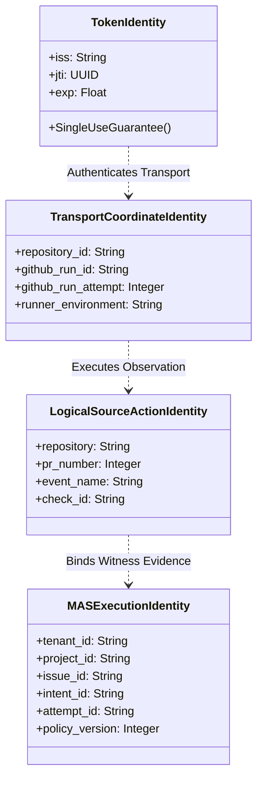
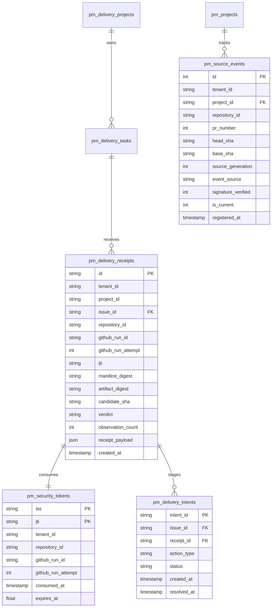
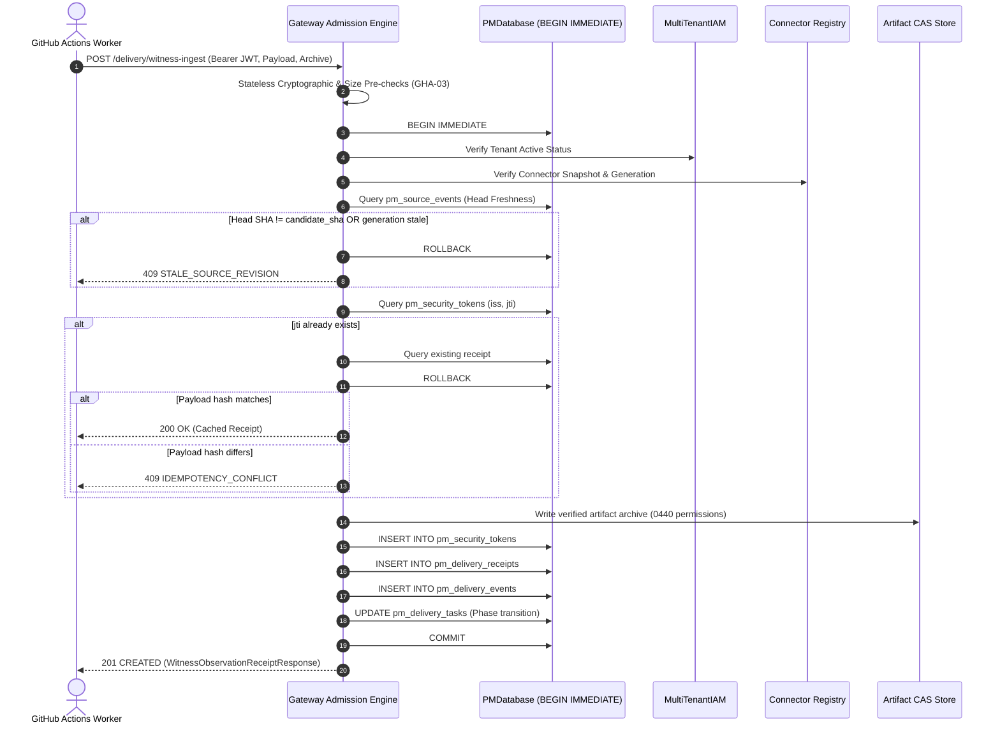
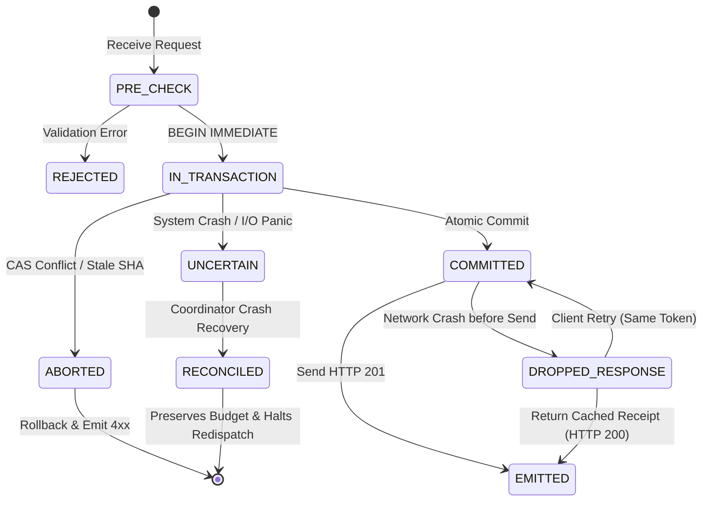

# GHA-04: Durable Ingestion, Replay Protection & Source-Event Synchronization
## Architectural Design Specification & Verification Plan

- **Author / Implementation Owner:** Antigravity Development Team
- **Reviewer / Acceptance Owner:** Codex
- **Date:** 14 October 2026
- **Status:** **PROPOSED DESIGN CHECKPOINT** (Submitted for Codex Independent Architectural Review)
- **Base Baseline:** Commit `82407210f97eb41500f2a4d671d71d38175b685e` (GHA-03 Approved in `3ca8fc4d`, Recorded in `GHA_03_ACCEPTANCE_RECORD.md`)
- **Scope:** Durable witness observation ingestion, cryptographic replay prevention, authoritative PR head freshness tracking, atomic CAS admission protocol, crash recovery, and side-effect intent ledger.
- **Explicit Gating Notice:** This document is an architectural specification only. No implementation code, database migrations, or live workflow activations are performed prior to mutual design approval.

---

## 1. Architectural Foundations & Identity Model

### 1.1. Decoupled Identity Hierarchy
GHA-03 proved that decoupling transport authentication from internal coordinator state is necessary to maintain a secure witness boundary. GHA-04 extends this by formalizing four strictly separated identity layers:



1. **Token Identity (`iss`, `jti`):**
   - Ephemeral OIDC assertion identity issued by GitHub Actions.
   - Constrained to single-use consumption within its expiration lifetime (`exp`).
   - Prevents transport-level replay of exact intercepted requests.
2. **Transport Coordinate Identity (`repository_id`, `github_run_id`, `github_run_attempt`):**
   - The concrete execution instance of a workflow job in GitHub's infrastructure.
   - Run attempts represent distinct executions of the same workflow job.
3. **Logical Source-Action Identity (`repository`, `pr_number`, `check_id`):**
   - The semantic verification task being performed (e.g. running unit tests or linter against a PR).
   - Multiple attempts or retries observe the *same* logical action.
4. **MAS Execution Identity (`tenant_id`, `project_id`, `issue_id`, `intent_id`, `policy_version`):**
   - The server-authoritative delivery state in `PMDatabase`.
   - Bound to an approved delivery agreement and token budget.

> [!IMPORTANT]
> **Why Token Replay Does Not Equal "Executes Once Remotely":**
> Enforcing uniqueness on `(iss, jti)` merely prevents an attacker from replaying the *identical OIDC assertion token*. It does **not** guarantee that a remote CI action runs once, because GitHub Actions workflows can be retried (yielding a fresh token for a new run attempt) or run concurrently. Therefore, GHA-04 distinguishes token replay (reject with `TOKEN_ALREADY_CONSUMED`) from rerun attempts (evaluate as new observations of the logical action).

### 1.2. Canonical Semantic Payload Digest & Immutable Artifact Storage
- **Manifest Semantic Canonicalization:**
  Manifest admission requires deterministic hashing that is immune to whitespace, formatting, or dictionary key ordering differences. The `manifest_digest` is computed as:
  $$\text{manifest\_digest} = \text{SHA-256}(\text{JSON}_{\text{canonical}}(\text{manifest}))$$
  where $\text{JSON}_{\text{canonical}}$ sorts keys recursively, removes extraneous whitespace, and uses UTF-8 encoding.
- **Immutable Artifact Content-Addressable Storage (CAS):**
  Artifact archives are validated against GHA-02 zip security constraints (no symlinks, no path traversal, $\le 12$ MiB decompressed) and stored content-addressably:
  $$\text{artifact\_digest} = \text{SHA-256}(\text{archive\_bytes})$$
  Staged artifact files are written to `/workspace/artifacts/cas/{tenant_id}/{project_id}/{artifact_digest}.zip` with read-only permissions (`0440`). Once written, an artifact record is strictly immutable.

### 1.3. Core System Invariants (INV-01 through INV-10)

- **INV-01 (Single Token Consumption):** Each GitHub OIDC `(iss, jti)` can be consumed at most once across the entire MAS platform. Concurrent attempts to consume the same `(iss, jti)` serialize on the database transaction; exactly one caller commits.
- **INV-02 (Atomic Admission Boundary):** Token consumption, durable receipt persistence, source-event binding, and delivery task side-effect intent commit together in a single atomic SQLite transaction (`BEGIN IMMEDIATE`). A successful receipt is NEVER returned unless the transaction commits.
- **INV-03 (Server-Authoritative Source Freshness):** PR number, head commit SHA, base commit SHA, and branch state are resolved from server-authoritative tracking (`pm_source_events`), NEVER trusted from client-provided manifest fields or request headers.
- **INV-04 (Fresh Authorization Recheck):** Active tenant status in `MultiTenantIAM` and active connector configuration in `ConnectorPolicySnapshot` are re-queried inside the transactional lock immediately prior to commit.
- **INV-05 (Witness Observations Are Untrusted):** Ingested witness records cannot alter delivery state to `ACCEPTED` or forge human critic verdicts. Observations advance tasks to `IN_REVIEW` or `READINESS_RETURNED` only.
- **INV-06 (No Replay Across Generations):** When a project source advances its monotonically increasing `source_generation` (e.g. a new commit is pushed to the PR), observations for prior generations or mismatched `head_sha` are refused with `STALE_SOURCE_REVISION`.
- **INV-07 (Scoped Idempotency Keys):** Idempotency keys are composite `(tenant_id, scope, idempotency_key)` with `scope = 'delivery:witness_ingest'`. Submitting an existing idempotency key with a conflicting payload hash returns `409 IDEMPOTENCY_CONFLICT`.
- **INV-08 (Zero Budget / Execution Release on UNCERTAIN):** A server crash or transient database error during admission transitions the intent to `UNCERTAIN`; token budgets are never refunded and worker reservations are never released prematurely.
- **INV-09 (Quota and Storage Boundaries):** Artifact storage enforces per-project byte quotas and retention periods. Expired receipts are archived without mutating append-only event ledgers.
- **INV-10 (Audit Immutability):** All receipt records, token consumptions, and state transitions are appended to tables protected by SQLite `BEFORE UPDATE` and `BEFORE DELETE` abort triggers.

---

## 2. Proposed Additive Schema (Migration `2026101401`)

The proposed schema is strictly additive, preserving all existing tables (`pm_delivery_projects`, `pm_delivery_tasks`, `pm_delivery_submissions`, `pm_delivery_events`, `pm_delivery_findings`).



### 2.1. Table Specifications (DDL Proposal)

```sql
-- Migration 2026101401: GHA-04 Durable Ingestion and Receipts Ledger

-- 1. Replay Protection: Single-use GitHub Actions OIDC Token Ledger
CREATE TABLE IF NOT EXISTS pm_security_tokens (
    iss TEXT NOT NULL,
    jti TEXT NOT NULL,
    tenant_id TEXT NOT NULL,
    repository_id TEXT NOT NULL,
    github_run_id TEXT NOT NULL,
    github_run_attempt INTEGER NOT NULL CHECK(github_run_attempt > 0),
    consumed_at TIMESTAMP NOT NULL DEFAULT CURRENT_TIMESTAMP,
    expires_at REAL NOT NULL,
    PRIMARY KEY (iss, jti)
);
CREATE INDEX IF NOT EXISTS idx_security_tokens_expiry ON pm_security_tokens(expires_at);
CREATE INDEX IF NOT EXISTS idx_security_tokens_coords ON pm_security_tokens(repository_id, github_run_id, github_run_attempt);

-- 2. Durable Ingestion Receipts Store
CREATE TABLE IF NOT EXISTS pm_delivery_receipts (
    id TEXT PRIMARY KEY,
    tenant_id TEXT NOT NULL,
    project_id TEXT NOT NULL REFERENCES pm_delivery_projects(project_id),
    issue_id TEXT NOT NULL REFERENCES pm_delivery_tasks(issue_id),
    repository_id TEXT NOT NULL,
    github_run_id TEXT NOT NULL,
    github_run_attempt INTEGER NOT NULL CHECK(github_run_attempt > 0),
    jti TEXT NOT NULL,
    manifest_digest TEXT NOT NULL,
    artifact_digest TEXT,
    candidate_sha TEXT NOT NULL,
    verdict TEXT NOT NULL CHECK(verdict IN ('PASSED', 'FAILED', 'ERROR')),
    observation_count INTEGER NOT NULL CHECK(observation_count >= 0),
    receipt_payload JSON NOT NULL,
    created_at TIMESTAMP NOT NULL DEFAULT CURRENT_TIMESTAMP,
    CONSTRAINT uq_receipt_run_attempt UNIQUE (tenant_id, repository_id, github_run_id, github_run_attempt)
);
CREATE INDEX IF NOT EXISTS idx_delivery_receipts_issue ON pm_delivery_receipts(issue_id);
CREATE INDEX IF NOT EXISTS idx_delivery_receipts_manifest ON pm_delivery_receipts(manifest_digest);

-- 3. Authoritative Source Events Ledger (PR Head Freshness Tracking)
CREATE TABLE IF NOT EXISTS pm_source_events (
    id INTEGER PRIMARY KEY AUTOINCREMENT,
    tenant_id TEXT NOT NULL,
    project_id TEXT NOT NULL REFERENCES pm_projects(id),
    repository_id TEXT NOT NULL,
    pr_number INTEGER NOT NULL CHECK(pr_number > 0),
    head_sha TEXT NOT NULL CHECK(length(head_sha) = 40),
    base_sha TEXT NOT NULL CHECK(length(base_sha) = 40),
    source_generation INTEGER NOT NULL CHECK(source_generation > 0),
    event_source TEXT NOT NULL CHECK(event_source IN ('WEBHOOK', 'API_SYNC', 'ADMIN')),
    signature_verified INTEGER NOT NULL CHECK(signature_verified IN (0, 1)),
    is_current INTEGER NOT NULL CHECK(is_current IN (0, 1)) DEFAULT 1,
    registered_at TIMESTAMP NOT NULL DEFAULT CURRENT_TIMESTAMP,
    CONSTRAINT uq_source_event_generation UNIQUE (tenant_id, project_id, pr_number, source_generation)
);
CREATE INDEX IF NOT EXISTS idx_source_events_current ON pm_source_events(tenant_id, project_id, pr_number, is_current);

-- 4. Side-Effect Intent Journal (Two-Phase Crash Recovery)
CREATE TABLE IF NOT EXISTS pm_delivery_intents (
    intent_id TEXT PRIMARY KEY,
    issue_id TEXT NOT NULL REFERENCES pm_delivery_tasks(issue_id),
    receipt_id TEXT NOT NULL REFERENCES pm_delivery_receipts(id),
    action_type TEXT NOT NULL CHECK(action_type IN ('ADMIT_OBSERVATION', 'RETURN_READINESS')),
    status TEXT NOT NULL CHECK(status IN ('PENDING', 'COMMITTED', 'ROLLED_BACK', 'UNCERTAIN')),
    created_at TIMESTAMP NOT NULL DEFAULT CURRENT_TIMESTAMP,
    resolved_at TIMESTAMP
);
CREATE INDEX IF NOT EXISTS idx_delivery_intents_status ON pm_delivery_intents(status);

-- 5. Immutability Triggers
CREATE TRIGGER IF NOT EXISTS trg_delivery_receipts_no_update
BEFORE UPDATE ON pm_delivery_receipts
BEGIN
    SELECT RAISE(ABORT, 'ReceiptTamperViolation: Delivery receipts are immutable and cannot be updated.');
END;

CREATE TRIGGER IF NOT EXISTS trg_delivery_receipts_no_delete
BEFORE DELETE ON pm_delivery_receipts
BEGIN
    SELECT RAISE(ABORT, 'ReceiptTamperViolation: Delivery receipts are immutable and cannot be deleted.');
END;
```

### 2.2. Migration & Backfill Behavior
- **Zero-Downtime Atomic Application:** Applied via `migrate_coordinator_schema()` within a `BEGIN IMMEDIATE` block.
- **Checksum Invariance:** Migration checksum is calculated from static migration DDL and verified in `pm_schema_migrations`.
- **Existing Data Compatibility:** No alterations to existing rows in `pm_delivery_tasks` or `pm_delivery_submissions`. Unenrolled legacy tasks remain completely untouched.

---

## 3. Atomic Admission Protocol & CAS Boundaries



### 3.1. Detailed Admission Steps

1. **Phase 1: Stateless Invariant Validation (GHA-03 Engine):**
   - Verify JWT cryptographic signature via RS256 and GitHub JWKS.
   - Enforce temporal claims (`exp > now`, `now - iat <= 900s`).
   - Validate request envelope size ($\le 18$ MiB), manifest JSON ($\le 1$ MiB), and base64 archive ($\le 16$ MiB).
   - Compute `manifest_digest` and decode zip archive.
2. **Phase 2: Atomic CAS Transaction Acquisition:**
   - Execute `BEGIN IMMEDIATE` on `PMDatabase` to serialize concurrent admissions.
3. **Phase 3: Server-Authoritative Freshness & Authority Verification:**
   - Call `iam.get_tenant(snapshot.tenant_id)`; abort if not `ACTIVE` (`TENANT_REVOKED`).
   - Re-check connector generation and canonical digest; abort if changed (`CONNECTOR_AUTHORITY_CHANGED`).
   - Query `pm_source_events` for `(tenant_id, project_id, pr_number)` where `is_current = 1`:
     - If `manifest.candidate_sha != pm_source_events.head_sha`, abort with `409 STALE_SOURCE_REVISION`.
     - If `manifest.base_sha != pm_source_events.base_sha`, abort with `409 STALE_SOURCE_REVISION`.
4. **Phase 4: Token Consumption & Idempotency Resolution:**
   - Query `pm_security_tokens` for `(iss, jti)`:
     - If record exists: compare stored `github_run_id`, `github_run_attempt`, and receipt hash. If identical, roll back and return cached receipt (HTTP 200). If conflicting, roll back and return `409 IDEMPOTENCY_CONFLICT`.
   - Query `pm_delivery_receipts` for `(tenant_id, repository_id, github_run_id, github_run_attempt)`:
     - If run attempt already committed under a different token, roll back and return `409 RUN_ATTEMPT_ALREADY_COMMITTED`.
5. **Phase 5: Immutable Commit & Phase Transition:**
   - Store archive bytes to Content-Addressable Storage (CAS).
   - Insert row into `pm_security_tokens`.
   - Insert row into `pm_delivery_receipts`.
   - Record immutable event in `pm_delivery_events`.
   - Execute delivery state transition:
     - If all observations `PASSED` $\rightarrow$ set `pm_delivery_tasks.phase = 'IN_REVIEW'`.
     - If any observation `FAILED` $\rightarrow$ set `pm_delivery_tasks.phase = 'READINESS_RETURNED'`.
   - Execute `COMMIT`.
6. **Phase 6: Response Emission:**
   - Return HTTP 201 with immutable receipt payload containing `receipt_id`, `manifest_digest`, and `created_at`.

---

## 4. Authenticated Source Registration & Freshness Tracking

### 4.1. Server-Authoritative PR Head Tracking
To prevent workers from validating stale PR commits or cherry-picked SHAs, branch heads are tracked authoritatively in `pm_source_events`.

- **Webhook Ingestion:**
  - GitHub `pull_request` (`opened`, `synchronize`) webhooks are received by a dedicated webhook intake handler.
  - Webhooks are cryptographically authenticated using HMAC-SHA256 signatures (`X-Hub-Signature-256`) against a secret stored in secure storage.
  - On `synchronize` (new commit pushed):
    1. Query latest `source_generation` for `(tenant_id, project_id, pr_number)`.
    2. Set `is_current = 0` on previous records.
    3. Insert new row with `source_generation = previous_generation + 1`, `head_sha = after_sha`, and `is_current = 1`.
- **Out-of-Order Webhook Protection:**
  - If a webhook delivery arrives with commit ancestry older than the currently recorded `head_sha` (determined via git commit ancestry graph or monotonic event delivery counter), the webhook is logged as out-of-order and rejected without downgrading `source_generation`.
- **Recheck at Delivery Acceptance:**
  - Before a delivery reviewer or verifier issues a final acceptance verdict (`pm_critic_verdicts`), the coordinator re-queries `pm_source_events`. If the PR head has changed since the witness observations were ingested, acceptance is blocked with `PR_HEAD_ADVANCED_DURING_REVIEW`.

---

## 5. Crash, Restart, & UNCERTAIN Recovery Protocol



### 5.1. Response Loss & Client Retry Handling
- **Scenario:** The database transaction commits successfully, but the network connection drops or the process crashes before the HTTP response reaches the client.
- **Client Action:** The client retries the request using the *same* JWT token.
- **Gateway Handling:**
  1. The gateway begins transaction and checks `pm_security_tokens` for `(iss, jti)`.
  2. The record exists and links to `pm_delivery_receipts`.
  3. The gateway verifies `manifest_digest` matches the previous commit.
  4. The gateway rolls back the empty transaction and returns **HTTP 200 OK** with the existing `receipt_id` and cached receipt payload.
  5. Zero duplicate rows are written, and task phase is unaffected.

### 5.2. UNCERTAIN State Handling
- If a server crashes while writing external artifact blobs or prior to SQLite atomic commit:
  - SQLite automatic WAL recovery rolls back uncommitted rows on restart.
  - The delivery task remains in its previous phase (`DISPATCHED` or `AWAITING_SUBMISSION`).
  - Worker reservations and token budgets remain locked; no funds are refunded and no tasks are duplicated.

---

## 6. Shared Failure & Concurrency Matrix

The following table specifies exact behavior across all 14 required failure and edge scenarios:

| Scenario # | Scenario Description | Trigger Condition | System Behavior & Invariant | Expected HTTP / Outcome |
|---|---|---|---|---|
| **SC-01** | **Concurrent Same-Token Requests** | Two threads submit identical `(iss, jti)` simultaneously. | Requests serialize on `BEGIN IMMEDIATE`. Thread 1 inserts and commits. Thread 2 finds token in `pm_security_tokens` and returns committed receipt. | Thread 1: `201 CREATED`<br>Thread 2: `200 OK` (Cached) |
| **SC-02** | **Fresh-Token Same-Action Retry** | Worker reruns test and gets fresh JWT token for same run attempt. | Query `pm_delivery_receipts` finds `(repository_id, github_run_id, github_run_attempt)` already committed under another token. | `409 RUN_ATTEMPT_ALREADY_COMMITTED` |
| **SC-03** | **Identical vs Conflicting Payloads** | Client submits same token but alters manifest contents. | Payload digest differs from stored receipt for that `jti`. Violates INV-07. | `409 IDEMPOTENCY_CONFLICT` |
| **SC-04** | **Separate Rerun Attempts** | User triggers GitHub "Re-run failed jobs", incrementing attempt number. | New attempt has different `github_run_attempt`. Validated as a fresh observation attempt; previous attempt preserved. | `201 CREATED` (New Receipt ID) |
| **SC-05** | **Restart After Commit** | Server process restarts immediately after SQLite transaction commits. | Token and receipt safely persisted in SQLite WAL. On restart, database opens cleanly; subsequent client retry returns cached receipt. | `200 OK` (Cached Receipt) |
| **SC-06** | **Dropped Response** | Network times out between gateway response and client socket. | Client retries with same token. Gateway retrieves committed receipt from DB. | `200 OK` (Cached Receipt) |
| **SC-07** | **Stale / Out-of-Order Head Update** | Webhook arrives for commit $N-1$ after commit $N$ was recorded. | Webhook handler checks commit ancestry / delivery timestamp; detects older generation; rejects update. | Webhook: `409 STALE_SOURCE_REVISION` |
| **SC-08** | **Head Changing During Admission** | PR head advances while gateway validation is executing pre-checks. | Admission checks `pm_source_events` under `BEGIN IMMEDIATE` lock. Candidate SHA does not match current head SHA. Aborts. | `409 STALE_SOURCE_REVISION` |
| **SC-09** | **Tenant / Connector Revocation Race** | Tenant suspended or connector revoked while gateway parses archive. | `iam.get_tenant()` and connector lookup re-checked inside atomic transaction lock. Revocation detected before commit. | `403 TENANT_REVOKED` or `403 CONNECTOR_REVOKED` |
| **SC-10** | **Missing / Expired Artifacts** | Manifest references non-inline artifact evidence but archive missing. | Enforced by GHA-02/GHA-03 artifact validation rules before transaction acquisition. | `400 ARTIFACTS_REQUIRED` |
| **SC-11** | **Storage Failure (Disk Full / I/O Panic)** | Disk full while writing CAS archive or SQLite disk I/O error. | Transaction rolls back automatically. Zero database rows committed. Intent marked `UNCERTAIN`. | `500 INTERNAL_ERROR` |
| **SC-12** | **Schema Migration & Reopen** | System upgrades schema to version 2026101401 and reopens database. | Ledger checked; migration runs atomically under lock; PRAGMA integrity check runs. Zero legacy rows corrupted. | Migration: `200 OK` |
| **SC-13** | **Cross-Tenant / Cross-Run Reference** | Client attempts to link observation to an issue belonging to another tenant. | Tenant ID from connector snapshot checked against `pm_delivery_tasks.tenant_id`. Coordinate mismatch detected. | `400 COORDINATE_MISMATCH` |
| **SC-14** | **UNCERTAIN Recovery Without Duplicate Work** | Coordinator restarts with pending intents in `pm_delivery_intents`. | Recovery scanner inspects `status = 'UNCERTAIN'`. Verifies WAL state; does not release token budget or trigger duplicate dispatch. | Recovery Audit: `RECONCILED` |

---

## 7. Component Ownership & Proposed Interface Contracts

### 7.1. Component Responsibility Matrix
- **Antigravity Development Team (Backend / Engine Ownership):**
  - Schema migration authoring and database integrity tests (`migrate_coordinator_schema`).
  - Durable admission engine (`DurableWitnessAdmissionEngine`).
  - Idempotency and token replay enforcement (`SecurityTokenStore`).
  - Source-event synchronization and freshness provider (`SourceEventSynchronizer`).
  - CAS artifact persistence and quota manager (`ArtifactCASStore`).
- **Codex (Architecture Review & Frontend / UX Ownership):**
  - Independent architectural review of this specification.
  - UI / CLI receipt inspection commands (`mas delivery receipts inspect <id>`).
  - PR status display in scrum automation board.

### 7.2. Proposed Interface Contracts (APIs Marked Proposed)

#### 7.2.1. Ingestion Request & Receipt Models
```python
# Proposed: mas/pm/gateway/durable_models.py

from datetime import datetime
from typing import Any, Literal
from pydantic import Field
from mas.pm.delivery_validator import StrictModel, SHA

class WitnessObservationReceipt(StrictModel):
    """Proposed immutable delivery receipt returned upon durable commit."""
    receipt_id: str = Field(min_length=1, max_length=64)
    tenant_id: str = Field(min_length=1, max_length=128)
    project_id: str = Field(min_length=1, max_length=128)
    issue_id: str = Field(min_length=1, max_length=128)
    repository_id: str = Field(pattern=r"^\d+$")
    github_run_id: str = Field(pattern=r"^\d+$")
    github_run_attempt: int = Field(ge=1, le=100)
    manifest_digest: str = Field(pattern=r"^[0-9a-f]{64}$")
    artifact_digest: str | None = Field(default=None, pattern=r"^[0-9a-f]{64}$")
    candidate_sha: str = Field(pattern=SHA)
    verdict: Literal["PASSED", "FAILED", "ERROR"]
    observation_count: int = Field(ge=0)
    created_at: str

class WitnessIngestionResult(StrictModel):
    """Proposed API response envelope."""
    status: Literal["COMMITTED", "CACHED_RECEIPT"]
    receipt: WitnessObservationReceipt
```

#### 7.2.2. Proposed Read-Only Receipt Query Contract
```python
# Proposed: mas/pm/gateway/receipt_service.py

class DeliveryReceiptQueryService:
    """Proposed read-only query service for receipts and verification provenance."""

    def get_receipt(self, receipt_id: str, tenant_id: str) -> WitnessObservationReceipt | None:
        """Fetch receipt by ID strictly scoped to authenticated tenant."""
        ...

    def list_receipts_for_issue(
        self, issue_id: str, tenant_id: str, limit: int = 50
    ) -> list[WitnessObservationReceipt]:
        """List historical observation receipts for an issue in reverse chronological order."""
        ...
```

---

## 8. Executable Acceptance Test Specification Plan

The following 20 test specifications represent the mandatory verification suite for GHA-04 implementation:

- **TC-01 (Durable Commit):** Valid submission commits row to `pm_delivery_receipts` and `pm_security_tokens` with matching digests; returns `201 CREATED`.
- **TC-02 (Token Replay Refusal):** Resubmitting exact same JWT token with conflicting payload returns `409 IDEMPOTENCY_CONFLICT`.
- **TC-03 (Token Replay Idempotency):** Resubmitting exact same JWT token with identical payload returns `200 OK` with cached receipt.
- **TC-04 (Run Attempt Deduplication):** Fresh token for already-committed `(github_run_id, github_run_attempt)` returns `409 RUN_ATTEMPT_ALREADY_COMMITTED`.
- **TC-05 (Rerun Attempt Acceptance):** Submitting attempt 2 with fresh token commits distinct receipt row with `github_run_attempt = 2`.
- **TC-06 (PR Head Freshness Match):** Submission where `manifest.candidate_sha == pm_source_events.head_sha` succeeds.
- **TC-07 (Stale PR Head Rejection):** Submission where `manifest.candidate_sha != pm_source_events.head_sha` rejected with `409 STALE_SOURCE_REVISION`.
- **TC-08 (Out-of-Order Webhook Rejection):** Webhook providing older commit than current `source_generation` rejected without updating current head.
- **TC-09 (Mid-Transaction Revocation Refusal):** Tenant suspended during admission lock causes immediate rollback and `403 TENANT_REVOKED`.
- **TC-10 (Atomic Rollback on Error):** Simulated disk full during archive CAS write causes 100% rollback; zero rows in receipts or tokens.
- **TC-11 (Phase Transition on Pass):** Ingestion of passed observations advances delivery task from `AWAITING_SUBMISSION` to `IN_REVIEW`.
- **TC-12 (Phase Transition on Failure):** Ingestion of failed observations advances delivery task to `READINESS_RETURNED`.
- **TC-13 (Immutability Trigger on Update):** Direct SQL `UPDATE` on `pm_delivery_receipts` raises SQLite `ABORT` via trigger.
- **TC-14 (Immutability Trigger on Delete):** Direct SQL `DELETE` on `pm_delivery_receipts` raises SQLite `ABORT` via trigger.
- **TC-15 (Receipt Query Tenant Boundary):** Requesting receipt with mismatching `tenant_id` returns `None` / 404 (zero cross-tenant bleed).
- **TC-16 (Side-Effect Intent Crash Recovery):** Restarting coordinator with `UNCERTAIN` intent verifies WAL state and marks resolved without redispatching.
- **TC-17 (Monotonic Generation Advancement):** Webhook advancing commit SHA monotonically increments `source_generation` by 1.
- **TC-18 (CAS Archive Deduplication):** Two identical archives from different runs reference same `artifact_digest` without duplicating disk storage.
- **TC-19 (Delivery Event Log Integrity):** Each admitted receipt appends corresponding event in `pm_delivery_events`.
- **TC-20 (No Direct Delivery Acceptance):** Verifying that admitted receipt does not mark delivery task `ACCEPTED` or write `pm_critic_verdicts`.

---

## 9. Review Reconciliation & Hand-off Request

Antigravity submits this specification for Codex's independent review in accordance with the Scrum Board Automation delivery process gates.

**Checklist for Review Hand-off:**
1. [x] Architectural separation of all four identity layers established (§ 1.1).
2. [x] Additive schema defined with zero impact on existing tables (§ 2.1).
3. [x] Atomic admission protocol specified under `BEGIN IMMEDIATE` (§ 3.1).
4. [x] Server-authoritative PR freshness synchronization specified (§ 4.1).
5. [x] Crash recovery and response loss state transitions mapped (§ 5.1, § 5.2).
6. [x] 14 shared failure scenarios specified with expected outcomes (§ 6).
7. [x] Component ownership, proposed APIs, and 20 acceptance tests detailed (§ 7, § 8).
8. [x] Implementation code and migrations strictly withheld pending review (§ 1).
