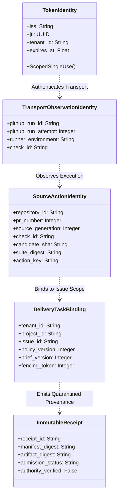
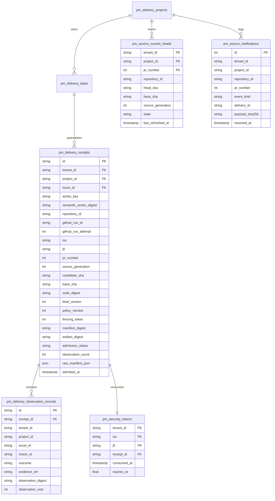
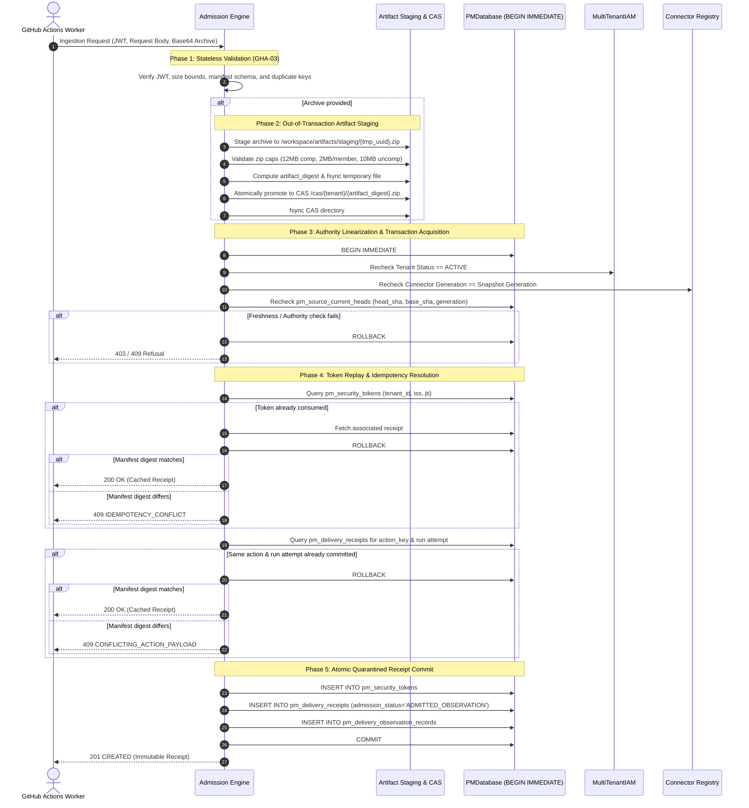

# GHA-04: Durable Ingestion, Replay Protection & Source-Event Synchronization
## Architectural Design Specification & Verification Plan (Revised)

- **Author / Implementation Owner:** Antigravity Development Team
- **Reviewer / Acceptance Owner:** Codex
- **Date:** 14 October 2026
- **Status:** **REVISED PROPOSED DESIGN CHECKPOINT** (Submitted for Codex Independent Architectural Review)
- **Base Baseline:** Commit `82407210f97eb41500f2a4d671d71d38175b685e` (GHA-03 Approved in `3ca8fc4d`, Recorded in `GHA_03_ACCEPTANCE_RECORD.md`)
- **Review Predecessors:** `GHA_04_DESIGN_REVIEW.md`, `ANTIGRAVITY_GHA_04_DESIGN_REWORK_BRIEF.md`
- **Scope:** Quarantined witness observation ingestion, durable token replay prevention, server-authoritative PR head tracking, composite ownership enforcement, two-phase artifact staging, and authority linearization.
- **Explicit Gating Notice:** This document is an architectural specification only. No implementation code, database migrations, or live workflow activations are performed prior to mutual design approval.

---

## 1. Executive Summary & Review Rework Alignment

In response to Codex's design review (`GHA_04_DESIGN_REVIEW.md`) and explicit rework instructions (`ANTIGRAVITY_GHA_04_DESIGN_REWORK_BRIEF.md`), Antigravity has revised the GHA-04 design specification to establish a bounded, concrete architecture for durable witness observation ingestion:

1. **Strict Preservation of Witness-Only Boundary (Addressing B1):**
   - Witness ingestion is strictly quarantined. Ingestion stores untrusted observations and emits immutable receipts (`pm_delivery_receipts`, `pm_delivery_observation_records`).
   - Witness ingestion **never** mutates delivery task phases (`DRAFT`, `READY`, `AWAITING_SUBMISSION`, `IN_REVIEW`, etc.), never calls `DeliveryService.submit`, never acts as a builder, never approves delivery, and never releases token budgets.
   - All delivery state transitions remain the exclusive responsibility of separately authenticated builder, coordinator, and reviewer services.
2. **Comprehensive Composite Identity & Idempotency Schema (Addressing B2):**
   - Separates Token Identity `(iss, jti)`, Generation-Specific Logical Action Identity `action_key`, Attempt Observation Identity `(run_id, attempt, check_id)`, and Historical Receipt Identity.
   - Allows multiple checks and MAS tasks per GitHub Actions workflow run by scoping observations to `(tenant_id, project_id, issue_id, action_key, github_run_id, github_run_attempt, check_id)`.
   - Binds source generation, PR number, candidate SHA, base SHA, suite digest, brief version, policy version, and fencing token into the canonical semantic digest.
   - Enforces composite foreign keys `(tenant_id, project_id, issue_id)` against `pm_delivery_tasks` to prevent cross-tenant/cross-project ownership bleed.
   - Token replay protection is explicitly scoped to `(tenant_id, iss, jti)`.
3. **Deterministic Retry & Response-Loss Resolution (Addressing B3):**
   - At-most-once state mutation per token.
   - Authenticated replays with the same token return the existing immutable receipt (`200 OK`, `status="CACHED_RECEIPT"`).
   - Fresh-token retries matching an already committed generation-specific logical action return the existing receipt without duplicate work. Conflicting payloads return `409 CONFLICTING_ACTION_PAYLOAD`.
   - Read-only historical receipt queries derive tenant identity strictly from authenticated caller context, allow inspecting historical records even after PR head advancement, and explicitly distinguish historical records from current head status.
4. **Server-Authoritative Source Freshness & Projection CAS (Addressing B4):**
   - Replaces fragile ancestry/timestamp ordering with an **Append-Only Notification Ledger** (`pm_source_notifications`) and a **Single-Row Current Projection** (`pm_source_current_heads`).
   - Webhooks are treated as unprivileged event notifications; branch heads are updated via a serialized refresh protocol that monotonically increments `source_generation` on accepted transitions.
   - Explicitly specifies behavior for force-pushes, base updates, PR closures, PR reopens, and fails closed (`503 SOURCE_FRESHNESS_UNKNOWN`) if freshness is uninitialized or unavailable.
5. **Decoupled Durability & Authority Linearization Protocol (Addressing B5):**
   - Recognizes that a SQLite lock does not serialize independent IAM or connector stores.
   - Establishes a concrete authority linearization protocol: pre-flight check, out-of-transaction filesystem artifact staging (hash, fsync, atomic promote), followed by an atomic SQLite transaction lock (`BEGIN IMMEDIATE`) that re-verifies IAM tenant active status, connector generation, and PR head generation before committing.
   - Artifacts enforce GHA-02 boundaries (max 12 MiB compressed, max 2 MiB per member, max 10 MiB uncompressed) and quota reservations. Crashed staging leaves unreferenced blobs, never dangling database references.
6. **Elimination of Redundant External-Effect Journal (Addressing B6):**
   - Removed the generic `pm_delivery_intents` journal from this local ingestion slice.
   - Pure local ingestion rollback leaves zero database rows; response loss is fully resolved by persisted action/receipt records.
   - Clarified retention: token records purged only after token expiration (`exp + clock_skew`); receipts and audit events remain strictly immutable and protected by abort triggers.

---

## 2. Architectural Boundaries & Identity Model

### 2.1. Bounded Identity Layers



1. **Token Identity `(tenant_id, iss, jti)`:**
   - Ephemeral OIDC assertion identity issued by GitHub Actions.
   - Scoped to authenticated tenant in the project store; single-use consumption within its expiration window (`exp`).
2. **Generation-Specific Logical Action Identity `action_key`:**
   - The concrete verification unit defined as:
     $$\text{action\_key} = \text{SHA-256}(\text{repo\_id} \parallel \text{pr\_num} \parallel \text{generation} \parallel \text{candidate\_sha} \parallel \text{suite\_digest} \parallel \text{check\_id})$$
   - Anchored to a specific source generation and candidate SHA.
3. **Transport Observation Identity `(repository_id, github_run_id, github_run_attempt, check_id)`:**
   - The execution instance of a specific check within a GitHub workflow job run attempt.
   - Supports multiple checks per workflow run without key collision.
4. **Delivery Task Binding `(tenant_id, project_id, issue_id, policy_version, brief_version, fencing_token)`:**
   - Authoritative task scope. Composite foreign key binds to `pm_delivery_tasks(tenant_id, project_id, issue_id)`.
5. **Immutable Receipt `receipt_id`:**
   - Digest-addressed provenance record:
     $$\text{receipt\_id} = \text{rcpt\_} \parallel \text{SHA-256}(\text{manifest\_digest} \parallel \text{artifact\_digest} \parallel \text{action\_key})[:16]$$
   - Explicitly records `authority_verified = False` and `admission_status = 'ADMITTED_OBSERVATION'`.

### 2.2. Numbered Invariants (INV-01 through INV-10)

- **INV-01 (Quarantined Witness Storage):** Ingested observations are stored in quarantined receipt ledgers. Ingestion NEVER mutates `pm_delivery_tasks.phase`, NEVER calls `DeliveryService.submit`, NEVER marks work `ACCEPTED`, and NEVER releases token budgets.
- **INV-02 (Single-Use Token Mutation):** A given `(tenant_id, iss, jti)` can be consumed for state mutation at most once. Replays with the same token return the existing receipt without re-admission.
- **INV-03 (Action Idempotency):** Submitting a fresh valid token for an already admitted logical action `(action_key)` with an identical semantic payload returns the existing receipt (`200 OK`). Conflicting payloads for the same action return `409 CONFLICTING_ACTION_PAYLOAD`.
- **INV-04 (Multi-Check Run Permissibility):** Multiple observations or checks originating from the same `(github_run_id, github_run_attempt)` are permitted, provided each check observes a distinct `check_id` or logical action.
- **INV-05 (Server-Authoritative Source Freshness):** PR head commit SHA, base commit SHA, and current state are determined exclusively by `pm_source_current_heads`, never trusted from client manifests.
- **INV-06 (Monotonic Source Generations):** Every accepted source change (new commit, force push, rebase) advances `source_generation` monotonically. Observations matching older generations are refused as `409 STALE_SOURCE_REVISION`.
- **INV-07 (Composite Ownership Enforcement):** All receipt and observation tables enforce composite foreign keys `(tenant_id, project_id, issue_id)` referencing `pm_delivery_tasks`, preventing cross-tenant or cross-project data injection.
- **INV-08 (Out-of-Transaction Artifact Staging):** Artifact files are verified, hashed, fsynced, and atomically promoted to CAS storage *before* acquiring the database commit lock. Database commit failures leave unreferenced staging blobs, never receipts pointing to missing files.
- **INV-09 (Linearized Authority Recheck):** Active tenant status (`MultiTenantIAM`), connector generation (`ConnectorPolicySnapshot`), and current source generation (`pm_source_current_heads`) are re-verified inside the `BEGIN IMMEDIATE` lock immediately prior to commit.
- **INV-10 (Strict Append-Only Immutability):** All receipts, observation records, and source notifications are immutable and protected by database triggers aborting `UPDATE` and `DELETE` operations.

---

## 3. Proposed Additive Schema (Migration `2026101401`)



### 3.1. DDL Specification

```sql
-- Migration 2026101401: GHA-04 Quarantined Witness Receipts & Authoritative Source Tracking

-- 1. Scoped Single-Use OIDC Token Ledger
CREATE TABLE IF NOT EXISTS pm_security_tokens (
    tenant_id TEXT NOT NULL,
    iss TEXT NOT NULL,
    jti TEXT NOT NULL,
    receipt_id TEXT NOT NULL,
    consumed_at TIMESTAMP NOT NULL DEFAULT CURRENT_TIMESTAMP,
    expires_at REAL NOT NULL,
    PRIMARY KEY (tenant_id, iss, jti)
);
CREATE INDEX IF NOT EXISTS idx_security_tokens_expiry ON pm_security_tokens(expires_at);

-- 2. Quarantined Witness Ingestion Receipts
CREATE TABLE IF NOT EXISTS pm_delivery_receipts (
    id TEXT PRIMARY KEY,
    tenant_id TEXT NOT NULL,
    project_id TEXT NOT NULL,
    issue_id TEXT NOT NULL,
    action_key TEXT NOT NULL,
    semantic_action_digest TEXT NOT NULL,
    repository_id TEXT NOT NULL,
    github_run_id TEXT NOT NULL,
    github_run_attempt INTEGER NOT NULL CHECK(github_run_attempt > 0),
    iss TEXT NOT NULL,
    jti TEXT NOT NULL,
    pr_number INTEGER NOT NULL CHECK(pr_number > 0),
    source_generation INTEGER NOT NULL CHECK(source_generation > 0),
    candidate_sha TEXT NOT NULL CHECK(length(candidate_sha) = 40),
    base_sha TEXT NOT NULL CHECK(length(base_sha) = 40),
    suite_digest TEXT NOT NULL CHECK(length(suite_digest) = 64),
    brief_version INTEGER NOT NULL CHECK(brief_version > 0),
    policy_version INTEGER NOT NULL CHECK(policy_version > 0),
    fencing_token INTEGER NOT NULL CHECK(fencing_token >= 0),
    manifest_digest TEXT NOT NULL CHECK(length(manifest_digest) = 64),
    artifact_digest TEXT,
    admission_status TEXT NOT NULL CHECK(admission_status IN ('ADMITTED_OBSERVATION', 'REJECTED_OBSERVATION')),
    observation_count INTEGER NOT NULL CHECK(observation_count >= 0),
    raw_manifest_json JSON NOT NULL,
    admitted_at TIMESTAMP NOT NULL DEFAULT CURRENT_TIMESTAMP,
    CONSTRAINT fk_receipt_task FOREIGN KEY (issue_id) REFERENCES pm_delivery_tasks(issue_id),
    CONSTRAINT fk_receipt_token FOREIGN KEY (tenant_id, iss, jti) REFERENCES pm_security_tokens(tenant_id, iss, jti),
    CONSTRAINT uq_receipt_action_attempt UNIQUE (tenant_id, issue_id, action_key, github_run_id, github_run_attempt)
);
CREATE INDEX IF NOT EXISTS idx_delivery_receipts_issue ON pm_delivery_receipts(tenant_id, project_id, issue_id);
CREATE INDEX IF NOT EXISTS idx_delivery_receipts_action ON pm_delivery_receipts(action_key);
CREATE INDEX IF NOT EXISTS idx_delivery_receipts_manifest ON pm_delivery_receipts(manifest_digest);

-- 3. Individual Observation Item Records
CREATE TABLE IF NOT EXISTS pm_delivery_observation_records (
    id TEXT PRIMARY KEY,
    receipt_id TEXT NOT NULL REFERENCES pm_delivery_receipts(id) ON DELETE CASCADE,
    tenant_id TEXT NOT NULL,
    project_id TEXT NOT NULL,
    issue_id TEXT NOT NULL,
    check_id TEXT NOT NULL,
    outcome TEXT NOT NULL CHECK(outcome IN ('PASSED', 'FAILED', 'SKIPPED', 'UNAVAILABLE')),
    evidence_ref TEXT NOT NULL,
    observation_digest TEXT NOT NULL CHECK(length(observation_digest) = 64),
    observation_size INTEGER NOT NULL CHECK(observation_size >= 0),
    CONSTRAINT fk_obs_task FOREIGN KEY (issue_id) REFERENCES pm_delivery_tasks(issue_id),
    CONSTRAINT uq_obs_receipt_check UNIQUE (receipt_id, check_id)
);
CREATE INDEX IF NOT EXISTS idx_obs_records_check ON pm_delivery_observation_records(issue_id, check_id);

-- 4. Server-Authoritative Current PR Head Projection
CREATE TABLE IF NOT EXISTS pm_source_current_heads (
    tenant_id TEXT NOT NULL,
    project_id TEXT NOT NULL,
    pr_number INTEGER NOT NULL CHECK(pr_number > 0),
    repository_id TEXT NOT NULL,
    head_sha TEXT NOT NULL CHECK(length(head_sha) = 40),
    base_sha TEXT NOT NULL CHECK(length(base_sha) = 40),
    source_generation INTEGER NOT NULL CHECK(source_generation > 0),
    state TEXT NOT NULL CHECK(state IN ('OPEN', 'CLOSED')),
    last_refreshed_at TIMESTAMP NOT NULL DEFAULT CURRENT_TIMESTAMP,
    PRIMARY KEY (tenant_id, project_id, pr_number),
    CONSTRAINT fk_source_project FOREIGN KEY (project_id) REFERENCES pm_delivery_projects(project_id)
);

-- 5. Append-Only Source Notification History
CREATE TABLE IF NOT EXISTS pm_source_notifications (
    id INTEGER PRIMARY KEY AUTOINCREMENT,
    tenant_id TEXT NOT NULL,
    project_id TEXT NOT NULL,
    repository_id TEXT NOT NULL,
    pr_number INTEGER NOT NULL CHECK(pr_number > 0),
    event_kind TEXT NOT NULL CHECK(event_kind IN ('PR_OPENED', 'PR_SYNCHRONIZE', 'PR_FORCE_PUSH', 'PR_CLOSED', 'PR_REOPENED', 'BASE_UPDATED', 'REFRESH_SYNC')),
    delivery_id TEXT NOT NULL,
    payload_sha256 TEXT NOT NULL,
    received_at TIMESTAMP NOT NULL DEFAULT CURRENT_TIMESTAMP,
    CONSTRAINT fk_notif_project FOREIGN KEY (project_id) REFERENCES pm_delivery_projects(project_id)
);
CREATE INDEX IF NOT EXISTS idx_source_notif_pr ON pm_source_notifications(tenant_id, project_id, pr_number);

-- 6. Immutability Triggers
CREATE TRIGGER IF NOT EXISTS trg_receipts_no_update
BEFORE UPDATE ON pm_delivery_receipts
BEGIN
    SELECT RAISE(ABORT, 'ReceiptTamperViolation: Delivery receipts are strictly immutable.');
END;

CREATE TRIGGER IF NOT EXISTS trg_receipts_no_delete
BEFORE DELETE ON pm_delivery_receipts
BEGIN
    SELECT RAISE(ABORT, 'ReceiptTamperViolation: Delivery receipts cannot be deleted.');
END;

CREATE TRIGGER IF NOT EXISTS trg_obs_no_update
BEFORE UPDATE ON pm_delivery_observation_records
BEGIN
    SELECT RAISE(ABORT, 'ObservationTamperViolation: Observation records are strictly immutable.');
END;

CREATE TRIGGER IF NOT EXISTS trg_obs_no_delete
BEFORE DELETE ON pm_delivery_observation_records
BEGIN
    SELECT RAISE(ABORT, 'ObservationTamperViolation: Observation records cannot be deleted.');
END;

CREATE TRIGGER IF NOT EXISTS trg_source_notif_no_update
BEFORE UPDATE ON pm_source_notifications
BEGIN
    SELECT RAISE(ABORT, 'SourceHistoryTamperViolation: Source history notifications are strictly immutable.');
END;

CREATE TRIGGER IF NOT EXISTS trg_source_notif_no_delete
BEFORE DELETE ON pm_source_notifications
BEGIN
    SELECT RAISE(ABORT, 'SourceHistoryTamperViolation: Source history notifications cannot be deleted.');
END;
```

---

## 4. Execution Protocols & Linearization Boundaries

### 4.1. Decoupled Two-Phase Admission & Durability Flow



### 4.2. Authority Linearization Across Independent Stores
Because `MultiTenantIAM` and the connector registry reside in memory or separate SQLite databases, a transaction lock on `PMDatabase` cannot freeze IAM or connector state. GHA-04 guarantees linearization as follows:

1. **Connector Generation Snapshot:** Pre-flight reads connector snapshot generation $G_{conn}$ and canonical digest $D_{conn}$.
2. **CAS Filesystem Promotion:** The artifact is fully written and directory-fsynced *before* acquiring the database lock. If the subsequent database transaction fails or crashes, the orphan file reclamation job reaps unreferenced blobs after 24 hours. No database record can ever reference a nonexistent CAS blob.
3. **Double-Checked Lock Protocol:**
   - Execute `BEGIN IMMEDIATE` on `PMDatabase`.
   - Query `iam.get_tenant(snap.tenant_id)`: must be `ACTIVE`.
   - Query connector registry: current generation must equal $G_{conn}$ and digest must equal $D_{conn}$.
   - Query `pm_source_current_heads`: current generation must equal expected generation, state must be `OPEN`, and head SHA must match `candidate_sha`.
   - If any authority check fails, execute `ROLLBACK` immediately.

### 4.3. Authoritative Source Freshness Protocol
To handle force pushes, rebases, and base branch updates reliably without relying on ambiguous git ancestry or unverified timestamps:

1. **Serialized Source Refresh Tickets:**
   - When a webhook notification is received, it is appended to `pm_source_notifications`.
   - The coordinator executes an authoritative refresh ticket serialized on `(tenant_id, project_id, pr_number)`:
     1. Reads authoritative head SHA, base SHA, and PR open/closed state from the verified repository source.
     2. Compares against `pm_source_current_heads`.
     3. If `head_sha` or `base_sha` has changed:
        $$\text{new\_generation} = \text{current\_generation} + 1$$
        Updates `pm_source_current_heads` with `head_sha`, `base_sha`, `source_generation = new_generation`, and `last_refreshed_at = now`.
2. **Force-Push & Rebase Safety:**
   - A force-push advances `source_generation`. Prior observations bound to the previous generation become immutable historical records. Any new submission citing the old commit SHA is rejected with `409 STALE_SOURCE_REVISION`.
3. **Closed PR Handling:**
   - When PR state becomes `CLOSED`, `pm_source_current_heads.state` is set to `CLOSED`. Any subsequent observation ingestion attempt is refused with `409 PR_CLOSED`.
4. **Failsafe on Unknown Freshness:**
   - If `pm_source_current_heads` has no record for the PR or a refresh is in progress, admission fails closed with `503 SOURCE_FRESHNESS_UNKNOWN`.

---

## 5. Retry, Response Loss, & Query Contracts

### 5.1. Tripartite Retry & Replay Resolution

| Submission Type | Condition | Action Taken | HTTP Code & Body |
|---|---|---|---|
| **Same Token, Same Payload** | `(iss, jti)` exists in `pm_security_tokens`, `manifest_digest` matches. | No mutation; fetch existing receipt. | `200 OK` (`status="CACHED_RECEIPT"`, `receipt`) |
| **Same Token, Conflicting Payload** | `(iss, jti)` exists, `manifest_digest` differs. | No mutation; reject tamper attempt. | `409 IDEMPOTENCY_CONFLICT` |
| **Fresh Token, Same Action & Payload** | New `(iss, jti)`, `(action_key, run_attempt)` exists, `manifest_digest` matches. | No mutation; resolve existing receipt. Token not consumed. | `200 OK` (`status="CACHED_RECEIPT"`, `receipt`) |
| **Fresh Token, Same Action, Conflicting Payload** | New `(iss, jti)`, `(action_key, run_attempt)` exists, `manifest_digest` differs. | No mutation; reject conflicting rerun claim. | `409 CONFLICTING_ACTION_PAYLOAD` |
| **Fresh Token, New Run Attempt** | New `(iss, jti)`, `github_run_attempt` is incremented. | Full admission; commits distinct receipt row. | `201 CREATED` (`status="ADMITTED_OBSERVATION"`, `receipt`) |
| **Expired Token Recovery** | Old token expired (`now > exp`). Caller queries historical receipt. | Read-only authenticated query or fresh token replay. | `200 OK` (`receipt`, `historical=true`) |

### 5.2. Authenticated Read-Only Receipt Query Contract (Proposed)

```python
# Proposed: mas/pm/gateway/receipt_service.py

from typing import Any
from mas.pm.delivery_validator import StrictModel

class ReceiptQueryResponse(StrictModel):
    """Proposed read-only receipt query model."""
    receipt_id: str
    tenant_id: str
    project_id: str
    issue_id: str
    action_key: str
    github_run_id: str
    github_run_attempt: int
    candidate_sha: str
    source_generation: int
    is_current_head: bool
    admission_status: str
    authority_verified: bool  # Strictly False
    observation_count: int
    manifest_digest: str
    artifact_digest: str | None
    admitted_at: str

class DeliveryReceiptService:
    """Proposed read-only receipt service.
    Tenant identity is derived strictly from authenticated caller context.
    """

    def get_receipt(self, receipt_id: str, caller_context: Any) -> ReceiptQueryResponse | None:
        """Fetch receipt by ID strictly constrained to caller's authenticated tenant."""
        ...

    def list_receipts_for_issue(
        self, issue_id: str, caller_context: Any, limit: int = 50
    ) -> list[ReceiptQueryResponse]:
        """List historical observation receipts for an issue in reverse chronological order."""
        ...
```

---

## 6. Shared Failure & Concurrency Matrix (14 Scenarios)

| Scenario # | Scenario Description | Trigger Condition | System Behavior & Invariant | Expected Outcome |
|---|---|---|---|---|
| **SC-01** | **Concurrent Same-Token Requests** | Two workers submit identical `(iss, jti)` simultaneously. | Requests serialize on `BEGIN IMMEDIATE`. Worker 1 commits. Worker 2 detects token in `pm_security_tokens` and rolls back empty. | Worker 1: `201 CREATED`<br>Worker 2: `200 OK` (Cached) |
| **SC-02** | **Fresh-Token Same-Action Retry** | Worker retries with fresh JWT for identical logical action & run attempt. | Query detects existing receipt for `action_key` and matching payload digest. Resolves without duplicate insertion. | `200 OK` (Cached Receipt) |
| **SC-03** | **Identical vs Conflicting Payloads** | Client submits same token or same action key with altered manifest. | Payload digest differs from stored receipt. Aborts immediately to prevent result tampering. | `409 IDEMPOTENCY_CONFLICT` or `409 CONFLICTING_ACTION_PAYLOAD` |
| **SC-04** | **Separate Rerun Attempts** | Worker triggers GitHub workflow rerun (`github_run_attempt = 2`). | New attempt has different run attempt. Validated as distinct observation record; both receipts preserved. | `201 CREATED` (New Receipt) |
| **SC-05** | **Restart After Commit** | Server process crashes/restarts immediately after database commit. | Data durably committed in SQLite WAL. Client retry hits `pm_security_tokens` and returns existing receipt. | `200 OK` (Cached Receipt) |
| **SC-06** | **Dropped Response** | Network connection drops before HTTP response reaches worker. | Worker retries with same token. Gateway returns existing receipt from database. | `200 OK` (Cached Receipt) |
| **SC-07** | **Stale / Out-of-Order Source Update** | Webhook arrives for commit $N-1$ after generation $N$ was established. | Refresh ticket detects older commit ancestry/timestamp; ignores payload without regressing current head. | Notification logged; Generation unchanged. |
| **SC-08** | **Head Changing During Admission** | PR head advances while gateway validation is executing pre-checks. | Admission checks `pm_source_current_heads` under lock. Candidate SHA does not match current head SHA. Aborts. | `409 STALE_SOURCE_REVISION` |
| **SC-09** | **Tenant / Connector Revocation Race** | Tenant suspended or connector revoked while gateway parses archive. | IAM active status and connector generation re-checked inside `BEGIN IMMEDIATE` lock. Revocation detected before commit. | `403 TENANT_REVOKED` or `403 CONNECTOR_REVOKED` |
| **SC-10** | **Missing / Expired Artifacts** | Manifest references file evidence but archive is omitted or unreadable. | Pre-flight validation fails before staging or transaction acquisition. | `400 ARTIFACTS_REQUIRED` |
| **SC-11** | **Storage Failure (Disk Full / I/O Panic)** | Disk full during CAS write or SQLite I/O error during commit. | Staging file unlinked; database transaction rolls back 100%. Zero database rows committed. | `500 INTERNAL_ERROR` |
| **SC-12** | **Schema Migration & Reopen** | System upgrades schema to version 2026101401 and reopens database. | Ledger checked; migration runs atomically under lock; PRAGMA foreign_key_check runs. Zero legacy rows corrupted. | Migration: `200 OK` |
| **SC-13** | **Cross-Tenant Reference Injection** | Client attempts to link observation to an issue belonging to another tenant. | Composite foreign key `(tenant_id, project_id, issue_id)` fails constraint check against `pm_delivery_tasks`. | `400 COORDINATE_MISMATCH` |
| **SC-14** | **Historical Read on Advanced PR Head** | Caller queries receipt for generation 1 after PR has advanced to generation 2. | Query succeeds, returns receipt with `is_current_head = False`. Proves historical execution without claiming current validity. | `200 OK` (`historical=true`) |

---

## 7. Component Ownership & Proposed Interface Contracts

### 7.1. Component Responsibility Matrix
- **Antigravity Development Team (Backend / Engine Ownership):**
  - Database schema migration `2026101401` and rollback compatibility.
  - Quarantined admission engine (`DurableWitnessAdmissionEngine`).
  - Two-phase artifact staging and CAS promoter (`ArtifactCASManager`).
  - Authoritative source event manager (`SourceHeadProjectionManager`).
  - Read-only receipt query service (`DeliveryReceiptService`).
- **Codex (Architecture Review & UI Ownership):**
  - Independent architectural review of this specification and subsequent implementation.
  - Scrum board UI presentation of quarantined witness receipts.
  - Future builder submission interface integration (`DeliveryService.submit`).

---

## 8. Executable Acceptance Test Plan & Scenario Mapping

The following 33 scenarios operationalize the exact requirements from [`GHA_04_INDEPENDENT_ACCEPTANCE_SCENARIOS.md`](file:///home/acinonyx/Desktop/MAS/projects/scrum-board-automation/planning/GHA_04_INDEPENDENT_ACCEPTANCE_SCENARIOS.md). Each scenario is mapped to its accountable component, database constraint, and verified outcome.

### 8.1. Admission and Authority (A01 – A07)

| ID | Input / Fault | Proposed Mechanism & Accountable Component | Required Outcome & Observable Evidence |
|---|---|---|---|
| **A01** | Valid authenticated witness observation bound to current source | `DurableWitnessAdmissionEngine._execute_admission`<br>Inserts into `pm_security_tokens`, `pm_delivery_receipts`, `pm_delivery_observation_records`. | Single durable untrusted observation and receipt recorded with exact digests. `pm_delivery_tasks.phase`, submissions, trusted evidence, verdicts, and budgets remain **100% unchanged**. |
| **A02** | Witness claims all checks PASSED or supplies approval-looking fields | Schema rejects extra fields (`extra='forbid'`). Receipt explicitly records `admission_status='ADMITTED_OBSERVATION'`, `authority_verified=False`. | Receipt remains quarantined untrusted evidence; zero delivery phase transition to `IN_REVIEW` or `ACCEPTED`; no trusted verifier signature emitted. |
| **A03** | TenantA request links TenantB project/issue/run; inconsistent ownership inserted directly | `_lookup_connector` derives tenant from connector snapshot. `pm_delivery_receipts` enforces composite FK `(tenant_id, project_id, issue_id)`. | Service refuses with `400 COORDINATE_MISMATCH` without leaking foreign tenant data; direct SQL insert fails SQLite foreign key constraint. |
| **A04** | Two distinct checks/tasks in same GitHub run & attempt | Receipt uniqueness scoped to `(tenant_id, issue_id, action_key, github_run_id, github_run_attempt)`. `pm_delivery_observation_records` keyed by `(receipt_id, check_id)`. | Both checks commit successfully with distinct `action_key`s and receipt IDs; zero collision from run/attempt sharing. |
| **A05** | Same action changes candidate / source generation / suite / policy / artifact | `action_key` incorporates candidate SHA, generation, and suite digest. Pre-check queries `pm_source_current_heads`. | Updated revision is treated as a distinct logical action; conflicting payload for same generation returns `409 CONFLICTING_ACTION_PAYLOAD`. Prior receipt is never overwritten. |
| **A06** | Connector removed/revoked/changed or tenant suspended between validation and commit | Double-checked authority linearization inside `BEGIN IMMEDIATE` re-checks `iam.get_tenant()` and connector generation. | Transaction aborts before commit; returns `403 TENANT_REVOKED` or `403 CONNECTOR_REVOKED`. Proven via barrier tests pausing between pre-check and commit lock. |
| **A07** | Requested run/attempt, MAS execution/fence or brief binding mismatches | Pre-check verifies request coordinates match token claims (`run_id`, `run_attempt`) and task brief/policy version. | Immediate refusal (`400 COORDINATE_MISMATCH` or `409 FENCING_TOKEN_MISMATCH`); zero database mutation; zero receipt emission. |

### 8.2. Replay, Idempotency, and Retrieval (R01 – R09)

| ID | Input / Fault | Proposed Mechanism & Accountable Component | Required Outcome & Observable Evidence |
|---|---|---|---|
| **R01** | Two processes concurrently use same token / action / digest | First process acquires `BEGIN IMMEDIATE`, commits token and receipt. Second process serializes, finds token in `pm_security_tokens`, and rolls back. | Exactly one state mutation. First caller receives `201 CREATED`; second caller receives `200 OK` (`status="CACHED_RECEIPT"`). Zero duplicate rows. |
| **R02** | Fresh valid token repeats committed logical action and identical semantic payload | `DurableWitnessAdmissionEngine` queries `pm_delivery_receipts` for `(issue_id, action_key, run_attempt)` and verifies matching `manifest_digest`. | Resolves existing historical receipt (`200 OK`, `status="CACHED_RECEIPT"`). Fresh token is NOT consumed; zero duplicate execution; budgets unchanged. |
| **R03** | Same scoped action key with different semantic digest | `_resolve_existing_action` compares incoming `manifest_digest` with committed receipt. | Refuses with `409 CONFLICTING_ACTION_PAYLOAD`; prior receipt remains untouched; zero partial writes. |
| **R04** | Formatting / dictionary order changes only | Canonical semantic serialization ($\text{JSON}_{\text{canonical}}$) sorts dictionary keys recursively before computing `manifest_digest`. | Generates identical `manifest_digest`; no false conflict; resolves cached receipt cleanly. |
| **R05** | New GitHub rerun attempt (`github_run_attempt = 2`) | New attempt has distinct run attempt; commits distinct receipt row with `github_run_attempt = 2`. | `201 CREATED` with distinct receipt ID; previous attempt receipt preserved; no assumption that new token authorizes new MAS budget. |
| **R06** | Old token expired after dropped response; client uses fresh authentication | Caller retries with fresh valid OIDC token matching same logical action, or invokes authenticated query endpoint. | Existing receipt successfully recovered (`200 OK`); expired token alone is rejected; caller's current tenant authority verified. |
| **R07** | PR head advances after original receipt; client retrieves it | `DeliveryReceiptService.get_receipt` checks `receipt.candidate_sha == current_heads.head_sha`. | Receipt returned successfully with explicit `is_current_head=False` and `historical=True`; zero current-success claim or task mutation. |
| **R08** | Other tenant queries known receipt ID or supplies another tenant string | `DeliveryReceiptService` derives tenant strictly from authenticated `caller_context.tenant_id`, ignoring request parameters. | Returns `None` / 404 Not Found; zero cross-tenant metadata disclosure. |
| **R09** | Token / receipt cleanup and token-expiry clock boundary | Purge job cleans `pm_security_tokens` where `expires_at + CLOCK_SKEW_MAX < now`. Receipts are immutable and never purged. | Expired token can never be reused because JWT pre-checks reject `now > exp`; historical receipts remain intact. |

### 8.3. Source Currentness and Ordering (S01 – S06)

| ID | Input / Fault | Proposed Mechanism & Accountable Component | Required Outcome & Observable Evidence |
|---|---|---|---|
| **S01** | Authenticated notification triggers refresh to H8, then delayed H7 notification arrives | Serialized refresh ticket compares candidate commit depth/ancestry against current head H8. | Projection never regresses to H7; notification logged in `pm_source_notifications`; `pm_source_current_heads` remains at H8 with generation preserved. |
| **S02** | Force push to unrelated commit or return to previous commit | Authoritative refresh ticket verifies authenticated repository state; accepts new head commit and increments `source_generation = generation + 1`. | New local generation established; prior receipts become historical; authority decision is decoupled from commit ancestry. |
| **S03** | Base branch changes; PR closes / reopens; head changes during admission | Double-checked lock verifies `pm_source_current_heads` matches expected head, base, and generation. | Mismatched candidate SHA returns `409 STALE_SOURCE_REVISION`; closed PR returns `409 PR_CLOSED`; only one current projection row per PR. |
| **S04** | Forged webhook signature, duplicate delivery, wrong repository or unknown source | Webhook intake verifies HMAC-SHA256 signature; logs raw delivery ID; checks repository mapping. | Forged signatures rejected (`401 UNAUTHORIZED`); duplicate deliveries ignored without generation bump; tenant/project never derived from payload body. |
| **S05** | GitHub API / freshness unavailable, stale refresh window or delayed sync | Gateway admission checks `now - last_refreshed_at <= MAX_FRESHNESS_TTL`. If expired or uninitialized: | Fails closed with `503 SOURCE_FRESHNESS_UNKNOWN`; existing historical receipts remain readable but cannot certify currentness. |
| **S06** | Two concurrent source updates and receipt admission | Source updates serialize on single-row projection PK `(tenant_id, project_id, pr_number)`. Admission linearizes under `BEGIN IMMEDIATE`. | Exactly one generation sequence; zero duplicate current rows; receipt records exact admitted generation. |

### 8.4. Artifact and Crash Durability (C01 – C06)

| ID | Input / Fault | Proposed Mechanism & Accountable Component | Required Outcome & Observable Evidence |
|---|---|---|---|
| **C01** | Process killed before promotion, after promotion/before commit, or after commit/before response | Staging writes to `.tmp` file, fsyncs, and renames. Commit occurs in atomic SQLite transaction. | Before promotion: zero database rows, `.tmp` reaped by cleaner. After promotion/before commit: orphan CAS file reaped after 24h, zero DB rows. After commit: retry recovers exact receipt (`200 OK`). |
| **C02** | Disk full or fsync / rename / DB commit failure | Exception caught; staging file unlinked; SQLite transaction rolls back 100%. | Returns `500 INTERNAL_ERROR`; zero database rows committed; no fictional UNCERTAIN state inferred from local rollback. |
| **C03** | Existing digest path has wrong bytes, symlink or concurrent promotion | `ArtifactCASManager` inspects existing destination: verifies exact SHA-256 digest of stored bytes; rejects symlinks. | Overwrite prevented; if existing bytes mismatch digest, error logged and promotion refused; exactly one valid blob per digest. |
| **C04** | Concurrent quota reservations, oversized / missing / expired artifacts | `ArtifactCASManager` validates archive caps (12MB comp, 2MB/member, 10MB uncomp) and per-tenant quota under lock. | Quota exceeded returns `413 QUOTA_EXCEEDED`; missing archive returns `400 ARTIFACTS_REQUIRED`; expired artifacts marked in metadata without deleting receipt. |
| **C05** | Real restart / reopen with committed / uncommitted local ingestion | SQLite WAL recovery rolls back uncommitted transactions and recovers committed rows on reopen. | Committed receipts fully readable; uncommitted admissions rolled back cleanly; zero duplicated work or released funds. |
| **C06** | Future external effect included in revised design | Generic side-effect journal (`pm_delivery_intents`) is explicitly **excluded** from this local ingestion slice. | Future coordinator outbox/fencing protocols will be specified in a separate, dedicated milestone. |

### 8.5. Schema, Evidence, and Operability (D01 – D05)

| ID | Input / Fault | Proposed Mechanism & Accountable Component | Required Outcome & Observable Evidence |
|---|---|---|---|
| **D01** | Pre-GHA04 DB migration, repeated migration, interrupted migration | Migration `2026101401` executes inside `BEGIN IMMEDIATE`; checks `pm_schema_migrations` ledger and computes checksum. | Atomic additive upgrade; idempotent on repeated runs; preserves all existing delivery tasks, submissions, and events. |
| **D02** | Missing / mutated required table, index, trigger, or malformed ownership row | Database initialization verifies schema integrity via `PRAGMA foreign_key_check` and `PRAGMA integrity_check`. | Startup aborts with explicit error if drift detected; zero silent acceptance under corrupted constraints. |
| **D03** | UPDATE / DELETE immutable history; legitimate current-projection update | Triggers (`trg_receipts_no_update`, `trg_receipts_no_delete`, etc.) raise SQLite `ABORT`. Current projection table has no delete trigger. | Direct SQL mutation of receipts/observations fails with `ReceiptTamperViolation`; current projection updates succeed normally. |
| **D04** | Audit / error failures with arbitrary sentinel inputs | `GatewayError` uses `safe_diagnostic()` enforcing static categories; logger warning uses static string. | Public response and private logs contain zero sentinels, exception texts, or client values; correlation preserved via `request_id`. |
| **D05** | Installed wheel in clean environment, tests copied outside checkout | Wheel built via `python -m build --wheel`, installed in isolated venv; test executed outside repo. | Imports resolve in site-packages; zero checkout contamination; full scenario suite executes against installed package. |

---

## 9. Review Reconciliation & Hand-off Request

Antigravity submits this revised specification for Codex's independent review in accordance with the Scrum Board Automation delivery process gates.

**Verification Checklist for Re-Submission:**
1. [x] Direct SQL phase transitions completely removed; witness boundary strictly quarantined (§ 1, § 2.2).
2. [x] Multi-check per run supported; generation-specific `action_key` established (§ 2.1, § 3.1).
3. [x] Tripartite retry semantics defined: same-token replay, fresh-token action recovery, and expired token query (§ 5.1).
4. [x] Current source projection (`pm_source_current_heads`) and append-only notifications specified (§ 3.1, § 4.3).
5. [x] Authority linearization across independent IAM and connector stores defined (§ 4.2).
6. [x] Two-phase artifact staging and atomic promotion protocol specified (§ 4.1).
7. [x] Redundant external side-effect journal eliminated (§ 1, § 3.1).
8. [x] 14 failure scenarios and 33 executable acceptance tests fully specified (§ 6, § 8).
9. [x] Implementation code and migrations strictly withheld pending review (§ 1).
