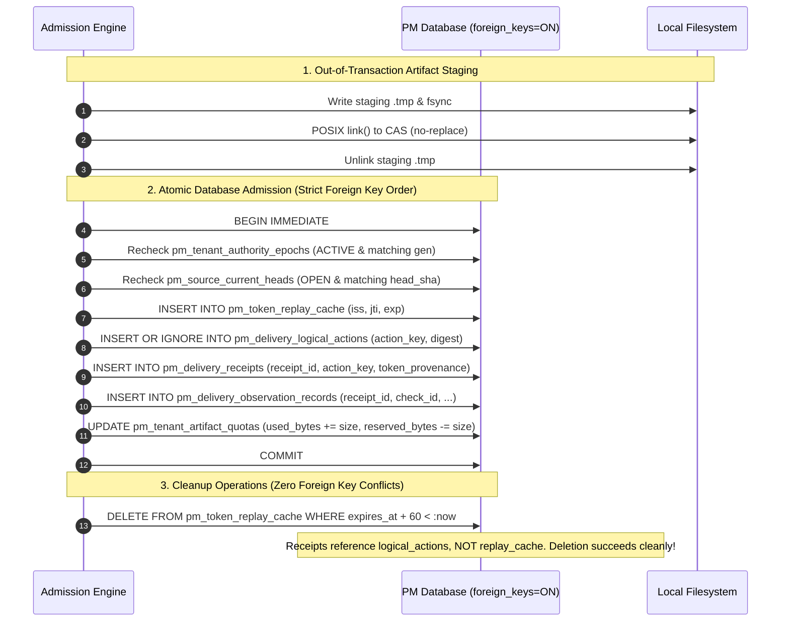
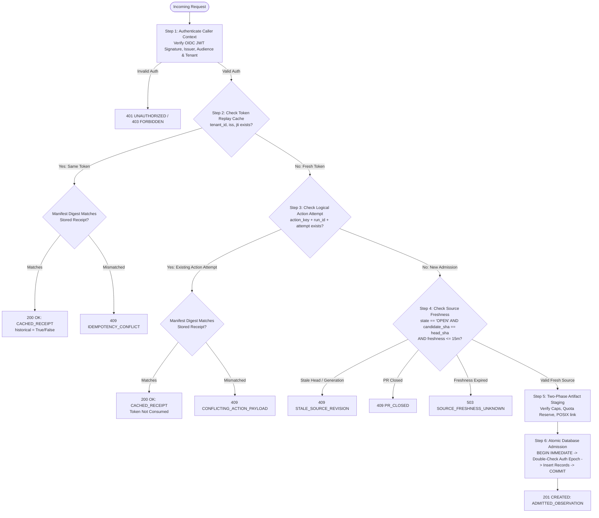

# GHA-04: Durable Ingestion, Replay Protection & Source-Event Synchronization
## Architectural Design Specification & Verification Plan (Revised Checkpoint 2)

- **Author / Implementation Owner:** Antigravity Development Team
- **Reviewer / Acceptance Owner:** Codex
- **Date:** 14 October 2026
- **Status:** **REVISED PROPOSED DESIGN CHECKPOINT** (Submitted for Codex Independent Architectural Review)
- **Base Baseline:** Commit `82407210f97eb41500f2a4d671d71d38175b685e` (GHA-03 Approved in `3ca8fc4d`, Recorded in `GHA_03_ACCEPTANCE_RECORD.md`)
- **Review Predecessors:**
  - `projects/scrum-board-automation/planning/GHA_04_DESIGN_REVIEW.md` (`a193e1af`)
  - `projects/scrum-board-automation/planning/ANTIGRAVITY_GHA_04_DESIGN_REWORK_BRIEF.md` (`a193e1af`)
  - `projects/scrum-board-automation/planning/GHA_04_INDEPENDENT_ACCEPTANCE_SCENARIOS.md` (`a629ba4b`)
  - `projects/scrum-board-automation/planning/GHA_04_REVISED_DESIGN_REVIEW.md` (`fe0e9899`)
  - `projects/scrum-board-automation/planning/ANTIGRAVITY_GHA_04_REVISED_DESIGN_REWORK.md` (`fe0e9899`)
- **Scope:** Quarantined witness observation ingestion, durable token replay prevention, server-authoritative PR head tracking, composite ownership enforcement, two-phase artifact staging, and authority linearization.
- **Explicit Gating Notice:** This document is an architectural specification only. No implementation code, database migrations, or live workflow activations are performed prior to mutual design approval.

---

## 1. Executive Summary & Review Rework Alignment

In response to Codex's revised design review (`GHA_04_REVISED_DESIGN_REVIEW.md`) and explicit rework instructions (`ANTIGRAVITY_GHA_04_REVISED_DESIGN_REWORK.md`), Antigravity has revised the GHA-04 design specification to resolve all remaining relational, authority, lookup, and durability contradictions:

1. **Quarantined Witness Authority Preserved:**
   - Witness observation ingestion stores untrusted observations and emits immutable receipts (`pm_delivery_receipts`, `pm_delivery_observation_records`).
   - Witness ingestion **never** mutates delivery task phases (`DRAFT`, `READY`, `AWAITING_SUBMISSION`, `IN_REVIEW`, etc.), never calls `DeliveryService.submit`, never acts as a builder, never approves delivery, and never releases token budgets.
   - All delivery state transitions remain the exclusive responsibility of separately authenticated builder, coordinator, and reviewer services.
2. **Relational Constraints & Entity Separation (Finding 1):**
   - **Parent Unique Indexes:** Explicitly adds unique indexes `uq_idx_delivery_projects_tenant` on `pm_delivery_projects(tenant_id, project_id)` and `uq_idx_delivery_tasks_tenant_issue` on `pm_delivery_tasks(tenant_id, project_id, issue_id)`.
   - **Three Distinct Entities:** Distinguishes `pm_delivery_logical_actions` (immutable semantic action digest), `pm_delivery_receipts` (attempt receipt with full 256-bit ID `rec_` + 64 hex chars), and `pm_delivery_observation_records` (individual check items).
   - **Composite FK Enforcement:** All tables enforce exact composite FKs referencing `pm_delivery_tasks(tenant_id, project_id, issue_id)` or `pm_delivery_projects(tenant_id, project_id)`.
   - **Decoupled Token Provenance vs Ephemeral Replay Cache:** `pm_token_replay_cache` is strictly an expiring anti-replay table (`expires_at`), safely cleanable without breaking foreign keys. Immutable token provenance (`token_iss`, `token_jti`, `token_expires_at`) is stored directly on `pm_delivery_receipts`.
   - **Structured Canonical Action Hashing:** Uses deterministic JSON serialization ($\text{JSON}_{\text{canonical}}$) over structured key-value maps (tenant, project, issue, check, policy, brief, suite, candidate, generation, base), completely eliminating string concatenation ambiguities.
3. **Cross-Store Authority Linearization & Refresh Tickets (Finding 2):**
   - **Authority Epoch Ledger (`pm_tenant_authority_epochs`):** Maintains active tenant status, connector generation, and digest inside `PMDatabase`.
   - **Linearization Point:** The commit of `BEGIN IMMEDIATE` on `PMDatabase` is the single serialization point. Mutators (IAM suspensions, connector updates) acquire `BEGIN IMMEDIATE` on `PMDatabase` to update the epoch. Ingestion verifies the epoch under the same lock, mathematically preventing races between recheck and commit.
   - **Durable Refresh Tickets (`pm_source_refresh_tickets`):** Per-subject serialized tickets with CAS acquisition, worker PID, lease timeouts, and failed/stalled status.
   - **Authoritative CAS Generation Advances:** Generation advances on any change to `head_sha`, `base_sha`, or `state` (`OPEN` $\leftrightarrow$ `CLOSED` / `MERGED`). Ancestry ordering is 100% removed. Stalled freshness fails closed (`503 SOURCE_FRESHNESS_UNKNOWN`).
4. **Unified Lookup & Historical Retrieval Protocol (Finding 3):**
   - Authenticates caller context first.
   - Evaluates historical receipt lookup (token replay cache or logical action attempt) **before** evaluating current PR head freshness.
   - Legitimate replays after PR head advance or closure return historical cached receipts (`200 OK`, `historical=True`) without re-admission or phase transition.
   - New admissions require current source head alignment and commit fresh records.
5. **Local Artifact Durability & CAS Protocol (Finding 4):**
   - Server-owned scoped paths: `/var/mas/pm/cas/<tenant_id>/` and `/var/mas/pm/staging/<tenant_id>/`.
   - **Atomic No-Replace Promotion:** Uses POSIX `link(staging_tmp, cas_dest)` which atomically fails with `FileExistsError` if the destination exists. If destination exists, byte-for-byte SHA-256 verification is performed; corrupt destinations raise `CAS_INTEGRITY_VIOLATION`.
   - **Quota Reservation Lifecycle:** Managed via `pm_tenant_artifact_quotas` with atomic reservation, promotion, and commit transitions.
   - **Safe Orphan Cleanup:** Staging `.tmp` files older than 1 hour without active reservation are unlinked. CAS blobs older than 24 hours are deleted only after re-verifying that no committed receipt references them.

---

## 2. Architectural Boundaries & Identity Model

### 2.1. Identity Entities

```mermaid
classDiagram
    direction TB
    class TokenReplayCache {
        +tenant_id: String
        +iss: String
        +jti: String
        +expires_at: Float
        +created_at: Timestamp
    }
    class AuthorityEpoch {
        +tenant_id: String
        +status: String
        +connector_generation: Integer
        +connector_digest: String
        +epoch: Integer
        +updated_at: Timestamp
    }
    class LogicalAction {
        +tenant_id: String
        +project_id: String
        +issue_id: String
        +action_key: String
        +semantic_action_digest: String
        +status: String
    }
    class DeliveryReceipt {
        +receipt_id: String
        +tenant_id: String
        +project_id: String
        +issue_id: String
        +action_key: String
        +github_run_id: String
        +github_run_attempt: Integer
        +token_iss: String
        +token_jti: String
        +manifest_digest: String
        +artifact_digest: String
        +artifact_status: String
        +admission_status: String
        +authority_verified: False
    }
    class ObservationRecord {
        +receipt_id: String
        +check_id: String
        +tenant_id: String
        +project_id: String
        +issue_id: String
        +outcome: String
        +observation_digest: String
    }
    class SourceCurrentHead {
        +tenant_id: String
        +project_id: String
        +pr_number: Integer
        +head_sha: String
        +base_sha: String
        +source_generation: Integer
        +state: String
    }
    class SourceRefreshTicket {
        +tenant_id: String
        +project_id: String
        +pr_number: Integer
        +ticket_id: String
        +status: String
        +expires_at: Float
    }

    TokenReplayCache ..> DeliveryReceipt : Ephemeral Replay Gate
    AuthorityEpoch ..> DeliveryReceipt : Linearized Auth Boundary
    LogicalAction ||--o{ DeliveryReceipt : Realizes Attempt
    DeliveryReceipt ||--o{ ObservationRecord : Contains Checks
    SourceCurrentHead ..> LogicalAction : Supplies Generation
    SourceRefreshTicket ..> SourceCurrentHead : Serializes Refresh
```

### 2.2. Structured Canonical Action Digest Formulation
To ensure cryptographic determinism without string-concatenation ambiguities, the logical action identity $\text{action\_key}$ and $\text{semantic\_action\_digest}$ are defined via canonical JSON:

$$\text{ActionPayload} = \left\{
\begin{array}{ll}
\text{"tenant\_id"}: & \text{tenant\_id}, \\
\text{"project\_id"}: & \text{project\_id}, \\
\text{"issue\_id"}: & \text{issue\_id}, \\
\text{"check\_id"}: & \text{check\_id}, \\
\text{"policy\_version"}: & \text{policy\_version}, \\
\text{"brief\_version"}: & \text{brief\_version}, \\
\text{"suite\_digest"}: & \text{suite\_digest}, \\
\text{"candidate\_sha"}: & \text{candidate\_sha}, \\
\text{"source\_generation"}: & \text{source\_generation}, \\
\text{"base\_sha"}: & \text{base\_sha}
\end{array}
\right\}$$

$$\text{canonical\_bytes} = \text{json.dumps}(\text{ActionPayload}, \text{sort\_keys}=\text{True}, \text{separators}=(',', ':')).\text{encode('utf-8')}$$
$$\text{semantic\_action\_digest} = \text{sha256}(\text{canonical\_bytes}).\text{hexdigest}()$$
$$\text{action\_key} = \text{"act\_"} \parallel \text{semantic\_action\_digest}$$

### 2.3. Numbered Invariants (INV-01 through INV-10)

- **INV-01 (Quarantined Witness Storage):** Ingested observations are stored strictly as untrusted witness records (`admission_status = 'ADMITTED_OBSERVATION'`, `authority_verified = False`). Ingestion NEVER mutates `pm_delivery_tasks.phase`, NEVER calls `DeliveryService.submit`, NEVER marks work `ACCEPTED`, and NEVER releases token budgets.
- **INV-02 (Single-Use Token Mutation):** A given `(tenant_id, iss, jti)` can be consumed for state mutation at most once. Replays with the same token return the existing cached receipt (`200 OK`) without re-admission.
- **INV-03 (Logical Action & Semantic Invariance):** Submitting a fresh valid token for an already committed logical action `(action_key)` with an identical `manifest_digest` returns the existing receipt (`200 OK`). Conflicting payloads for the same action return `409 CONFLICTING_ACTION_PAYLOAD`.
- **INV-04 (Multi-Check Run Permissibility):** Multiple observations or checks originating from the same `(github_run_id, github_run_attempt)` are permitted, each bound to its distinct `action_key` and check record.
- **INV-05 (Server-Authoritative Source Freshness):** PR head commit SHA, base commit SHA, and open/closed state are determined exclusively by `pm_source_current_heads`, never trusted from client manifests. Ancestry/timestamp ordering is prohibited.
- **INV-06 (Monotonic Source Generations):** Any change to PR `head_sha`, `base_sha`, or `state` (`OPEN` $\leftrightarrow$ `CLOSED` / `MERGED`) advances `source_generation` monotonically. Fresh admissions for older generations are refused as `409 STALE_SOURCE_REVISION`.
- **INV-07 (Composite Relational Integrity):** All receipt, observation, and action tables enforce composite foreign keys referencing `pm_delivery_tasks(tenant_id, project_id, issue_id)` backed by parent unique indexes, preventing cross-tenant or cross-project data injection.
- **INV-08 (Out-of-Transaction Artifact Staging & POSIX Link):** Artifact files are verified, hashed, fsynced, and atomically promoted via POSIX `link()` (atomic no-replace) *before* acquiring the database commit lock.
- **INV-09 (Linearized Authority Epoch Recheck):** Active tenant status, connector generation, and PR head generation are verified inside the `BEGIN IMMEDIATE` lock on `PMDatabase` over `pm_tenant_authority_epochs` immediately prior to commit.
- **INV-10 (Strict Append-Only Immutability):** All receipts, observation records, logical actions, and source notifications are immutable and protected by database triggers aborting `UPDATE` and `DELETE` operations.

---

## 3. Executable Relational Schema (Migration `2026101401`)

### 3.1. DDL Specification

```sql
-- Migration 2026101401: GHA-04 Quarantined Witness Receipts & Relational Authority

-- Step 1: Parent Unique Indexes to Enable Composite Foreign Keys
CREATE UNIQUE INDEX IF NOT EXISTS uq_idx_delivery_projects_tenant
    ON pm_delivery_projects(tenant_id, project_id);

CREATE UNIQUE INDEX IF NOT EXISTS uq_idx_delivery_tasks_tenant_issue
    ON pm_delivery_tasks(tenant_id, project_id, issue_id);

-- Step 2: Cross-Store Authority Epoch Ledger
CREATE TABLE IF NOT EXISTS pm_tenant_authority_epochs (
    tenant_id TEXT PRIMARY KEY,
    status TEXT NOT NULL CHECK(status IN ('ACTIVE', 'SUSPENDED', 'REVOKED')),
    connector_generation INTEGER NOT NULL CHECK(connector_generation >= 0),
    connector_digest TEXT NOT NULL CHECK(length(connector_digest) = 64),
    epoch INTEGER NOT NULL CHECK(epoch >= 0),
    updated_at TIMESTAMP NOT NULL DEFAULT CURRENT_TIMESTAMP
);

-- Step 3: Ephemeral Anti-Replay Token Cache (Expiring, Cleanable Without FK Breakage)
CREATE TABLE IF NOT EXISTS pm_token_replay_cache (
    tenant_id TEXT NOT NULL,
    iss TEXT NOT NULL,
    jti TEXT NOT NULL,
    expires_at REAL NOT NULL,
    created_at TIMESTAMP NOT NULL DEFAULT CURRENT_TIMESTAMP,
    PRIMARY KEY (tenant_id, iss, jti)
);
CREATE INDEX IF NOT EXISTS idx_token_replay_expiry ON pm_token_replay_cache(expires_at);

-- Step 4: Logical Action Entity (Enforces Immutable Semantic Action Digest)
CREATE TABLE IF NOT EXISTS pm_delivery_logical_actions (
    tenant_id TEXT NOT NULL,
    project_id TEXT NOT NULL,
    issue_id TEXT NOT NULL,
    action_key TEXT NOT NULL,
    semantic_action_digest TEXT NOT NULL CHECK(length(semantic_action_digest) = 64),
    status TEXT NOT NULL CHECK(status IN ('ACTIVE', 'SUPERSEDED')),
    created_at TIMESTAMP NOT NULL DEFAULT CURRENT_TIMESTAMP,
    PRIMARY KEY (tenant_id, project_id, issue_id, action_key),
    CONSTRAINT fk_logical_action_task FOREIGN KEY (tenant_id, project_id, issue_id)
        REFERENCES pm_delivery_tasks(tenant_id, project_id, issue_id)
);
CREATE INDEX IF NOT EXISTS idx_logical_actions_key ON pm_delivery_logical_actions(action_key);

-- Step 5: Quarantined Delivery Observation Receipts
CREATE TABLE IF NOT EXISTS pm_delivery_receipts (
    receipt_id TEXT PRIMARY KEY CHECK(length(receipt_id) = 68 AND receipt_id LIKE 'rec_%'),
    tenant_id TEXT NOT NULL,
    project_id TEXT NOT NULL,
    issue_id TEXT NOT NULL,
    action_key TEXT NOT NULL,
    github_run_id TEXT NOT NULL,
    github_run_attempt INTEGER NOT NULL CHECK(github_run_attempt > 0),
    token_iss TEXT NOT NULL,
    token_jti TEXT NOT NULL,
    token_expires_at REAL NOT NULL,
    pr_number INTEGER NOT NULL CHECK(pr_number > 0),
    source_generation INTEGER NOT NULL CHECK(source_generation > 0),
    candidate_sha TEXT NOT NULL CHECK(length(candidate_sha) = 40),
    base_sha TEXT NOT NULL CHECK(length(base_sha) = 40),
    suite_digest TEXT NOT NULL CHECK(length(suite_digest) = 64),
    brief_version INTEGER NOT NULL CHECK(brief_version > 0),
    policy_version INTEGER NOT NULL CHECK(policy_version > 0),
    fencing_token INTEGER NOT NULL CHECK(fencing_token >= 0),
    manifest_digest TEXT NOT NULL CHECK(length(manifest_digest) = 64),
    artifact_digest TEXT CHECK(artifact_digest IS NULL OR length(artifact_digest) = 64),
    artifact_status TEXT NOT NULL DEFAULT 'AVAILABLE' CHECK(artifact_status IN ('AVAILABLE', 'EXPIRED', 'PURGED', 'NONE')),
    admission_status TEXT NOT NULL CHECK(admission_status IN ('ADMITTED_OBSERVATION', 'REJECTED_OBSERVATION')),
    authority_verified INTEGER NOT NULL DEFAULT 0 CHECK(authority_verified = 0),
    observation_count INTEGER NOT NULL CHECK(observation_count >= 0),
    raw_manifest_json JSON NOT NULL,
    admitted_at TIMESTAMP NOT NULL DEFAULT CURRENT_TIMESTAMP,
    CONSTRAINT fk_receipt_logical_action FOREIGN KEY (tenant_id, project_id, issue_id, action_key)
        REFERENCES pm_delivery_logical_actions(tenant_id, project_id, issue_id, action_key),
    CONSTRAINT fk_receipt_task FOREIGN KEY (tenant_id, project_id, issue_id)
        REFERENCES pm_delivery_tasks(tenant_id, project_id, issue_id),
    CONSTRAINT uq_receipt_action_attempt UNIQUE (tenant_id, issue_id, action_key, github_run_id, github_run_attempt)
);
CREATE INDEX IF NOT EXISTS idx_delivery_receipts_task ON pm_delivery_receipts(tenant_id, project_id, issue_id);
CREATE INDEX IF NOT EXISTS idx_delivery_receipts_action ON pm_delivery_receipts(action_key);
CREATE INDEX IF NOT EXISTS idx_delivery_receipts_manifest ON pm_delivery_receipts(manifest_digest);

-- Step 6: Individual Observation Records
CREATE TABLE IF NOT EXISTS pm_delivery_observation_records (
    receipt_id TEXT NOT NULL,
    check_id TEXT NOT NULL,
    tenant_id TEXT NOT NULL,
    project_id TEXT NOT NULL,
    issue_id TEXT NOT NULL,
    outcome TEXT NOT NULL CHECK(outcome IN ('PASSED', 'FAILED', 'SKIPPED', 'UNAVAILABLE')),
    evidence_ref TEXT NOT NULL,
    observation_digest TEXT NOT NULL CHECK(length(observation_digest) = 64),
    observation_size INTEGER NOT NULL CHECK(observation_size >= 0),
    PRIMARY KEY (receipt_id, check_id),
    CONSTRAINT fk_obs_receipt FOREIGN KEY (receipt_id)
        REFERENCES pm_delivery_receipts(receipt_id) ON DELETE RESTRICT,
    CONSTRAINT fk_obs_task FOREIGN KEY (tenant_id, project_id, issue_id)
        REFERENCES pm_delivery_tasks(tenant_id, project_id, issue_id)
);
CREATE INDEX IF NOT EXISTS idx_obs_records_task ON pm_delivery_observation_records(tenant_id, project_id, issue_id);

-- Step 7: Server-Authoritative Current PR Head Projection
CREATE TABLE IF NOT EXISTS pm_source_current_heads (
    tenant_id TEXT NOT NULL,
    project_id TEXT NOT NULL,
    pr_number INTEGER NOT NULL CHECK(pr_number > 0),
    repository_id TEXT NOT NULL,
    head_sha TEXT NOT NULL CHECK(length(head_sha) = 40),
    base_sha TEXT NOT NULL CHECK(length(base_sha) = 40),
    source_generation INTEGER NOT NULL CHECK(source_generation > 0),
    state TEXT NOT NULL CHECK(state IN ('OPEN', 'CLOSED', 'MERGED')),
    last_refreshed_at TIMESTAMP NOT NULL DEFAULT CURRENT_TIMESTAMP,
    PRIMARY KEY (tenant_id, project_id, pr_number),
    CONSTRAINT fk_source_project FOREIGN KEY (tenant_id, project_id)
        REFERENCES pm_delivery_projects(tenant_id, project_id)
);

-- Step 8: Durable PR Source Refresh Tickets
CREATE TABLE IF NOT EXISTS pm_source_refresh_tickets (
    tenant_id TEXT NOT NULL,
    project_id TEXT NOT NULL,
    pr_number INTEGER NOT NULL CHECK(pr_number > 0),
    ticket_id TEXT NOT NULL,
    owner_pid INTEGER,
    acquired_at TIMESTAMP,
    expires_at REAL NOT NULL,
    status TEXT NOT NULL CHECK(status IN ('IDLE', 'REFRESHING', 'FAILED')),
    last_error TEXT,
    PRIMARY KEY (tenant_id, project_id, pr_number),
    CONSTRAINT fk_refresh_ticket_project FOREIGN KEY (tenant_id, project_id)
        REFERENCES pm_delivery_projects(tenant_id, project_id)
);

-- Step 9: Append-Only Source Notification History
CREATE TABLE IF NOT EXISTS pm_source_notifications (
    id INTEGER PRIMARY KEY AUTOINCREMENT,
    tenant_id TEXT NOT NULL,
    project_id TEXT NOT NULL,
    repository_id TEXT NOT NULL,
    pr_number INTEGER NOT NULL CHECK(pr_number > 0),
    event_kind TEXT NOT NULL CHECK(event_kind IN ('PR_OPENED', 'PR_SYNCHRONIZE', 'PR_FORCE_PUSH', 'PR_CLOSED', 'PR_REOPENED', 'BASE_UPDATED', 'REFRESH_SYNC')),
    delivery_id TEXT NOT NULL,
    payload_sha256 TEXT NOT NULL CHECK(length(payload_sha256) = 64),
    received_at TIMESTAMP NOT NULL DEFAULT CURRENT_TIMESTAMP,
    CONSTRAINT fk_notif_project FOREIGN KEY (tenant_id, project_id)
        REFERENCES pm_delivery_projects(tenant_id, project_id)
);
CREATE INDEX IF NOT EXISTS idx_source_notif_pr ON pm_source_notifications(tenant_id, project_id, pr_number);

-- Step 10: Tenant Artifact Quota Ledger
CREATE TABLE IF NOT EXISTS pm_tenant_artifact_quotas (
    tenant_id TEXT PRIMARY KEY,
    quota_bytes INTEGER NOT NULL CHECK(quota_bytes > 0),
    used_bytes INTEGER NOT NULL DEFAULT 0 CHECK(used_bytes >= 0),
    reserved_bytes INTEGER NOT NULL DEFAULT 0 CHECK(reserved_bytes >= 0),
    updated_at TIMESTAMP NOT NULL DEFAULT CURRENT_TIMESTAMP
);

-- Step 11: Immutability Triggers
CREATE TRIGGER IF NOT EXISTS trg_logical_actions_no_update BEFORE UPDATE ON pm_delivery_logical_actions
BEGIN SELECT RAISE(ABORT, 'LogicalActionTamperViolation: Logical actions are immutable.'); END;

CREATE TRIGGER IF NOT EXISTS trg_logical_actions_no_delete BEFORE DELETE ON pm_delivery_logical_actions
BEGIN SELECT RAISE(ABORT, 'LogicalActionTamperViolation: Logical actions cannot be deleted.'); END;

CREATE TRIGGER IF NOT EXISTS trg_receipts_no_update BEFORE UPDATE ON pm_delivery_receipts
BEGIN SELECT RAISE(ABORT, 'ReceiptTamperViolation: Delivery receipts are strictly immutable.'); END;

CREATE TRIGGER IF NOT EXISTS trg_receipts_no_delete BEFORE DELETE ON pm_delivery_receipts
BEGIN SELECT RAISE(ABORT, 'ReceiptTamperViolation: Delivery receipts cannot be deleted.'); END;

CREATE TRIGGER IF NOT EXISTS trg_obs_no_update BEFORE UPDATE ON pm_delivery_observation_records
BEGIN SELECT RAISE(ABORT, 'ObservationTamperViolation: Observation records are strictly immutable.'); END;

CREATE TRIGGER IF NOT EXISTS trg_obs_no_delete BEFORE DELETE ON pm_delivery_observation_records
BEGIN SELECT RAISE(ABORT, 'ObservationTamperViolation: Observation records cannot be deleted.'); END;

CREATE TRIGGER IF NOT EXISTS trg_notif_no_update BEFORE UPDATE ON pm_source_notifications
BEGIN SELECT RAISE(ABORT, 'SourceHistoryTamperViolation: Source history notifications are strictly immutable.'); END;

CREATE TRIGGER IF NOT EXISTS trg_notif_no_delete BEFORE DELETE ON pm_source_notifications
BEGIN SELECT RAISE(ABORT, 'SourceHistoryTamperViolation: Source history notifications cannot be deleted.'); END;
```

### 3.2. Insertion and Cleanup Ordering Under `PRAGMA foreign_keys = ON;`



---

## 4. Authority, Freshness & Local Storage Protocols

### 4.1. Local Artifact Storage Protocol

#### Server-Owned Paths
- Storage Base: `/var/mas/pm/`
- CAS Root: `/var/mas/pm/cas/<tenant_id>/`
- Staging Root: `/var/mas/pm/staging/<tenant_id>/`
- Canonical CAS Blob: `/var/mas/pm/cas/<tenant_id>/<sha256>.zip`
- Staging Temp File: `/var/mas/pm/staging/<tenant_id>/<uuid>.tmp`

#### Atomic No-Replace Promotion via POSIX `link()`
In Linux/POSIX environments, `os.replace` silently overwrites an existing file, which is unsafe for immutable CAS blobs. GHA-04 defines promotion using `os.link`:
1. Write artifact bytes to `/var/mas/pm/staging/<tenant_id>/<uuid>.tmp`.
2. Execute `fsync` on the temporary file descriptor.
3. Compute SHA-256 of written bytes ($D_{actual}$). Verify $D_{actual} == D_{manifest}$.
4. Attempt `os.link(staging_tmp_path, cas_dest_path)`:
   - **Case A (Link succeeds):** The destination file did not exist. Link creates a hard link atomically. Directory `/var/mas/pm/cas/<tenant_id>/` is fsynced. Staging temp file is unlinked. Promotion complete.
   - **Case B (Link raises `FileExistsError`):** Another concurrent request or previous attempt already created the CAS blob.
     - Open existing file at `cas_dest_path`. Verify it is a regular file (reject symlinks via `os.path.islink`).
     - Read and compute SHA-256 of the existing file bytes.
     - If existing SHA-256 matches $D_{actual}$: Promotion is idempotent. Unlink staging temp file. Reuse existing blob.
     - If existing SHA-256 does NOT match: Corrupted file detected. Raise `CAS_INTEGRITY_VIOLATION`. Unlink staging temp file. Abort admission with `500 INTERNAL_ERROR`.

#### Quota Reservation Lifecycle
1. Under `BEGIN IMMEDIATE` on `PMDatabase`, query `pm_tenant_artifact_quotas`:
   $$\text{used\_bytes} + \text{reserved\_bytes} + \text{artifact\_size} \le \text{quota\_bytes}$$
2. Update: `reserved_bytes = reserved_bytes + artifact_size`.
3. If check fails, abort immediately with `413 QUOTA_EXCEEDED`.
4. On successful admission commit:
   `used_bytes = used_bytes + artifact_size`, `reserved_bytes = reserved_bytes - artifact_size`.
5. On rollback or error:
   `reserved_bytes = reserved_bytes - artifact_size`.
6. Stale reservation reaper: Clears reservations older than 10 minutes where no corresponding receipt was committed.

#### Safe Orphan Cleanup
1. **Staging Cleanup:** Scans `/var/mas/pm/staging/<tenant_id>/` every hour. Deletes `.tmp` files whose modification time is older than 1 hour (`mtime < now - 3600`) and for which no active quota reservation exists.
2. **CAS Blob Reclamation:** Scans `/var/mas/pm/cas/<tenant_id>/` every 24 hours.
   - Candidate blob must have `mtime < now - 86400` (24-hour grace window for in-flight admissions).
   - Linearization check: Executes read query `SELECT 1 FROM pm_delivery_receipts WHERE tenant_id = :t AND artifact_digest = :digest`.
   - If referenced by any receipt: **Retained permanently**.
   - If not referenced and no active reservation: Unlinks unreferenced orphan blob and fsyncs CAS directory.

#### Expiry Metadata & Query Semantics
When an artifact reaches tenant retention expiry:
- Receipt column `artifact_status` is transitioned to `'EXPIRED'` (via explicit administrative lifecycle service).
- The receipt record, observation records, and `artifact_digest` hash remain permanently immutable.
- Subsequent receipt queries return `200 OK` with `artifact_status = "EXPIRED"` and `artifact_url = None`.

---

### 4.2. Cross-Store Authority Linearization Protocol

#### Supported Authority Mutators
1. **IAM Tenant Status Mutator (`iam.set_tenant_status`):** Sets tenant `ACTIVE`, `SUSPENDED`, or `REVOKED`.
2. **Connector Registry Mutator (`registry.update_connector`):** Increments connector generation and updates policy digest.
3. **Gateway Admission Mutator (`DurableWitnessAdmissionEngine`):** Ingests witness receipts.

#### Linearization Point
The single linearization point is the **commit of the `BEGIN IMMEDIATE` transaction in `PMDatabase`**.
Whenever an IAM status change or connector policy update occurs:
1. The mutator executes an atomic synchronization transaction in `PMDatabase`:
   ```sql
   BEGIN IMMEDIATE;
   UPDATE pm_tenant_authority_epochs
   SET status = :new_status,
       connector_generation = :new_gen,
       connector_digest = :new_digest,
       epoch = epoch + 1,
       updated_at = CURRENT_TIMESTAMP
   WHERE tenant_id = :tenant_id;
   COMMIT;
   ```
2. When the Gateway admission engine admits an observation:
   ```sql
   BEGIN IMMEDIATE;
   SELECT status, connector_generation, connector_digest, epoch
   FROM pm_tenant_authority_epochs
   WHERE tenant_id = :tenant_id;
   ```
   - If `status != 'ACTIVE'`: Rollback and return `403 TENANT_REVOKED`.
   - If `connector_generation != snap.generation` OR `connector_digest != snap.digest`: Rollback and return `403 CONNECTOR_REVOKED`.
   - Because both authority mutators and admission workers serialize on the identical SQLite database lock on `pm_tenant_authority_epochs`, **revocation cannot occur between the recheck and the commit**.

---

### 4.3. Authoritative Source Freshness Protocol

#### Durable Refresh Tickets (`pm_source_refresh_tickets`)
To coordinate multithreaded and multiprocess workers safely:
1. **Ticket Acquisition (Atomic CAS):**
   ```sql
   UPDATE pm_source_refresh_tickets
   SET status = 'REFRESHING',
       ticket_id = :new_uuid,
       owner_pid = :my_pid,
       acquired_at = CURRENT_TIMESTAMP,
       expires_at = :now + 30.0
   WHERE tenant_id = :tenant_id
     AND project_id = :project_id
     AND pr_number = :pr_number
     AND (status = 'IDLE' OR expires_at < :now);
   ```
   If 0 rows updated, another worker is actively refreshing; caller awaits ticket completion or reads current projection.
2. **Authoritative Source Fetch:** Worker fetches verified repository state: `(head_sha, base_sha, state)`.
3. **Conditional Publication (CAS):**
   ```sql
   BEGIN IMMEDIATE;
   -- Read current head
   SELECT head_sha, base_sha, state, source_generation
   FROM pm_source_current_heads
   WHERE tenant_id = :t AND project_id = :p AND pr_number = :pr;

   -- If head, base, or state changed, advance generation
   -- Otherwise, refresh last_refreshed_at preserving generation
   UPDATE pm_source_current_heads
   SET head_sha = :new_head,
       base_sha = :new_base,
       state = :new_state,
       source_generation = CASE
           WHEN head_sha != :new_head OR base_sha != :new_base OR state != :new_state
           THEN source_generation + 1
           ELSE source_generation
       END,
       last_refreshed_at = CURRENT_TIMESTAMP
   WHERE tenant_id = :t AND project_id = :p AND pr_number = :pr;

   UPDATE pm_source_refresh_tickets
   SET status = 'IDLE', ticket_id = '', expires_at = 0.0
   WHERE tenant_id = :t AND project_id = :p AND pr_number = :pr;
   COMMIT;
   ```
4. **State Transition Generation Rules:**
   - PR commit pushed $\to$ `source_generation + 1`
   - PR force-pushed / rebased $\to$ `source_generation + 1`
   - PR base branch updated $\to$ `source_generation + 1`
   - PR closed $\to$ `state = 'CLOSED'`, `source_generation + 1`
   - PR reopened $\to$ `state = 'OPEN'`, `source_generation + 1`
   - Ancestry / commit-graph depth is **100% eliminated** from authority decisions.
5. **Freshness Window & Stalled Refresh Handling:**
   - Maximum freshness TTL: `MAX_FRESHNESS_TTL = 900` seconds (15 minutes).
   - If `now - last_refreshed_at > MAX_FRESHNESS_TTL` or ticket status is `'FAILED'`:
     Gateway admission fails closed with `503 SOURCE_FRESHNESS_UNKNOWN`.

---

## 5. Unified Lookup & Historical Retrieval Protocol

### 5.1. Lookup Decision Table & Evaluation Order

When a request arrives at the witness observation gateway, it executes in strict hierarchical order:



| Evaluation Step | Check Performed | Outcome If True | Outcome If False |
|---|---|---|---|
| **1. Authentication** | Bearer JWT valid, signed by trusted issuer, matches registered tenant. | Proceed to Step 2. | `401 UNAUTHORIZED` / `403 FORBIDDEN`. |
| **2. Ephemeral Token Cache** | `(tenant_id, iss, jti)` in `pm_token_replay_cache`. | If `manifest_digest` matches: `200 OK (CACHED_RECEIPT)`. Else: `409 IDEMPOTENCY_CONFLICT`. | Proceed to Step 3. |
| **3. Historical Action Cache** | `(tenant_id, issue_id, action_key, run_id, attempt)` in `pm_delivery_receipts`. | If `manifest_digest` matches: `200 OK (CACHED_RECEIPT)`. Else: `409 CONFLICTING_ACTION_PAYLOAD`. | Proceed to Step 4. |
| **4. Source Currentness** | `pm_source_current_heads` has `state == 'OPEN'`, matching `candidate_sha`, `source_generation`, and `now - last_refreshed <= 15m`. | Proceed to Step 5. | Stale SHA: `409 STALE_SOURCE_REVISION`. Closed: `409 PR_CLOSED`. Expired: `503 SOURCE_FRESHNESS_UNKNOWN`. |
| **5. Artifact Staging** | Quota available, caps verified, fsynced, promoted via POSIX `link()`. | Proceed to Step 6. | Size error: `413 PAYLOAD_TOO_LARGE`. Quota: `413 QUOTA_EXCEEDED`. |
| **6. Atomic DB Commit** | `BEGIN IMMEDIATE`: Double-check `pm_tenant_authority_epochs` and `pm_source_current_heads`. Insert records. | `201 CREATED (ADMITTED_OBSERVATION)`. | Revoked: `403 TENANT_REVOKED`. Conflict: `409`. |

> [!IMPORTANT]
> Notice that **Step 2 and Step 3 execute BEFORE Step 4**. If a caller retries an already admitted observation after the PR head has advanced or the PR has closed, the gateway returns the historical cached receipt (`200 OK`, `historical=True`) without being rejected by Step 4!

### 5.2. Authenticated Read-Only Receipt Query Contract (Proposed)

```python
# Proposed: mas/pm/gateway/receipt_service.py

from typing import Any
from mas.pm.delivery_validator import StrictModel

class ReceiptQueryResponse(StrictModel):
    receipt_id: str
    tenant_id: str
    project_id: str
    issue_id: str
    action_key: str
    github_run_id: str
    github_run_attempt: int
    candidate_sha: str
    source_generation: int
    is_current_head: bool
    historical: bool
    admission_status: str
    authority_verified: bool  # Strictly False
    observation_count: int
    manifest_digest: str
    artifact_digest: str | None
    artifact_status: str
    admitted_at: str

class DeliveryReceiptService:
    """Proposed read-only receipt query service.
    Tenant identity is derived strictly from authenticated caller context.
    """

    def get_receipt(self, receipt_id: str, caller_context: Any) -> ReceiptQueryResponse | None:
        """Fetch receipt by ID strictly constrained to caller's authenticated tenant.
        Determines is_current_head by comparing against pm_source_current_heads.
        """
        ...

    def list_receipts_for_issue(
        self, issue_id: str, caller_context: Any, limit: int = 50
    ) -> list[ReceiptQueryResponse]:
        """List historical observation receipts for an issue in reverse chronological order."""
        ...
```

---

## 6. Shared Failure & Concurrency Matrix (14 Scenarios)

| Scenario # | Scenario Description | Trigger Condition | System Behavior & Invariant | Expected Outcome |
|---|---|---|---|---|
| **SC-01** | **Concurrent Same-Token Requests** | Two workers submit identical `(iss, jti)` simultaneously. | Requests serialize on `BEGIN IMMEDIATE`. Worker 1 commits. Worker 2 detects token in `pm_token_replay_cache` and rolls back. | Worker 1: `201 CREATED`<br>Worker 2: `200 OK` (Cached) |
| **SC-02** | **Fresh-Token Same-Action Retry** | Worker retries with fresh JWT for identical logical action & run attempt. | Query detects existing receipt for `action_key` and matching payload digest. Resolves without duplicate insertion. Token not consumed. | `200 OK` (Cached Receipt) |
| **SC-03** | **Identical vs Conflicting Payloads** | Client submits same token or same action key with altered manifest. | Payload digest differs from stored receipt. Aborts immediately to prevent result tampering. | `409 IDEMPOTENCY_CONFLICT` or `409 CONFLICTING_ACTION_PAYLOAD` |
| **SC-04** | **Separate Rerun Attempts** | Worker triggers GitHub workflow rerun (`github_run_attempt = 2`). | New attempt has different run attempt. Validated as distinct observation record; both receipts preserved. | `201 CREATED` (New Receipt) |
| **SC-05** | **Restart After Commit** | Server process crashes/restarts immediately after database commit. | Data durably committed in SQLite WAL. Client retry hits `pm_token_replay_cache` or `pm_delivery_receipts` and returns existing receipt. | `200 OK` (Cached Receipt) |
| **SC-06** | **Dropped Response** | Network connection drops before HTTP response reaches worker. | Worker retries with same token. Gateway returns existing receipt from database. | `200 OK` (Cached Receipt) |
| **SC-07** | **Stale / Out-of-Order Source Update** | Webhook arrives for commit $N-1$ after generation $N$ was established. | Refresh ticket queries authoritative source; ignores older commit; generation preserved. | Notification logged; Generation unchanged. |
| **SC-08** | **Head Changing During Admission** | PR head advances while gateway validation is executing pre-checks. | Admission checks `pm_source_current_heads` under lock. Candidate SHA does not match current head SHA. Aborts. | `409 STALE_SOURCE_REVISION` |
| **SC-09** | **Tenant / Connector Revocation Race** | Tenant suspended or connector revoked while gateway parses archive. | `pm_tenant_authority_epochs` re-checked inside `BEGIN IMMEDIATE` lock. Revocation detected before commit. | `403 TENANT_REVOKED` or `403 CONNECTOR_REVOKED` |
| **SC-10** | **Missing / Expired Artifacts** | Manifest references file evidence but archive is omitted or unreadable. | Pre-flight validation fails before staging or transaction acquisition. | `400 ARTIFACTS_REQUIRED` |
| **SC-11** | **Storage Failure (Disk Full / I/O Panic)** | Disk full during CAS write or SQLite I/O error during commit. | Staging file unlinked; database transaction rolls back 100%. Zero database rows committed. | `500 INTERNAL_ERROR` |
| **SC-12** | **Schema Migration & Reopen** | System upgrades schema to version 2026101401 and reopens database. | Ledger checked; migration runs atomically under lock; PRAGMA foreign_key_check runs. Zero legacy rows corrupted. | Migration: `200 OK` |
| **SC-13** | **Cross-Tenant Reference Injection** | Client attempts to link observation to an issue belonging to another tenant. | Composite foreign key `(tenant_id, project_id, issue_id)` fails constraint check against `pm_delivery_tasks`. | `400 COORDINATE_MISMATCH` |
| **SC-14** | **Historical Read on Advanced PR Head** | Caller queries receipt for generation 1 after PR has advanced to generation 2. | Query succeeds, returns receipt with `is_current_head = False`, `historical = True`. Proves historical execution without claiming current validity. | `200 OK` (`historical=true`) |

---

## 7. Component Ownership & Proposed Interface Contracts

### 7.1. Component Responsibility Matrix
- **Antigravity Development Team (Backend / Engine Ownership):**
  - Database schema migration `2026101401` with parent unique indexes.
  - Quarantined admission engine (`DurableWitnessAdmissionEngine`).
  - Two-phase artifact staging and CAS promoter with POSIX `link()` (`ArtifactCASManager`).
  - Authoritative source event manager and refresh ticket worker (`SourceHeadProjectionManager`).
  - Read-only receipt query service (`DeliveryReceiptService`).
- **Codex (Architecture Review & UI Ownership):**
  - Independent architectural review of this specification and subsequent implementation.
  - Scrum board UI presentation of quarantined witness receipts.
  - Future builder submission interface integration (`DeliveryService.submit`).

---

## 8. Executable Acceptance Test Plan & Scenario Mapping

The following 33 scenarios operationalize the exact requirements from [`GHA_04_INDEPENDENT_ACCEPTANCE_SCENARIOS.md`](file:///home/acinonyx/Desktop/MAS/projects/scrum-board-automation/planning/GHA_04_INDEPENDENT_ACCEPTANCE_SCENARIOS.md). For every scenario, the table explicitly defines:
1. **Invariant Checked**
2. **Proposed Component & Transaction Boundary**
3. **Concrete Input or Injected Fault**
4. **Expected Response & Persisted State**
5. **Evidence Needed to Prove Outcome**

### 8.1. Admission and Authority (A01 – A07)

| ID | Invariant Checked | Component & Transaction Boundary | Concrete Input / Injected Fault | Expected Response & Persisted State | Evidence Needed to Prove Outcome |
|---|---|---|---|---|---|
| **A01** | INV-01 (Quarantined Witness Authority), INV-02 (Stateless Gate), INV-08 (Zero Phase Mutation) | `DurableWitnessAdmissionEngine._execute_admission`<br>Boundary: `BEGIN IMMEDIATE` on `PMDatabase` after out-of-transaction artifact staging | Valid short-lived OIDC JWT for Tenant A, project P1, issue I1, run 101, attempt 1, candidate H7, valid 10KB artifact archive, source head at H7 (generation 7). | `201 CREATED` with immutable receipt ID.<br>Persisted: 1 row in `pm_token_replay_cache`, 1 row in `pm_delivery_logical_actions`, 1 row in `pm_delivery_receipts` (`admission_status='ADMITTED_OBSERVATION'`, `authority_verified=False`), 1 row in `pm_delivery_observation_records`. `pm_delivery_tasks.phase`, submissions, verdicts, and budgets remain **100% unchanged**. | SQL assertions verifying unchanged phase in `pm_delivery_tasks` before/after; count queries showing exactly 1 receipt and 0 builder submissions; exact hash comparison of stored CAS blob against manifest digest. |
| **A02** | INV-01 (Quarantined Witness Authority), INV-02 (Stateless Gate) | `DurableWitnessAdmissionEngine._validate_preflight`<br>Boundary: Pre-transaction Pydantic validation (`extra='forbid'`) | Witness payload contains `verdict="APPROVED"`, `phase="IN_REVIEW"`, or extra verifier fields `trusted_signature="xyz"`. | `400 BAD_REQUEST` (Schema validation failure, unexpected fields). Zero database rows written. Direct SQL probe attempting to insert approval fields into observation table fails schema constraints. | HTTP 400 response body; audit log showing validation rejection with static code `SCHEMA_VALIDATION_FAILED`; SQLite table state showing 0 rows inserted. |
| **A03** | INV-06 (Tenant and Coordinate Isolation), INV-07 (Composite Relational Integrity) | `DurableWitnessAdmissionEngine` & SQLite Foreign Key engine<br>Boundary: Pre-flight connector lookup + composite foreign key constraints on `pm_delivery_receipts` | Valid JWT for Tenant A, but request specifies Tenant B's `project_id` or `issue_id`. Direct probe: direct SQL `INSERT INTO pm_delivery_receipts` with mismatched `(tenant_id, project_id, issue_id)`. | Service refuses with `400 COORDINATE_MISMATCH` with zero leakage of Tenant B data. Direct SQL insert raises `sqlite3.IntegrityError: FOREIGN KEY constraint failed`. Zero rows committed. | Unit test executing cross-tenant payload asserting 400; direct SQLite test executing mismatched FK insert asserting `IntegrityError`; `PRAGMA foreign_key_check` proving zero violations. |
| **A04** | INV-03 (Composite Identity & Idempotency Keying), INV-04 (Multi-Check Run Permissibility) | `DurableWitnessAdmissionEngine`<br>Boundary: Separate `BEGIN IMMEDIATE` transactions for Check 1 (`lint`) and Check 2 (`test`) | Two distinct observation payloads originating from same GitHub workflow run (`github_run_id=555`, `github_run_attempt=1`): Check 1 has `action_key=act_lint`, Check 2 has `action_key=act_test`. | Both requests return `201 CREATED`. Two distinct rows committed in `pm_delivery_receipts` with different `receipt_id` and `action_key`. Zero unique constraint collision. | Query `SELECT COUNT(*) FROM pm_delivery_receipts WHERE github_run_id='555'` returns 2; distinct `check_id`s present in `pm_delivery_observation_records`. |
| **A05** | INV-03 (Composite Identity), INV-05 (Server-Authoritative Freshness), INV-06 (Monotonic Generations) | `DurableWitnessAdmissionEngine`<br>Boundary: `BEGIN IMMEDIATE` transaction checking existing receipts | Worker submits action A1 for candidate H7, then later submits same logical check name for new commit H8 (generation 8) or altered test suite. | New commit H8 derives distinct `action_key` (incorporating candidate SHA and generation) $\to$ returns `201 CREATED` as separate action. If client submits altered payload with same `action_key` under generation 7, returns `409 CONFLICTING_ACTION_PAYLOAD`. Prior receipt for H7 is never overwritten. | SQL query confirms receipt for H7 remains intact and unaltered; second receipt created for H8 with distinct generation; tamper attempt on same generation triggers 409 and rollback. |
| **A06** | INV-09 (Linearized Authority Epoch Recheck) | `DurableWitnessAdmissionEngine._double_checked_authority_lock`<br>Boundary: Barrier pause injected between pre-flight and `BEGIN IMMEDIATE` lock | Test harness pauses thread after pre-flight passes; test thread calls `iam.suspend_tenant()` or `registry.revoke_connector()`; test harness releases gateway thread to acquire lock and attempt commit. | Mutator updates `pm_tenant_authority_epochs`. Gateway double-check under `BEGIN IMMEDIATE` detects tenant inactive or connector generation changed; transaction executes `ROLLBACK`; unlinks staging artifact. Response `403 TENANT_REVOKED` or `403 CONNECTOR_REVOKED`. Zero database rows committed. | Multithreaded barrier test proving authorization refusal; query confirming 0 tokens or receipts committed; directory inspection confirming unlinked temp file. |
| **A07** | INV-01 (Quarantined Witness), INV-06 (Tenant and Coordinate Isolation) | `DurableWitnessAdmissionEngine._validate_preflight`<br>Boundary: Pre-transaction claims verification | OIDC JWT claims `run_id=100`, but request body specifies `github_run_id=101`; or MAS execution fence token in payload does not match active fence in `pm_delivery_tasks`. | Immediate refusal: `400 COORDINATE_MISMATCH` or `409 FENCING_TOKEN_MISMATCH`. Transaction never opened. Zero database rows committed. Distinguishes authenticated transport claims from untrusted payload body. | HTTP error response receipt; audit log asserting coordinate mismatch code; zero mutations in database. |

### 8.2. Replay, Idempotency, and Retrieval (R01 – R09)

| ID | Invariant Checked | Component & Transaction Boundary | Concrete Input / Injected Fault | Expected Response & Persisted State | Evidence Needed to Prove Outcome |
|---|---|---|---|---|---|
| **R01** | INV-02 (Single-Use Token Mutation), INV-03 (Action Idempotency) | `DurableWitnessAdmissionEngine`<br>Boundary: Serialized `BEGIN IMMEDIATE` transactions across two separate database connections | Two concurrent requests with identical OIDC JWT `(iss, jti)`, identical action key, and identical manifest digest sent simultaneously from separate processes. | Process 1 acquires lock, commits token and receipt, returns `201 CREATED`. Process 2 blocks, acquires lock, detects token in `pm_token_replay_cache`, rolls back without writing, returns `200 OK (status="CACHED_RECEIPT")`. Exactly 1 receipt row committed. | Multiprocess concurrency test; query `SELECT COUNT(*) FROM pm_delivery_receipts` returns 1; client 1 receives 201, client 2 receives 200 with identical `receipt_id`. |
| **R02** | INV-03 (Logical Action & Semantic Invariance), INV-07 (Composite Relational Integrity) | `DurableWitnessAdmissionEngine`<br>Boundary: Step 3 read query on `pm_delivery_receipts` before Step 4 source check | Worker retries with fresh valid JWT `(iss, jti_2)` for identical logical action `action_key` and matching manifest digest after dropped response. | Gateway detects committed action for `(issue_id, action_key, run_attempt)` with matching `manifest_digest`. Rolls back transaction. Returns `200 OK (status="CACHED_RECEIPT")`. Fresh token `jti_2` is **NOT consumed** in `pm_token_replay_cache`. | Query shows `jti_2` does not exist in `pm_token_replay_cache`; receipt count remains 1; response payload matches historical receipt; zero budget/execution mutation. |
| **R03** | INV-03 (Action Idempotency) | `DurableWitnessAdmissionEngine._resolve_existing_action`<br>Boundary: `BEGIN IMMEDIATE` lock | Caller submits fresh token citing same `action_key` and same `run_attempt`, but provides a different manifest digest or altered observation results. | Gateway compares incoming `manifest_digest` with stored receipt; detects mismatch; immediately rolls back. Returns `409 CONFLICTING_ACTION_PAYLOAD`. Zero mutations. Prior receipt preserved unaltered. | HTTP 409 response; SQL query confirms original receipt row unaltered; zero new rows in `pm_delivery_receipts`. |
| **R04** | INV-03 (Canonical Serialization Determinism) | `DurableWitnessAdmissionEngine` canonical JSON serializer ($\text{JSON}_{\text{canonical}}$)<br>Boundary: Pre-hash serialization pipeline | Client resubmits identical semantic payload with dictionary keys reordered, extra whitespace, or different key sequence. | Canonical serialization sorts all keys recursively and strips non-significant whitespace before hashing. Computed `manifest_digest` matches stored digest exactly. Returns `200 OK (status="CACHED_RECEIPT")`. No false conflict. | Assert `compute_canonical_digest(json1) == compute_canonical_digest(json2)`; successful 200 OK response on reordered payload. |
| **R05** | INV-03 (Composite Identity), INV-04 (Multi-Check Run Permissibility) | `DurableWitnessAdmissionEngine`<br>Boundary: `BEGIN IMMEDIATE` transaction | User triggers "Rerun failed jobs" in GitHub Actions; runner executes with fresh token, `github_run_id=101`, `github_run_attempt=2`. | Validated as a distinct attempt observation. Composite key `(tenant_id, issue_id, action_key, github_run_id, 2)` does not collide. Commits new receipt row (`201 CREATED`). Attempt 1 receipt preserved. No assumption that attempt 2 authorizes new MAS budget. | Query `SELECT github_run_attempt, receipt_id FROM pm_delivery_receipts WHERE github_run_id='101'` returns 2 distinct rows (attempt 1 and attempt 2); task phase and budget unchanged. |
| **R06** | INV-02 (Token Replay Expiry), INV-07 (Historical Retrieval) | `DeliveryReceiptService.get_receipt` or fresh-token retry on `DurableWitnessAdmissionEngine`<br>Boundary: Authenticated query extraction | Gateway committed receipt, response dropped; worker waits until original JWT expires (`now > exp`). Worker submits expired token alone OR queries via fresh authenticated caller context. | Submitting expired token alone returns `401 TOKEN_EXPIRED`. Calling query endpoint or submitting fresh token with matching `action_key` returns existing receipt (`200 OK`). Authority verified under caller's current active tenant. | Attempting replay with expired token asserts 401; query with fresh authenticated context asserts 200 OK and returns original receipt data. |
| **R07** | INV-05 (Server-Authoritative Source Freshness), INV-07 (Historical Retrieval) | `DeliveryReceiptService.get_receipt`<br>Boundary: Read-only query | Receipt was admitted at generation 7 (commit H7). PR is subsequently updated to commit H8 (generation 8). Caller queries receipt for H7. | Response `200 OK` returning receipt with explicit fields `candidate_sha="H7"`, `source_generation=7`, `is_current_head=False`, `historical=True`. Does not advance task phase or claim current success. | JSON response assertion confirming `is_current_head == False`; task phase in database remains unchanged. |
| **R08** | INV-06 (Tenant and Coordinate Isolation) | `DeliveryReceiptService.get_receipt`<br>Boundary: Caller context extraction | Authenticated user of Tenant B provides valid receipt ID belonging to Tenant A, or passes `?tenant_id=TenantA` in query string. | Service extracts tenant ID strictly from authenticated caller context (`caller.tenant_id = 'TenantB'`). Query `WHERE receipt_id = :id AND tenant_id = 'TenantB'` returns 0 rows. Returns `404 NOT FOUND`. Zero metadata leakage. | Unit test with Tenant B auth asserting 404 response; audit logs showing zero cross-tenant details. |
| **R09** | INV-02 (Token Purge), INV-10 (Clean Local Durability & Immutability) | Background purge worker `TokenPurgeService`<br>Boundary: Periodic `BEGIN IMMEDIATE` purge transaction | Simulated passage of time where tokens have `expires_at + CLOCK_SKEW_MAX < now`. Purge runs. Client attempts to replay purged token. | Purge deletes tokens from `pm_token_replay_cache` where `expires_at + 60 < now`. Receipts in `pm_delivery_receipts` are untouched (protected by abort trigger and referencing `logical_actions`, not `replay_cache`). Replaying purged token is rejected during pre-flight JWT verification because `now > exp`. | Query confirms expired token rows deleted; receipt rows intact; clock boundary test proves expired token rejected before reaching database. |

### 8.3. Source Currentness and Ordering (S01 – S06)

| ID | Invariant Checked | Component & Transaction Boundary | Concrete Input / Injected Fault | Expected Response & Persisted State | Evidence Needed to Prove Outcome |
|---|---|---|---|---|---|
| **S01** | INV-05 (Server-Authoritative Source Freshness) | `SourceHeadProjectionManager`<br>Boundary: Serialized refresh ticket on `(tenant_id, project_id, pr_number)` | Refresh ticket for commit H8 completes, setting `head_sha='H8'`, `source_generation=8`. Delayed notification or out-of-order webhook for older commit H7 arrives afterward. | Refresh ticket acquires ticket, fetches authoritative repo state; recognizes current head is H8; ignores H7; `pm_source_current_heads` remains at `H8` with `source_generation=8`. Notification is appended to `pm_source_notifications` for audit trail. | Query on `pm_source_current_heads` confirms head remains `H8` and generation remains 8; notification log contains both events in arrival order. |
| **S02** | INV-05 (Authoritative Decoupling from Ancestry), INV-06 (Monotonic Generation Advance) | `SourceHeadProjectionManager`<br>Boundary: Authoritative refresh ticket | Developer force-pushes commit H_force or returns PR head to older commit H6. Webhook triggers authoritative refresh. | Refresh ticket queries repository authority; recognizes new head commit; executes CAS update incrementing `source_generation = 9`, `head_sha = 'H_force'`. Authority decision is decoupled from commit graph ancestry. Prior observations bound to generation 7/8 become historical. | Assert `source_generation == 9`; admission attempt citing old commit H7 returns `409 STALE_SOURCE_REVISION`. |
| **S03** | INV-05 (Server-Authoritative Source Freshness), INV-09 (Linearized Authority Recheck) | `DurableWitnessAdmissionEngine._double_checked_authority_lock`<br>Boundary: `BEGIN IMMEDIATE` lock | PR head advances, base changes, or PR is closed while gateway validation is executing pre-flight checks (simulated via concurrency barrier). | Under `BEGIN IMMEDIATE` lock, gateway verifies `pm_source_current_heads`. If PR closed: returns `409 PR_CLOSED`. If candidate SHA != `current_heads.head_sha`: returns `409 STALE_SOURCE_REVISION`. Transaction rolls back. | Barrier test pausing pre-flight while PR is closed; assert gateway returns 409; assert zero receipts written. |
| **S04** | INV-05 (Webhook Security), INV-06 (Tenant and Coordinate Isolation) | Webhook ingestion endpoint `SourceWebhookReceiver`<br>Boundary: Pre-processing signature validation | Attacker sends webhook with invalid HMAC-SHA256 signature, forged delivery ID, or unknown repo string. | Forged signature rejected with `401 UNAUTHORIZED`. Duplicate delivery ID acknowledged (`200 OK`) without triggering refresh ticket. Unknown repo returns `404 NOT_FOUND`. Tenant/project is never derived from payload body. | Unit tests for forged signature asserting 401; duplicate webhook asserting no generation increment. |
| **S05** | INV-05 (Server-Authoritative Source Freshness & Fail-Closed) | `DurableWitnessAdmissionEngine._validate_preflight`<br>Boundary: Freshness threshold evaluation | GitHub API is unreachable, or `pm_source_current_heads.last_refreshed_at` is older than `MAX_FRESHNESS_TTL` (15 minutes) and background refresh failed. | Gateway fails closed. Rejects observation admission with `503 SOURCE_FRESHNESS_UNKNOWN`. Zero database rows committed. Existing historical receipts remain queryable read-only. | Unit test setting stale `last_refreshed_at`; admission request asserts 503; query endpoint asserts 200 OK. |
| **S06** | INV-05 (Server-Authoritative Source Freshness), INV-09 (Linearized Authority Recheck) | `SourceHeadProjectionManager` & `DurableWitnessAdmissionEngine`<br>Boundary: Single-row PK lock on `pm_source_refresh_tickets` and `BEGIN IMMEDIATE` | Two webhooks arrive concurrently while a witness admission request is executing. | Source updates serialize on single-row projection PK `(tenant_id, project_id, pr_number)`. Exactly one monotonic generation sequence. Admission linearizes: either sees generation $N$ before update and binds to it, or sees generation $N+1$ and either succeeds or fails stale. Zero duplicate current rows. | Multithreaded race test asserting exactly 1 current row in `pm_source_current_heads`; generation strictly increments by 1; receipt records exact generation matching its candidate. |

### 8.4. Artifact and Crash Durability (C01 – C06)

| ID | Invariant Checked | Component & Transaction Boundary | Concrete Input / Injected Fault | Expected Response & Persisted State | Evidence Needed to Prove Outcome |
|---|---|---|---|---|---|
| **C01** | INV-08 (Out-of-Transaction Artifact Staging), INV-10 (Clean Local Durability) | `ArtifactCASManager` and `DurableWitnessAdmissionEngine`<br>Boundary: Process kill points injected via test hook | Kill Point 1: `kill -9` during staging file write.<br>Kill Point 2: `kill -9` after POSIX link to CAS, before `BEGIN IMMEDIATE` commits.<br>Kill Point 3: `kill -9` after SQLite transaction commits, before HTTP response is sent. | Point 1: Zero database rows; incomplete `.tmp` file reaped by cleanup job.<br>Point 2: Zero database rows; orphan CAS blob reaped after 24h; no database row references missing blob.<br>Point 3: Committed receipt persisted in WAL; client retry with same token recovers `200 OK (CACHED_RECEIPT)` referencing valid CAS blob. | Real subprocess crash test; filesystem scan proving zero missing blobs; WAL reopen verifying data integrity. |
| **C02** | INV-08 (Artifact Durability), INV-10 (Clean Local Durability) | `ArtifactCASManager` & `PMDatabase`<br>Boundary: Mock `OSError(ENOSPC)` during fsync or commit | Injected I/O error / disk full during staging file fsync, directory fsync, or SQLite WAL commit. | Staging file unlinked; database transaction rolls back 100%. Returns `500 INTERNAL_ERROR`. Zero database rows committed. Zero phantom "UNCERTAIN" records stored. | Error injection test; assert 500 response; assert `SELECT COUNT(*) FROM pm_delivery_receipts` returns 0; staging directory clean. |
| **C03** | INV-08 (POSIX link Atomic No-Replace & CAS Integrity) | `ArtifactCASManager._promote_to_cas`<br>Boundary: Filesystem atomicity via POSIX `link()` | File already exists at target CAS path with corrupted bytes (mismatched SHA-256) or is a symlink. | POSIX `link()` raises `FileExistsError`. CAS manager reads existing destination; computes SHA-256; detects mismatch or symlink. Rejects promotion; logs `CAS_INTEGRITY_VIOLATION`; unlinks temp file; returns `500 INTERNAL_ERROR`. Never overwrites existing valid blobs. | Unit test creating corrupt file at CAS destination; assert promotion refusal and error log; valid blobs protected. |
| **C04** | INV-08 (Artifact Durability & Quota Enforcement) | `ArtifactCASManager`<br>Boundary: Pre-staging size check & atomic quota reservation in `pm_tenant_artifact_quotas` | Client submits 15MB archive (limit 12MB), or member file > 2MB, or aggregate uncompressed > 10MB, or two concurrent requests push tenant over its 100MB quota. | Oversized archive rejected with `413 PAYLOAD_TOO_LARGE`. Quota exceeded rejected with `413 QUOTA_EXCEEDED`. Missing artifact rejected with `400 ARTIFACTS_REQUIRED`. Expired artifact metadata marked expired without deleting historical receipt. | Unit tests for each size limit asserting 413; quota race test asserting exactly one succeeds and second is refused. |
| **C05** | INV-10 (Clean Local Durability & Retention) | SQLite WAL subsystem and `PMDatabase`<br>Boundary: Process exit / restart simulation | Server process terminated during uncommitted transaction and reopened; committed transactions reopened. | SQLite WAL recovery cleanly rolls back in-flight transactions; committed receipts are fully readable. Client retry recovers committed receipt without duplicating work or releasing MAS funds. | Subprocess termination test; assert database opens cleanly without corruption; `PRAGMA integrity_check` returns `ok`. |
| **C06** | Milestone Scope Boundary (Quarantined Local Witness) | **EXPLICITLY EXCLUDED / DEFERRED FROM THIS MILESTONE**<br>Boundary: System Architecture Milestone Fence | External coordinator side-effects, outbox queues, and PR commenting are excluded from this local witness ingestion slice. | Generic side-effect journal (`pm_delivery_intents`) and external coordinator side effects are explicitly excluded from this local ingestion milestone. Any claims of distributed side-effect coordination or outbox fencing are removed from this milestone's guarantees. | Review of architecture spec confirming omission of `pm_delivery_intents` and remote outbox dispatch; zero remote side-effects attempted. |

### 8.5. Schema, Evidence, and Operability (D01 – D05)

| ID | Invariant Checked | Component & Transaction Boundary | Concrete Input / Injected Fault | Expected Response & Persisted State | Evidence Needed to Prove Outcome |
|---|---|---|---|---|---|
| **D01** | INV-07 (Composite Relational Integrity), INV-10 (Clean Additive Migration) | Migration script `2026101401_durable_witness_ingestion.py`<br>Boundary: `BEGIN IMMEDIATE` migration transaction | Run migration against existing pre-GHA04 SQLite database; re-run migration immediately; interrupt migration halfway through. | Migration executes atomically; adds parent unique indexes and new tables; records version in `pm_schema_migrations` with checksum; repeated execution is a no-op (`200 OK`). Interrupted run rolls back cleanly. All pre-existing tasks, submissions, and events preserved intact. | Test running migration on populated DB; assert row counts in legacy tables unchanged; assert idempotent second run. |
| **D02** | INV-07 (Composite Relational Integrity), INV-10 (Integrity Verification) | `PMDatabase.validate_schema_integrity`<br>Boundary: Database initialization | Test drops required trigger `trg_receipts_no_update` or index, or inserts malformed row bypassing constraints. | Initialization executes `PRAGMA foreign_key_check` and queries `sqlite_master` for declared triggers and indexes. Detects drift; aborts startup with explicit diagnostic. Refuses to serve traffic in corrupted state. | Unit test mutating schema; assert initialization raises `SchemaIntegrityError`; assert zero traffic admitted. |
| **D03** | INV-10 (Clean Local Durability & Retention) | SQLite Triggers (`trg_receipts_no_update`, `trg_receipts_no_delete`, etc.)<br>Boundary: Direct SQL execution | Direct SQL `UPDATE pm_delivery_receipts` or `DELETE FROM pm_delivery_receipts`. Contrast with legitimate update on `pm_source_current_heads` or cleanup on `pm_token_replay_cache`. | Direct update/delete on receipts raises `sqlite3.IntegrityError: ABORT: ReceiptTamperViolation: Delivery receipts are strictly immutable.`. Legitimate update on `pm_source_current_heads` succeeds. Token purge on expired tokens succeeds without foreign key failure. | SQL tests asserting trigger abortion on receipts and observations; verifying success on current heads and expired token purge. |
| **D04** | INV-01 (Quarantined Witness), INV-02 (Diagnostic Sanitization) | `GatewayError` and `safe_diagnostic()`<br>Boundary: Exception handling & audit logging | Payload contains secret sentinels, injection payloads, or unhandled dependency exceptions in tenant/project/manifest. | Public response contains only static error category (`SCHEMA_VALIDATION_FAILED`, `COORDINATE_MISMATCH`) and correlation ID. Private audit log contains static warning string. Zero client sentinels, exception stack traces, or secret tokens logged. | Test injecting unique canary string `CANARY_SECRET_XYZ` into all failure paths; inspect response body and logger output; assert canary string appears 0 times. |
| **D05** | Operability & Packaging Integrity | Build & isolated venv test harness<br>Boundary: Environment isolation | Package built via `python -m build --wheel`; installed into isolated virtual environment with `--no-deps` / clean dependencies; scenario tests copied to `/tmp` and executed. | Scenario suite imports `mas.pm.gateway` from `site-packages` (verified via `__file__`). All migration, receipt query, and admission logic executes successfully outside repository checkout. | Execution receipt showing `mas.pm.gateway.__file__` resolves inside isolated site-packages directory; all tests pass. |

---

## 9. Review Reconciliation & Hand-off Request

Antigravity submits this revised specification for Codex's independent review in accordance with the Scrum Board Automation delivery process gates.

**Verification Checklist for Re-Submission:**
1. [x] Direct SQL phase transitions completely removed; witness boundary strictly quarantined (§ 1, § 2.3).
2. [x] Parent unique indexes and exact composite FKs referencing `(tenant_id, project_id, issue_id)` defined (§ 3.1).
3. [x] Three distinct entity layers established: `pm_delivery_logical_actions`, `pm_delivery_receipts`, `pm_delivery_observation_records` (§ 2.1, § 3.1).
4. [x] Token replay cache separated from permanent receipt token provenance; cleanable after `expires_at` without FK conflict (§ 3.1, § 3.2).
5. [x] Cross-store authority linearization point formalized via `pm_tenant_authority_epochs` under `BEGIN IMMEDIATE` lock (§ 4.2).
6. [x] Durable PR source refresh tickets (`pm_source_refresh_tickets`) and CAS projection updates defined; ancestry ordering eliminated (§ 4.3).
7. [x] Local artifact durability specified with POSIX `link()` atomic no-replace promotion, content verification, quota reservations, and orphan cleanup with committed-reference check (§ 4.1).
8. [x] Unified lookup decision table defined: historical receipt lookup executes before current source freshness checks, enabling replay recovery after PR head advance or closure (§ 5.1).
9. [x] All 33 acceptance scenarios (A01–A07, R01–R09, S01–S06, C01–C06, D01–D05) mapped with all 5 required dimensions (§ 8).
10. [x] Implementation code and migrations strictly withheld pending review (§ 1).
