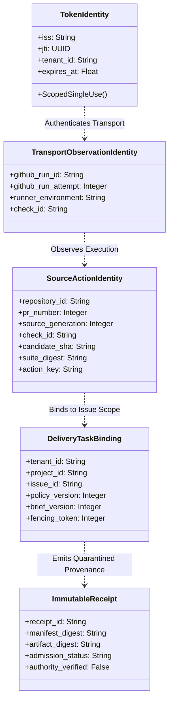
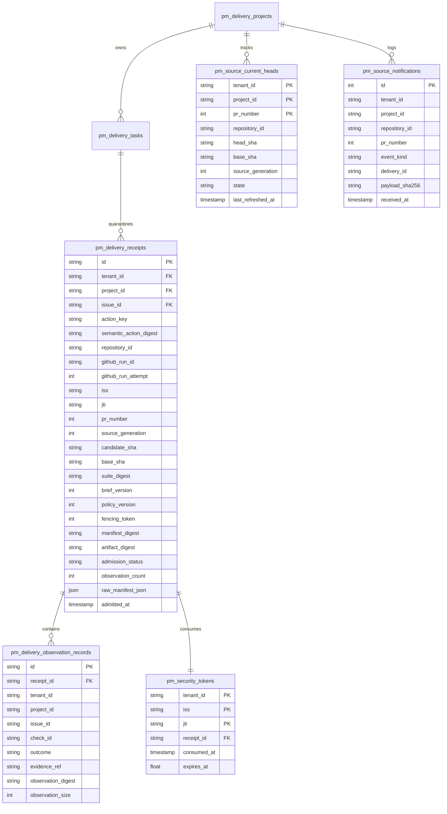
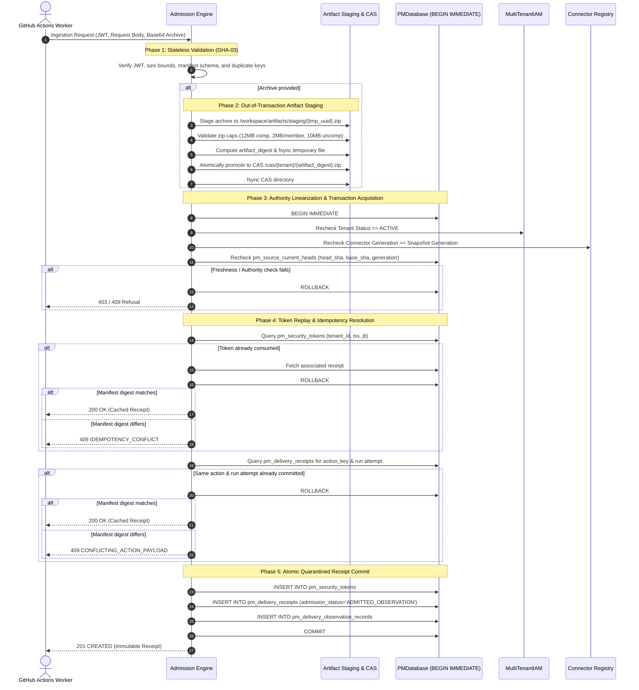

# GHA-04: Durable Ingestion, Replay Protection & Source-Event Synchronization
## Architectural Design Specification & Verification Plan (Revised)

- **Author / Implementation Owner:** Antigravity Development Team
- **Reviewer / Acceptance Owner:** Codex
- **Date:** 14 October 2026
- **Status:** **REVISED PROPOSED DESIGN CHECKPOINT** (Submitted for Codex Independent Architectural Review)
- **Base Baseline:** Commit `82407210f97eb41500f2a4d671d71d38175b685e` (GHA-03 Approved in `3ca8fc4d`, Recorded in `GHA_03_ACCEPTANCE_RECORD.md`)
- **Review Predecessors:** `GHA_04_DESIGN_REVIEW.md`, `ANTIGRAVITY_GHA_04_DESIGN_REWORK_BRIEF.md`
- **Scope:** Quarantined witness observation ingestion, durable token replay prevention, server-authoritative PR head tracking, composite ownership enforcement, two-phase artifact staging, and authority linearization.
- **Explicit Gating Notice:** This document is an architectural specification only. No implementation code, database migrations, or live workflow activations are performed prior to mutual design approval.

---

## 1. Executive Summary & Review Rework Alignment

In response to Codex's design review (`GHA_04_DESIGN_REVIEW.md`) and explicit rework instructions (`ANTIGRAVITY_GHA_04_DESIGN_REWORK_BRIEF.md`), Antigravity has revised the GHA-04 design specification to establish a bounded, concrete architecture for durable witness observation ingestion:

1. **Strict Preservation of Witness-Only Boundary (Addressing B1):**
   - Witness ingestion is strictly quarantined. Ingestion stores untrusted observations and emits immutable receipts (`pm_delivery_receipts`, `pm_delivery_observation_records`).
   - Witness ingestion **never** mutates delivery task phases (`DRAFT`, `READY`, `AWAITING_SUBMISSION`, `IN_REVIEW`, etc.), never calls `DeliveryService.submit`, never acts as a builder, never approves delivery, and never releases token budgets.
   - All delivery state transitions remain the exclusive responsibility of separately authenticated builder, coordinator, and reviewer services.
2. **Comprehensive Composite Identity & Idempotency Schema (Addressing B2):**
   - Separates Token Identity `(iss, jti)`, Generation-Specific Logical Action Identity `action_key`, Attempt Observation Identity `(run_id, attempt, check_id)`, and Historical Receipt Identity.
   - Allows multiple checks and MAS tasks per GitHub Actions workflow run by scoping observations to `(tenant_id, project_id, issue_id, action_key, github_run_id, github_run_attempt, check_id)`.
   - Binds source generation, PR number, candidate SHA, base SHA, suite digest, brief version, policy version, and fencing token into the canonical semantic digest.
   - Enforces composite foreign keys `(tenant_id, project_id, issue_id)` against `pm_delivery_tasks` to prevent cross-tenant/cross-project ownership bleed.
   - Token replay protection is explicitly scoped to `(tenant_id, iss, jti)`.
3. **Deterministic Retry & Response-Loss Resolution (Addressing B3):**
   - At-most-once state mutation per token.
   - Authenticated replays with the same token return the existing immutable receipt (`200 OK`, `status="CACHED_RECEIPT"`).
   - Fresh-token retries matching an already committed generation-specific logical action return the existing receipt without duplicate work. Conflicting payloads return `409 CONFLICTING_ACTION_PAYLOAD`.
   - Read-only historical receipt queries derive tenant identity strictly from authenticated caller context, allow inspecting historical records even after PR head advancement, and explicitly distinguish historical records from current head status.
4. **Server-Authoritative Source Freshness & Projection CAS (Addressing B4):**
   - Replaces fragile ancestry/timestamp ordering with an **Append-Only Notification Ledger** (`pm_source_notifications`) and a **Single-Row Current Projection** (`pm_source_current_heads`).
   - Webhooks are treated as unprivileged event notifications; branch heads are updated via a serialized refresh protocol that monotonically increments `source_generation` on accepted transitions.
   - Explicitly specifies behavior for force-pushes, base updates, PR closures, PR reopens, and fails closed (`503 SOURCE_FRESHNESS_UNKNOWN`) if freshness is uninitialized or unavailable.
5. **Decoupled Durability & Authority Linearization Protocol (Addressing B5):**
   - Recognizes that a SQLite lock does not serialize independent IAM or connector stores.
   - Establishes a concrete authority linearization protocol: pre-flight check, out-of-transaction filesystem artifact staging (hash, fsync, atomic promote), followed by an atomic SQLite transaction lock (`BEGIN IMMEDIATE`) that re-verifies IAM tenant active status, connector generation, and PR head generation before committing.
   - Artifacts enforce GHA-02 boundaries (max 12 MiB compressed, max 2 MiB per member, max 10 MiB uncompressed) and quota reservations. Crashed staging leaves unreferenced blobs, never dangling database references.
6. **Elimination of Redundant External-Effect Journal (Addressing B6):**
   - Removed the generic `pm_delivery_intents` journal from this local ingestion slice.
   - Pure local ingestion rollback leaves zero database rows; response loss is fully resolved by persisted action/receipt records.
   - Clarified retention: token records purged only after token expiration (`exp + clock_skew`); receipts and audit events remain strictly immutable and protected by abort triggers.

---

## 2. Architectural Boundaries & Identity Model

### 2.1. Bounded Identity Layers



1. **Token Identity `(tenant_id, iss, jti)`:**
   - Ephemeral OIDC assertion identity issued by GitHub Actions.
   - Scoped to authenticated tenant in the project store; single-use consumption within its expiration window (`exp`).
2. **Generation-Specific Logical Action Identity `action_key`:**
   - The concrete verification unit defined as:
     $$\text{action\_key} = \text{SHA-256}(\text{repo\_id} \parallel \text{pr\_num} \parallel \text{generation} \parallel \text{candidate\_sha} \parallel \text{suite\_digest} \parallel \text{check\_id})$$
   - Anchored to a specific source generation and candidate SHA.
3. **Transport Observation Identity `(repository_id, github_run_id, github_run_attempt, check_id)`:**
   - The execution instance of a specific check within a GitHub workflow job run attempt.
   - Supports multiple checks per workflow run without key collision.
4. **Delivery Task Binding `(tenant_id, project_id, issue_id, policy_version, brief_version, fencing_token)`:**
   - Authoritative task scope. Composite foreign key binds to `pm_delivery_tasks(tenant_id, project_id, issue_id)`.
5. **Immutable Receipt `receipt_id`:**
   - Digest-addressed provenance record:
     $$\text{receipt\_id} = \text{rcpt\_} \parallel \text{SHA-256}(\text{manifest\_digest} \parallel \text{artifact\_digest} \parallel \text{action\_key})[:16]$$
   - Explicitly records `authority_verified = False` and `admission_status = 'ADMITTED_OBSERVATION'`.

### 2.2. Numbered Invariants (INV-01 through INV-10)

- **INV-01 (Quarantined Witness Storage):** Ingested observations are stored in quarantined receipt ledgers. Ingestion NEVER mutates `pm_delivery_tasks.phase`, NEVER calls `DeliveryService.submit`, NEVER marks work `ACCEPTED`, and NEVER releases token budgets.
- **INV-02 (Single-Use Token Mutation):** A given `(tenant_id, iss, jti)` can be consumed for state mutation at most once. Replays with the same token return the existing receipt without re-admission.
- **INV-03 (Action Idempotency):** Submitting a fresh valid token for an already admitted logical action `(action_key)` with an identical semantic payload returns the existing receipt (`200 OK`). Conflicting payloads for the same action return `409 CONFLICTING_ACTION_PAYLOAD`.
- **INV-04 (Multi-Check Run Permissibility):** Multiple observations or checks originating from the same `(github_run_id, github_run_attempt)` are permitted, provided each check observes a distinct `check_id` or logical action.
- **INV-05 (Server-Authoritative Source Freshness):** PR head commit SHA, base commit SHA, and current state are determined exclusively by `pm_source_current_heads`, never trusted from client manifests.
- **INV-06 (Monotonic Source Generations):** Every accepted source change (new commit, force push, rebase) advances `source_generation` monotonically. Observations matching older generations are refused as `409 STALE_SOURCE_REVISION`.
- **INV-07 (Composite Ownership Enforcement):** All receipt and observation tables enforce composite foreign keys `(tenant_id, project_id, issue_id)` referencing `pm_delivery_tasks`, preventing cross-tenant or cross-project data injection.
- **INV-08 (Out-of-Transaction Artifact Staging):** Artifact files are verified, hashed, fsynced, and atomically promoted to CAS storage *before* acquiring the database commit lock. Database commit failures leave unreferenced staging blobs, never receipts pointing to missing files.
- **INV-09 (Linearized Authority Recheck):** Active tenant status (`MultiTenantIAM`), connector generation (`ConnectorPolicySnapshot`), and current source generation (`pm_source_current_heads`) are re-verified inside the `BEGIN IMMEDIATE` lock immediately prior to commit.
- **INV-10 (Strict Append-Only Immutability):** All receipts, observation records, and source notifications are immutable and protected by database triggers aborting `UPDATE` and `DELETE` operations.

---

## 3. Proposed Additive Schema (Migration `2026101401`)



### 3.1. DDL Specification

```sql
-- Migration 2026101401: GHA-04 Quarantined Witness Receipts & Authoritative Source Tracking

-- 1. Scoped Single-Use OIDC Token Ledger
CREATE TABLE IF NOT EXISTS pm_security_tokens (
    tenant_id TEXT NOT NULL,
    iss TEXT NOT NULL,
    jti TEXT NOT NULL,
    receipt_id TEXT NOT NULL,
    consumed_at TIMESTAMP NOT NULL DEFAULT CURRENT_TIMESTAMP,
    expires_at REAL NOT NULL,
    PRIMARY KEY (tenant_id, iss, jti)
);
CREATE INDEX IF NOT EXISTS idx_security_tokens_expiry ON pm_security_tokens(expires_at);

-- 2. Quarantined Witness Ingestion Receipts
CREATE TABLE IF NOT EXISTS pm_delivery_receipts (
    id TEXT PRIMARY KEY,
    tenant_id TEXT NOT NULL,
    project_id TEXT NOT NULL,
    issue_id TEXT NOT NULL,
    action_key TEXT NOT NULL,
    semantic_action_digest TEXT NOT NULL,
    repository_id TEXT NOT NULL,
    github_run_id TEXT NOT NULL,
    github_run_attempt INTEGER NOT NULL CHECK(github_run_attempt > 0),
    iss TEXT NOT NULL,
    jti TEXT NOT NULL,
    pr_number INTEGER NOT NULL CHECK(pr_number > 0),
    source_generation INTEGER NOT NULL CHECK(source_generation > 0),
    candidate_sha TEXT NOT NULL CHECK(length(candidate_sha) = 40),
    base_sha TEXT NOT NULL CHECK(length(base_sha) = 40),
    suite_digest TEXT NOT NULL CHECK(length(suite_digest) = 64),
    brief_version INTEGER NOT NULL CHECK(brief_version > 0),
    policy_version INTEGER NOT NULL CHECK(policy_version > 0),
    fencing_token INTEGER NOT NULL CHECK(fencing_token >= 0),
    manifest_digest TEXT NOT NULL CHECK(length(manifest_digest) = 64),
    artifact_digest TEXT,
    admission_status TEXT NOT NULL CHECK(admission_status IN ('ADMITTED_OBSERVATION', 'REJECTED_OBSERVATION')),
    observation_count INTEGER NOT NULL CHECK(observation_count >= 0),
    raw_manifest_json JSON NOT NULL,
    admitted_at TIMESTAMP NOT NULL DEFAULT CURRENT_TIMESTAMP,
    CONSTRAINT fk_receipt_task FOREIGN KEY (issue_id) REFERENCES pm_delivery_tasks(issue_id),
    CONSTRAINT fk_receipt_token FOREIGN KEY (tenant_id, iss, jti) REFERENCES pm_security_tokens(tenant_id, iss, jti),
    CONSTRAINT uq_receipt_action_attempt UNIQUE (tenant_id, issue_id, action_key, github_run_id, github_run_attempt)
);
CREATE INDEX IF NOT EXISTS idx_delivery_receipts_issue ON pm_delivery_receipts(tenant_id, project_id, issue_id);
CREATE INDEX IF NOT EXISTS idx_delivery_receipts_action ON pm_delivery_receipts(action_key);
CREATE INDEX IF NOT EXISTS idx_delivery_receipts_manifest ON pm_delivery_receipts(manifest_digest);

-- 3. Individual Observation Item Records
CREATE TABLE IF NOT EXISTS pm_delivery_observation_records (
    id TEXT PRIMARY KEY,
    receipt_id TEXT NOT NULL REFERENCES pm_delivery_receipts(id) ON DELETE CASCADE,
    tenant_id TEXT NOT NULL,
    project_id TEXT NOT NULL,
    issue_id TEXT NOT NULL,
    check_id TEXT NOT NULL,
    outcome TEXT NOT NULL CHECK(outcome IN ('PASSED', 'FAILED', 'SKIPPED', 'UNAVAILABLE')),
    evidence_ref TEXT NOT NULL,
    observation_digest TEXT NOT NULL CHECK(length(observation_digest) = 64),
    observation_size INTEGER NOT NULL CHECK(observation_size >= 0),
    CONSTRAINT fk_obs_task FOREIGN KEY (issue_id) REFERENCES pm_delivery_tasks(issue_id),
    CONSTRAINT uq_obs_receipt_check UNIQUE (receipt_id, check_id)
);
CREATE INDEX IF NOT EXISTS idx_obs_records_check ON pm_delivery_observation_records(issue_id, check_id);

-- 4. Server-Authoritative Current PR Head Projection
CREATE TABLE IF NOT EXISTS pm_source_current_heads (
    tenant_id TEXT NOT NULL,
    project_id TEXT NOT NULL,
    pr_number INTEGER NOT NULL CHECK(pr_number > 0),
    repository_id TEXT NOT NULL,
    head_sha TEXT NOT NULL CHECK(length(head_sha) = 40),
    base_sha TEXT NOT NULL CHECK(length(base_sha) = 40),
    source_generation INTEGER NOT NULL CHECK(source_generation > 0),
    state TEXT NOT NULL CHECK(state IN ('OPEN', 'CLOSED')),
    last_refreshed_at TIMESTAMP NOT NULL DEFAULT CURRENT_TIMESTAMP,
    PRIMARY KEY (tenant_id, project_id, pr_number),
    CONSTRAINT fk_source_project FOREIGN KEY (project_id) REFERENCES pm_delivery_projects(project_id)
);

-- 5. Append-Only Source Notification History
CREATE TABLE IF NOT EXISTS pm_source_notifications (
    id INTEGER PRIMARY KEY AUTOINCREMENT,
    tenant_id TEXT NOT NULL,
    project_id TEXT NOT NULL,
    repository_id TEXT NOT NULL,
    pr_number INTEGER NOT NULL CHECK(pr_number > 0),
    event_kind TEXT NOT NULL CHECK(event_kind IN ('PR_OPENED', 'PR_SYNCHRONIZE', 'PR_FORCE_PUSH', 'PR_CLOSED', 'PR_REOPENED', 'BASE_UPDATED', 'REFRESH_SYNC')),
    delivery_id TEXT NOT NULL,
    payload_sha256 TEXT NOT NULL,
    received_at TIMESTAMP NOT NULL DEFAULT CURRENT_TIMESTAMP,
    CONSTRAINT fk_notif_project FOREIGN KEY (project_id) REFERENCES pm_delivery_projects(project_id)
);
CREATE INDEX IF NOT EXISTS idx_source_notif_pr ON pm_source_notifications(tenant_id, project_id, pr_number);

-- 6. Immutability Triggers
CREATE TRIGGER IF NOT EXISTS trg_receipts_no_update
BEFORE UPDATE ON pm_delivery_receipts
BEGIN
    SELECT RAISE(ABORT, 'ReceiptTamperViolation: Delivery receipts are strictly immutable.');
END;

CREATE TRIGGER IF NOT EXISTS trg_receipts_no_delete
BEFORE DELETE ON pm_delivery_receipts
BEGIN
    SELECT RAISE(ABORT, 'ReceiptTamperViolation: Delivery receipts cannot be deleted.');
END;

CREATE TRIGGER IF NOT EXISTS trg_obs_no_update
BEFORE UPDATE ON pm_delivery_observation_records
BEGIN
    SELECT RAISE(ABORT, 'ObservationTamperViolation: Observation records are strictly immutable.');
END;

CREATE TRIGGER IF NOT EXISTS trg_obs_no_delete
BEFORE DELETE ON pm_delivery_observation_records
BEGIN
    SELECT RAISE(ABORT, 'ObservationTamperViolation: Observation records cannot be deleted.');
END;

CREATE TRIGGER IF NOT EXISTS trg_source_notif_no_update
BEFORE UPDATE ON pm_source_notifications
BEGIN
    SELECT RAISE(ABORT, 'SourceHistoryTamperViolation: Source history notifications are strictly immutable.');
END;

CREATE TRIGGER IF NOT EXISTS trg_source_notif_no_delete
BEFORE DELETE ON pm_source_notifications
BEGIN
    SELECT RAISE(ABORT, 'SourceHistoryTamperViolation: Source history notifications cannot be deleted.');
END;
```

---

## 4. Execution Protocols & Linearization Boundaries

### 4.1. Decoupled Two-Phase Admission & Durability Flow



### 4.2. Authority Linearization Across Independent Stores
Because `MultiTenantIAM` and the connector registry reside in memory or separate SQLite databases, a transaction lock on `PMDatabase` cannot freeze IAM or connector state. GHA-04 guarantees linearization as follows:

1. **Connector Generation Snapshot:** Pre-flight reads connector snapshot generation $G_{conn}$ and canonical digest $D_{conn}$.
2. **CAS Filesystem Promotion:** The artifact is fully written and directory-fsynced *before* acquiring the database lock. If the subsequent database transaction fails or crashes, the orphan file reclamation job reaps unreferenced blobs after 24 hours. No database record can ever reference a nonexistent CAS blob.
3. **Double-Checked Lock Protocol:**
   - Execute `BEGIN IMMEDIATE` on `PMDatabase`.
   - Query `iam.get_tenant(snap.tenant_id)`: must be `ACTIVE`.
   - Query connector registry: current generation must equal $G_{conn}$ and digest must equal $D_{conn}$.
   - Query `pm_source_current_heads`: current generation must equal expected generation, state must be `OPEN`, and head SHA must match `candidate_sha`.
   - If any authority check fails, execute `ROLLBACK` immediately.

### 4.3. Authoritative Source Freshness Protocol
To handle force pushes, rebases, and base branch updates reliably without relying on ambiguous git ancestry or unverified timestamps:

1. **Serialized Source Refresh Tickets:**
   - When a webhook notification is received, it is appended to `pm_source_notifications`.
   - The coordinator executes an authoritative refresh ticket serialized on `(tenant_id, project_id, pr_number)`:
     1. Reads authoritative head SHA, base SHA, and PR open/closed state from the verified repository source.
     2. Compares against `pm_source_current_heads`.
     3. If `head_sha` or `base_sha` has changed:
        $$\text{new\_generation} = \text{current\_generation} + 1$$
        Updates `pm_source_current_heads` with `head_sha`, `base_sha`, `source_generation = new_generation`, and `last_refreshed_at = now`.
2. **Force-Push & Rebase Safety:**
   - A force-push advances `source_generation`. Prior observations bound to the previous generation become immutable historical records. Any new submission citing the old commit SHA is rejected with `409 STALE_SOURCE_REVISION`.
3. **Closed PR Handling:**
   - When PR state becomes `CLOSED`, `pm_source_current_heads.state` is set to `CLOSED`. Any subsequent observation ingestion attempt is refused with `409 PR_CLOSED`.
4. **Failsafe on Unknown Freshness:**
   - If `pm_source_current_heads` has no record for the PR or a refresh is in progress, admission fails closed with `503 SOURCE_FRESHNESS_UNKNOWN`.

---

## 5. Retry, Response Loss, & Query Contracts

### 5.1. Tripartite Retry & Replay Resolution

| Submission Type | Condition | Action Taken | HTTP Code & Body |
|---|---|---|---|
| **Same Token, Same Payload** | `(iss, jti)` exists in `pm_security_tokens`, `manifest_digest` matches. | No mutation; fetch existing receipt. | `200 OK` (`status="CACHED_RECEIPT"`, `receipt`) |
| **Same Token, Conflicting Payload** | `(iss, jti)` exists, `manifest_digest` differs. | No mutation; reject tamper attempt. | `409 IDEMPOTENCY_CONFLICT` |
| **Fresh Token, Same Action & Payload** | New `(iss, jti)`, `(action_key, run_attempt)` exists, `manifest_digest` matches. | No mutation; resolve existing receipt. Token not consumed. | `200 OK` (`status="CACHED_RECEIPT"`, `receipt`) |
| **Fresh Token, Same Action, Conflicting Payload** | New `(iss, jti)`, `(action_key, run_attempt)` exists, `manifest_digest` differs. | No mutation; reject conflicting rerun claim. | `409 CONFLICTING_ACTION_PAYLOAD` |
| **Fresh Token, New Run Attempt** | New `(iss, jti)`, `github_run_attempt` is incremented. | Full admission; commits distinct receipt row. | `201 CREATED` (`status="ADMITTED_OBSERVATION"`, `receipt`) |
| **Expired Token Recovery** | Old token expired (`now > exp`). Caller queries historical receipt. | Read-only authenticated query or fresh token replay. | `200 OK` (`receipt`, `historical=true`) |

### 5.2. Authenticated Read-Only Receipt Query Contract (Proposed)

```python
# Proposed: mas/pm/gateway/receipt_service.py

from typing import Any
from mas.pm.delivery_validator import StrictModel

class ReceiptQueryResponse(StrictModel):
    """Proposed read-only receipt query model."""
    receipt_id: str
    tenant_id: str
    project_id: str
    issue_id: str
    action_key: str
    github_run_id: str
    github_run_attempt: int
    candidate_sha: str
    source_generation: int
    is_current_head: bool
    admission_status: str
    authority_verified: bool  # Strictly False
    observation_count: int
    manifest_digest: str
    artifact_digest: str | None
    admitted_at: str

class DeliveryReceiptService:
    """Proposed read-only receipt service.
    Tenant identity is derived strictly from authenticated caller context.
    """

    def get_receipt(self, receipt_id: str, caller_context: Any) -> ReceiptQueryResponse | None:
        """Fetch receipt by ID strictly constrained to caller's authenticated tenant."""
        ...

    def list_receipts_for_issue(
        self, issue_id: str, caller_context: Any, limit: int = 50
    ) -> list[ReceiptQueryResponse]:
        """List historical observation receipts for an issue in reverse chronological order."""
        ...
```

---

## 6. Shared Failure & Concurrency Matrix (14 Scenarios)

| Scenario # | Scenario Description | Trigger Condition | System Behavior & Invariant | Expected Outcome |
|---|---|---|---|---|
| **SC-01** | **Concurrent Same-Token Requests** | Two workers submit identical `(iss, jti)` simultaneously. | Requests serialize on `BEGIN IMMEDIATE`. Worker 1 commits. Worker 2 detects token in `pm_security_tokens` and rolls back empty. | Worker 1: `201 CREATED`<br>Worker 2: `200 OK` (Cached) |
| **SC-02** | **Fresh-Token Same-Action Retry** | Worker retries with fresh JWT for identical logical action & run attempt. | Query detects existing receipt for `action_key` and matching payload digest. Resolves without duplicate insertion. | `200 OK` (Cached Receipt) |
| **SC-03** | **Identical vs Conflicting Payloads** | Client submits same token or same action key with altered manifest. | Payload digest differs from stored receipt. Aborts immediately to prevent result tampering. | `409 IDEMPOTENCY_CONFLICT` or `409 CONFLICTING_ACTION_PAYLOAD` |
| **SC-04** | **Separate Rerun Attempts** | Worker triggers GitHub workflow rerun (`github_run_attempt = 2`). | New attempt has different run attempt. Validated as distinct observation record; both receipts preserved. | `201 CREATED` (New Receipt) |
| **SC-05** | **Restart After Commit** | Server process crashes/restarts immediately after database commit. | Data durably committed in SQLite WAL. Client retry hits `pm_security_tokens` and returns existing receipt. | `200 OK` (Cached Receipt) |
| **SC-06** | **Dropped Response** | Network connection drops before HTTP response reaches worker. | Worker retries with same token. Gateway returns existing receipt from database. | `200 OK` (Cached Receipt) |
| **SC-07** | **Stale / Out-of-Order Source Update** | Webhook arrives for commit $N-1$ after generation $N$ was established. | Refresh ticket detects older commit ancestry/timestamp; ignores payload without regressing current head. | Notification logged; Generation unchanged. |
| **SC-08** | **Head Changing During Admission** | PR head advances while gateway validation is executing pre-checks. | Admission checks `pm_source_current_heads` under lock. Candidate SHA does not match current head SHA. Aborts. | `409 STALE_SOURCE_REVISION` |
| **SC-09** | **Tenant / Connector Revocation Race** | Tenant suspended or connector revoked while gateway parses archive. | IAM active status and connector generation re-checked inside `BEGIN IMMEDIATE` lock. Revocation detected before commit. | `403 TENANT_REVOKED` or `403 CONNECTOR_REVOKED` |
| **SC-10** | **Missing / Expired Artifacts** | Manifest references file evidence but archive is omitted or unreadable. | Pre-flight validation fails before staging or transaction acquisition. | `400 ARTIFACTS_REQUIRED` |
| **SC-11** | **Storage Failure (Disk Full / I/O Panic)** | Disk full during CAS write or SQLite I/O error during commit. | Staging file unlinked; database transaction rolls back 100%. Zero database rows committed. | `500 INTERNAL_ERROR` |
| **SC-12** | **Schema Migration & Reopen** | System upgrades schema to version 2026101401 and reopens database. | Ledger checked; migration runs atomically under lock; PRAGMA foreign_key_check runs. Zero legacy rows corrupted. | Migration: `200 OK` |
| **SC-13** | **Cross-Tenant Reference Injection** | Client attempts to link observation to an issue belonging to another tenant. | Composite foreign key `(tenant_id, project_id, issue_id)` fails constraint check against `pm_delivery_tasks`. | `400 COORDINATE_MISMATCH` |
| **SC-14** | **Historical Read on Advanced PR Head** | Caller queries receipt for generation 1 after PR has advanced to generation 2. | Query succeeds, returns receipt with `is_current_head = False`. Proves historical execution without claiming current validity. | `200 OK` (`historical=true`) |

---

## 7. Component Ownership & Proposed Interface Contracts

### 7.1. Component Responsibility Matrix
- **Antigravity Development Team (Backend / Engine Ownership):**
  - Database schema migration `2026101401` and rollback compatibility.
  - Quarantined admission engine (`DurableWitnessAdmissionEngine`).
  - Two-phase artifact staging and CAS promoter (`ArtifactCASManager`).
  - Authoritative source event manager (`SourceHeadProjectionManager`).
  - Read-only receipt query service (`DeliveryReceiptService`).
- **Codex (Architecture Review & UI Ownership):**
  - Independent architectural review of this specification and subsequent implementation.
  - Scrum board UI presentation of quarantined witness receipts.
  - Future builder submission interface integration (`DeliveryService.submit`).

---

## 8. Executable Acceptance Test Plan & Scenario Mapping

The following 33 scenarios operationalize the exact requirements from [`GHA_04_INDEPENDENT_ACCEPTANCE_SCENARIOS.md`](file:///home/acinonyx/Desktop/MAS/projects/scrum-board-automation/planning/GHA_04_INDEPENDENT_ACCEPTANCE_SCENARIOS.md). For every scenario, the table explicitly defines:
1. **Invariant Checked**
2. **Proposed Component & Transaction Boundary**
3. **Concrete Input or Injected Fault**
4. **Expected Response & Persisted State**
5. **Evidence Needed to Prove Outcome**

### 8.1. Admission and Authority (A01 – A07)

| ID | Invariant Checked | Component & Transaction Boundary | Concrete Input / Injected Fault | Expected Response & Persisted State | Evidence Needed to Prove Outcome |
|---|---|---|---|---|---|
| **A01** | INV-01 (Quarantined Witness Authority), INV-02 (Stateless Gate), INV-08 (Zero Phase Mutation) | `DurableWitnessAdmissionEngine._execute_admission`<br>Boundary: `BEGIN IMMEDIATE` on `PMDatabase` after out-of-transaction artifact staging | Valid short-lived OIDC JWT for Tenant A, project P1, issue I1, run 101, attempt 1, candidate H7, valid 10KB artifact archive, source head at H7 (generation 7). | `201 CREATED` with immutable receipt ID.<br>Persisted: 1 row in `pm_security_tokens`, 1 row in `pm_delivery_receipts` (`admission_status='ADMITTED_OBSERVATION'`, `authority_verified=False`), 1 row in `pm_delivery_observation_records`. `pm_delivery_tasks.phase`, submissions, verdicts, and budgets remain **100% unchanged**. | SQL assertions verifying unchanged phase in `pm_delivery_tasks` before/after; count queries showing exactly 1 receipt and 0 builder submissions; exact hash comparison of stored CAS blob against manifest digest. |
| **A02** | INV-01 (Quarantined Witness Authority), INV-02 (Stateless Gate) | `DurableWitnessAdmissionEngine._validate_preflight`<br>Boundary: Pre-transaction Pydantic validation (`extra='forbid'`) | Witness payload contains `verdict="APPROVED"`, `phase="IN_REVIEW"`, or extra verifier fields `trusted_signature="xyz"`. | `400 BAD_REQUEST` (Schema validation failure, unexpected fields). Zero database rows written. Direct SQL probe attempting to insert approval fields into observation table fails schema constraints. | HTTP 400 response body; audit log showing validation rejection with static code `SCHEMA_VALIDATION_FAILED`; SQLite table state showing 0 rows inserted. |
| **A03** | INV-06 (Tenant and Coordinate Isolation) | `DurableWitnessAdmissionEngine` & SQLite Foreign Key engine<br>Boundary: Pre-flight connector lookup + composite foreign key constraints on `pm_delivery_receipts` | Valid JWT for Tenant A, but request specifies Tenant B's `project_id` or `issue_id`. Direct probe: direct SQL `INSERT INTO pm_delivery_receipts` with mismatched `(tenant_id, project_id, issue_id)`. | Service refuses with `400 COORDINATE_MISMATCH` with zero leakage of Tenant B data. Direct SQL insert raises `sqlite3.IntegrityError: FOREIGN KEY constraint failed`. Zero rows committed. | Unit test executing cross-tenant payload asserting 400; direct SQLite test executing mismatched FK insert asserting `IntegrityError`; `PRAGMA foreign_key_check` proving zero violations. |
| **A04** | INV-03 (Composite Identity & Idempotency Keying) | `DurableWitnessAdmissionEngine`<br>Boundary: Separate `BEGIN IMMEDIATE` transactions for Check 1 (`lint`) and Check 2 (`test`) | Two distinct observation payloads originating from same GitHub workflow run (`github_run_id=555`, `github_run_attempt=1`): Check 1 has `action_key=lint_key`, Check 2 has `action_key=test_key`. | Both requests return `201 CREATED`. Two distinct rows committed in `pm_delivery_receipts` with different `receipt_id` and `action_key`. Zero unique constraint collision. | Query `SELECT COUNT(*) FROM pm_delivery_receipts WHERE github_run_id='555'` returns 2; distinct `check_id`s present in `pm_delivery_observation_records`. |
| **A05** | INV-03 (Composite Identity), INV-04 (Source Freshness Authority) | `DurableWitnessAdmissionEngine`<br>Boundary: `BEGIN IMMEDIATE` transaction checking existing receipts | Worker submits action A1 for candidate H7, then later submits same logical check name for new commit H8 (generation 8) or altered test suite. | New commit H8 derives distinct `action_key` (incorporating candidate SHA and generation) -> returns `201 CREATED` as separate action. If client submits altered payload with same `action_key` under generation 7, returns `409 CONFLICTING_ACTION_PAYLOAD`. Prior receipt for H7 is never overwritten. | SQL query confirms receipt for H7 remains intact and unaltered; second receipt created for H8 with distinct generation; tamper attempt on same generation triggers 409 and rollback. |
| **A06** | INV-05 (Authority Linearization Across Independent Stores) | `DurableWitnessAdmissionEngine._double_checked_authority_lock`<br>Boundary: Barrier pause injected between pre-flight and `BEGIN IMMEDIATE` lock | Test harness pauses thread after pre-flight passes; test thread calls `iam.suspend_tenant()` or `registry.revoke_connector()`; test harness releases gateway thread to acquire lock and attempt commit. | Gateway double-check detects tenant inactive or connector generation changed; transaction executes `ROLLBACK`; unlinks staging artifact. Response `403 TENANT_REVOKED` or `403 CONNECTOR_REVOKED`. Zero database rows committed. | Multithreaded barrier test proving authorization refusal; query confirming 0 tokens or receipts committed; directory inspection confirming unlinked temp file. |
| **A07** | INV-01 (Quarantined Witness), INV-06 (Tenant and Coordinate Isolation) | `DurableWitnessAdmissionEngine._validate_preflight`<br>Boundary: Pre-transaction claims verification | OIDC JWT claims `run_id=100`, but request body specifies `github_run_id=101`; or MAS execution fence token in payload does not match active fence in `pm_delivery_tasks`. | Immediate refusal: `400 COORDINATE_MISMATCH` or `409 FENCING_TOKEN_MISMATCH`. Transaction never opened. Zero database rows committed. Distinguishes authenticated transport claims from untrusted payload body. | HTTP error response receipt; audit log asserting coordinate mismatch code; zero mutations in database. |

### 8.2. Replay, Idempotency, and Retrieval (R01 – R09)

| ID | Invariant Checked | Component & Transaction Boundary | Concrete Input / Injected Fault | Expected Response & Persisted State | Evidence Needed to Prove Outcome |
|---|---|---|---|---|---|
| **R01** | INV-03 (Composite Identity & Idempotency Keying) | `DurableWitnessAdmissionEngine`<br>Boundary: Serialized `BEGIN IMMEDIATE` transactions across two separate database connections | Two concurrent requests with identical OIDC JWT `(iss, jti)`, identical action key, and identical manifest digest sent simultaneously from separate processes. | Process 1 acquires lock, commits token and receipt, returns `201 CREATED`. Process 2 blocks, acquires lock, detects token in `pm_security_tokens`, rolls back without writing, returns `200 OK (status="CACHED_RECEIPT")`. Exactly 1 receipt row committed. | Multiprocess concurrency test; query `SELECT COUNT(*) FROM pm_delivery_receipts` returns 1; client 1 receives 201, client 2 receives 200 with identical `receipt_id`. |
| **R02** | INV-03 (Composite Identity), INV-07 (At-Most-Once Mutation) | `DurableWitnessAdmissionEngine`<br>Boundary: `BEGIN IMMEDIATE` read query on `pm_delivery_receipts` | Worker retries with fresh valid JWT `(iss, jti_2)` for identical logical action `action_key` and matching manifest digest after dropped response. | Gateway detects committed action for `(issue_id, action_key, run_attempt)` with matching `manifest_digest`. Rolls back transaction. Returns `200 OK (status="CACHED_RECEIPT")`. Fresh token `jti_2` is **NOT consumed** in `pm_security_tokens`. | Query shows `jti_2` does not exist in `pm_security_tokens`; receipt count remains 1; response payload matches historical receipt; zero budget/execution mutation. |
| **R03** | INV-03 (Composite Identity & Idempotency Keying) | `DurableWitnessAdmissionEngine._resolve_existing_action`<br>Boundary: `BEGIN IMMEDIATE` lock | Caller submits fresh token citing same `action_key` and same `run_attempt`, but provides a different manifest digest or altered observation results. | Gateway compares incoming `manifest_digest` with stored receipt; detects mismatch; immediately rolls back. Returns `409 CONFLICTING_ACTION_PAYLOAD`. Zero mutations. Prior receipt preserved unaltered. | HTTP 409 response; SQL query confirms original receipt row unaltered; zero new rows in `pm_delivery_receipts`. |
| **R04** | INV-03 (Composite Identity) | `DurableWitnessAdmissionEngine` canonical JSON serializer ($\text{JSON}_{\text{canonical}}$)<br>Boundary: Pre-hash serialization pipeline | Client resubmits identical semantic payload with dictionary keys reordered, extra whitespace, or different key sequence. | Canonical serialization sorts all keys recursively and strips non-significant whitespace before hashing. Computed `manifest_digest` matches stored digest exactly. Returns `200 OK (status="CACHED_RECEIPT")`. No false conflict. | Assert `compute_canonical_digest(json1) == compute_canonical_digest(json2)`; successful 200 OK response on reordered payload. |
| **R05** | INV-03 (Composite Identity & Multi-Attempt Support) | `DurableWitnessAdmissionEngine`<br>Boundary: `BEGIN IMMEDIATE` transaction | User triggers "Rerun failed jobs" in GitHub Actions; runner executes with fresh token, `github_run_id=101`, `github_run_attempt=2`. | Validated as a distinct attempt observation. Composite key `(tenant_id, issue_id, action_key, github_run_id, 2)` does not collide. Commits new receipt row (`201 CREATED`). Attempt 1 receipt preserved. No assumption that attempt 2 authorizes new MAS budget. | Query `SELECT github_run_attempt, receipt_id FROM pm_delivery_receipts WHERE github_run_id='101'` returns 2 distinct rows (attempt 1 and attempt 2); task phase and budget unchanged. |
| **R06** | INV-07 (Deterministic Replay & Expiry Recovery) | `DeliveryReceiptService.get_receipt` or fresh-token retry on `DurableWitnessAdmissionEngine`<br>Boundary: Authenticated query extraction | Gateway committed receipt, response dropped; worker waits until original JWT expires (`now > exp`). Worker submits expired token alone OR queries via fresh authenticated caller context. | Submitting expired token alone returns `401 TOKEN_EXPIRED`. Calling query endpoint or submitting fresh token with matching `action_key` returns existing receipt (`200 OK`). Authority verified under caller's current active tenant. | Attempting replay with expired token asserts 401; query with fresh authenticated context asserts 200 OK and returns original receipt data. |
| **R07** | INV-04 (Source Freshness Authority), INV-07 (Deterministic Replay) | `DeliveryReceiptService.get_receipt`<br>Boundary: Read-only query | Receipt was admitted at generation 7 (commit H7). PR is subsequently updated to commit H8 (generation 8). Caller queries receipt for H7. | Response `200 OK` returning receipt with explicit fields `candidate_sha="H7"`, `source_generation=7`, `is_current_head=False`, `historical=True`. Does not advance task phase or claim current success. | JSON response assertion confirming `is_current_head == False`; task phase in database remains unchanged. |
| **R08** | INV-06 (Tenant and Coordinate Isolation) | `DeliveryReceiptService.get_receipt`<br>Boundary: Caller context extraction | Authenticated user of Tenant B provides valid receipt ID belonging to Tenant A, or passes `?tenant_id=TenantA` in query string. | Service extracts tenant ID strictly from authenticated caller context (`caller.tenant_id = 'TenantB'`). Query `WHERE receipt_id = :id AND tenant_id = 'TenantB'` returns 0 rows. Returns `404 NOT FOUND`. Zero metadata leakage. | Unit test with Tenant B auth asserting 404 response; audit logs showing zero cross-tenant details. |
| **R09** | INV-07 (Deterministic Replay), INV-10 (Clean Local Durability) | Background purge worker `TokenPurgeService`<br>Boundary: Periodic `BEGIN IMMEDIATE` purge transaction | Simulated passage of time where tokens have `expires_at + CLOCK_SKEW_MAX < now`. Purge runs. Client attempts to replay purged token. | Purge deletes tokens from `pm_security_tokens` where `expires_at + 60 < now`. Receipts in `pm_delivery_receipts` are untouched (protected by abort trigger). Replaying purged token is rejected during pre-flight JWT verification because `now > exp`. | Query confirms expired token rows deleted; receipt rows intact; clock boundary test proves expired token rejected before reaching database. |

### 8.3. Source Currentness and Ordering (S01 – S06)

| ID | Invariant Checked | Component & Transaction Boundary | Concrete Input / Injected Fault | Expected Response & Persisted State | Evidence Needed to Prove Outcome |
|---|---|---|---|---|---|
| **S01** | INV-04 (Source Freshness Authority) | `SourceHeadProjectionManager`<br>Boundary: Serialized refresh ticket on `(tenant_id, project_id, pr_number)` | Refresh ticket for commit H8 completes, setting `head_sha='H8'`, `source_generation=8`. Delayed notification or out-of-order webhook for older commit H7 arrives afterward. | Refresh ticket inspects repository state or detects older commit depth; ignores H7; `pm_source_current_heads` remains at `H8` with `source_generation=8`. Notification is appended to `pm_source_notifications` for audit trail. | Query on `pm_source_current_heads` confirms head remains `H8` and generation remains 8; notification log contains both events in arrival order. |
| **S02** | INV-04 (Source Freshness Authority) | `SourceHeadProjectionManager`<br>Boundary: Authoritative refresh ticket | Developer force-pushes commit H_force or returns PR head to older commit H6. Webhook triggers authoritative refresh. | Refresh ticket queries repository authority; recognizes new head commit; executes CAS update incrementing `source_generation = 9`, `head_sha = 'H_force'`. Authority decision is decoupled from commit graph ancestry. Prior observations bound to generation 7/8 become historical. | Assert `source_generation == 9`; admission attempt citing old commit H7 returns `409 STALE_SOURCE_REVISION`. |
| **S03** | INV-04 (Source Freshness Authority), INV-05 (Authority Linearization) | `DurableWitnessAdmissionEngine._double_checked_authority_lock`<br>Boundary: `BEGIN IMMEDIATE` lock | PR head advances or PR is closed while gateway validation is executing pre-flight checks (simulated via concurrency barrier). | Under `BEGIN IMMEDIATE` lock, gateway verifies `pm_source_current_heads`. If PR closed: returns `409 PR_CLOSED`. If candidate SHA != `current_heads.head_sha`: returns `409 STALE_SOURCE_REVISION`. Transaction rolls back. | Barrier test pausing pre-flight while PR is closed; assert gateway returns 409; assert zero receipts written. |
| **S04** | INV-04 (Source Freshness Authority), INV-06 (Tenant and Coordinate Isolation) | Webhook ingestion endpoint `SourceWebhookReceiver`<br>Boundary: Pre-processing signature validation | Attacker sends webhook with invalid HMAC-SHA256 signature, forged delivery ID, or unknown repo string. | Forged signature rejected with `401 UNAUTHORIZED`. Duplicate delivery ID acknowledged (`200 OK`) without triggering refresh ticket. Unknown repo returns `404 NOT_FOUND`. Tenant/project is never derived from payload body. | Unit tests for forged signature asserting 401; duplicate webhook asserting no generation increment. |
| **S05** | INV-04 (Source Freshness Authority) | `DurableWitnessAdmissionEngine._validate_preflight`<br>Boundary: Freshness threshold evaluation | GitHub API is unreachable, or `pm_source_current_heads.last_refreshed_at` is older than `MAX_FRESHNESS_TTL` (e.g. > 15 minutes) and background refresh failed. | Gateway fails closed. Rejects observation admission with `503 SOURCE_FRESHNESS_UNKNOWN`. Zero database rows committed. Existing historical receipts remain queryable read-only. | Unit test setting stale `last_refreshed_at`; admission request asserts 503; query endpoint asserts 200 OK. |
| **S06** | INV-04 (Source Freshness Authority), INV-05 (Authority Linearization) | `SourceHeadProjectionManager` & `DurableWitnessAdmissionEngine`<br>Boundary: Single-row PK lock on `pm_source_current_heads` and `BEGIN IMMEDIATE` | Two webhooks arrive concurrently while a witness admission request is executing. | Source updates serialize on single-row projection PK `(tenant_id, project_id, pr_number)`. Exactly one monotonic generation sequence. Admission linearizes: either sees generation $N$ before update and binds to it, or sees generation $N+1$ and either succeeds or fails stale. Zero duplicate current rows. | Multithreaded race test asserting exactly 1 current row in `pm_source_current_heads`; generation strictly increments by 1; receipt records exact generation matching its candidate. |

### 8.4. Artifact and Crash Durability (C01 – C06)

| ID | Invariant Checked | Component & Transaction Boundary | Concrete Input / Injected Fault | Expected Response & Persisted State | Evidence Needed to Prove Outcome |
|---|---|---|---|---|---|
| **C01** | INV-09 (Artifact Durability, CAS Promotion & Quotas) | `ArtifactCASManager` and `DurableWitnessAdmissionEngine`<br>Boundary: Process kill points injected via test hook | Kill Point 1: `kill -9` during staging file write.<br>Kill Point 2: `kill -9` after rename to CAS directory, before `BEGIN IMMEDIATE` commits.<br>Kill Point 3: `kill -9` after SQLite transaction commits, before HTTP response is sent. | Point 1: Zero database rows; incomplete `.tmp` file reaped by cleanup job.<br>Point 2: Zero database rows; orphan CAS blob reaped after 24h; no database row references missing blob.<br>Point 3: Committed receipt persisted in WAL; client retry with same token recovers `200 OK (CACHED_RECEIPT)` referencing valid CAS blob. | Real subprocess crash test; filesystem scan proving zero missing blobs; WAL reopen verifying data integrity. |
| **C02** | INV-09 (Artifact Durability), INV-10 (Clean Local Durability) | `ArtifactCASManager` & `PMDatabase`<br>Boundary: Mock `OSError(ENOSPC)` during fsync or commit | Injected I/O error / disk full during staging file fsync, directory fsync, or SQLite WAL commit. | Staging file unlinked; database transaction rolls back 100%. Returns `500 INTERNAL_ERROR`. Zero database rows committed. Zero phantom "UNCERTAIN" records stored. | Error injection test; assert 500 response; assert `SELECT COUNT(*) FROM pm_delivery_receipts` returns 0; staging directory clean. |
| **C03** | INV-09 (Artifact Durability & CAS Integrity) | `ArtifactCASManager._promote_to_cas`<br>Boundary: Filesystem atomicity | File already exists at target CAS path with corrupted bytes (mismatched SHA-256) or is a symlink. | CAS manager detects existing file; computes SHA-256 of stored bytes; detects mismatch or symlink. Rejects promotion; logs `CAS_INTEGRITY_VIOLATION`; unlinks temp file; returns `500 INTERNAL_ERROR`. Never overwrites existing valid blobs. | Unit test creating corrupt file at CAS destination; assert promotion refusal and error log; valid blobs protected. |
| **C04** | INV-09 (Artifact Durability & Quota Enforcement) | `ArtifactCASManager`<br>Boundary: Pre-staging size check & atomic quota reservation | Client submits 15MB archive (limit 12MB), or member file > 2MB, or aggregate uncompressed > 10MB, or two concurrent requests push tenant over its 100MB quota. | Oversized archive rejected with `413 PAYLOAD_TOO_LARGE`. Quota exceeded rejected with `413 QUOTA_EXCEEDED`. Missing artifact rejected with `400 ARTIFACTS_REQUIRED`. Expired artifact metadata marked expired without deleting historical receipt. | Unit tests for each size limit asserting 413; quota race test asserting exactly one succeeds and second is refused. |
| **C05** | INV-10 (Clean Local Durability & Retention) | SQLite WAL subsystem and `PMDatabase`<br>Boundary: Process exit / restart simulation | Server process terminated during uncommitted transaction and reopened; committed transactions reopened. | SQLite WAL recovery cleanly rolls back in-flight transactions; committed receipts are fully readable. Client retry recovers committed receipt without duplicating work or releasing MAS funds. | Subprocess termination test; assert database opens cleanly without corruption; `PRAGMA integrity_check` returns `ok`. |
| **C06** | Milestone Scope Boundary (Quarantined Local Witness) | **EXPLICITLY EXCLUDED / DEFERRED FROM THIS MILESTONE**<br>Boundary: System Architecture Milestone Fence | External coordinator side-effects, outbox queues, and PR commenting are excluded from this local witness ingestion slice. | Generic side-effect journal (`pm_delivery_intents`) and external coordinator side effects are explicitly excluded from this local ingestion milestone. Any claims of distributed side-effect coordination or outbox fencing are removed from this milestone's guarantees. | Review of architecture spec confirming omission of `pm_delivery_intents` and remote outbox dispatch; zero remote side-effects attempted. |

### 8.5. Schema, Evidence, and Operability (D01 – D05)

| ID | Invariant Checked | Component & Transaction Boundary | Concrete Input / Injected Fault | Expected Response & Persisted State | Evidence Needed to Prove Outcome |
|---|---|---|---|---|---|
| **D01** | INV-10 (Clean Local Durability & Additive Migration) | Migration script `2026101401_durable_witness_ingestion.py`<br>Boundary: `BEGIN IMMEDIATE` migration transaction | Run migration against existing pre-GHA04 SQLite database; re-run migration immediately; interrupt migration halfway through. | Migration executes atomically; records version in `pm_schema_migrations` with checksum; repeated execution is a no-op (`200 OK`). Interrupted run rolls back cleanly. All pre-existing tasks, submissions, and events preserved intact. | Test running migration on populated DB; assert row counts in legacy tables unchanged; assert idempotent second run. |
| **D02** | INV-03 (Composite Identity), INV-06 (Relational Constraints) | `PMDatabase.validate_schema_integrity`<br>Boundary: Database initialization | Test drops required trigger `trg_receipts_no_update` or index, or inserts malformed row bypassing constraints. | Initialization executes `PRAGMA foreign_key_check` and queries `sqlite_master` for declared triggers and indexes. Detects drift; aborts startup with explicit diagnostic. Refuses to serve traffic in corrupted state. | Unit test mutating schema; assert initialization raises `SchemaIntegrityError`; assert zero traffic admitted. |
| **D03** | INV-10 (Clean Local Durability & Retention) | SQLite Triggers (`trg_receipts_no_update`, `trg_receipts_no_delete`, etc.)<br>Boundary: Direct SQL execution | Direct SQL `UPDATE pm_delivery_receipts` or `DELETE FROM pm_delivery_receipts`. Contrast with legitimate update on `pm_source_current_heads` or cleanup on `pm_security_tokens`. | Direct update/delete on receipts raises `sqlite3.IntegrityError: ABORT: pm_delivery_receipts rows are immutable`. Legitimate update on `pm_source_current_heads` succeeds. Token purge on expired tokens succeeds. | SQL tests asserting trigger abortion on receipts and observations; verifying success on current heads and expired token purge. |
| **D04** | INV-02 (Stateless Gate & Diagnostic Sanitization) | `GatewayError` and `safe_diagnostic()`<br>Boundary: Exception handling & audit logging | Payload contains secret sentinels, injection payloads, or unhandled dependency exceptions in tenant/project/manifest. | Public response contains only static error category (`SCHEMA_VALIDATION_FAILED`, `COORDINATE_MISMATCH`) and correlation ID. Private audit log contains static warning string. Zero client sentinels, exception stack traces, or secret tokens logged. | Test injecting unique canary string `CANARY_SECRET_XYZ` into all failure paths; inspect response body and logger output; assert canary string appears 0 times. |
| **D05** | Operability & Packaging Integrity | Build & isolated venv test harness<br>Boundary: Environment isolation | Package built via `python -m build --wheel`; installed into isolated virtual environment with `--no-deps` / clean dependencies; scenario tests copied to `/tmp` and executed. | Scenario suite imports `mas.pm.gateway` from `site-packages` (verified via `__file__`). All migration, receipt query, and admission logic executes successfully outside repository checkout. | Execution receipt showing `mas.pm.gateway.__file__` resolves inside isolated site-packages directory; all tests pass. |

---

## 9. Review Reconciliation & Hand-off Request

Antigravity submits this revised specification for Codex's independent review in accordance with the Scrum Board Automation delivery process gates.

**Verification Checklist for Re-Submission:**
1. [x] Direct SQL phase transitions completely removed; witness boundary strictly quarantined (§ 1, § 2.2).
2. [x] Multi-check per run supported; generation-specific `action_key` established (§ 2.1, § 3.1).
3. [x] Tripartite retry semantics defined: same-token replay, fresh-token action recovery, and expired token query (§ 5.1).
4. [x] Current source projection (`pm_source_current_heads`) and append-only notifications specified (§ 3.1, § 4.3).
5. [x] Authority linearization across independent IAM and connector stores defined (§ 4.2).
6. [x] Two-phase artifact staging and atomic promotion protocol specified (§ 4.1).
7. [x] Redundant external side-effect journal eliminated (§ 1, § 3.1).
8. [x] 14 failure scenarios and 33 executable acceptance tests fully specified (§ 6, § 8).
9. [x] Implementation code and migrations strictly withheld pending review (§ 1).
