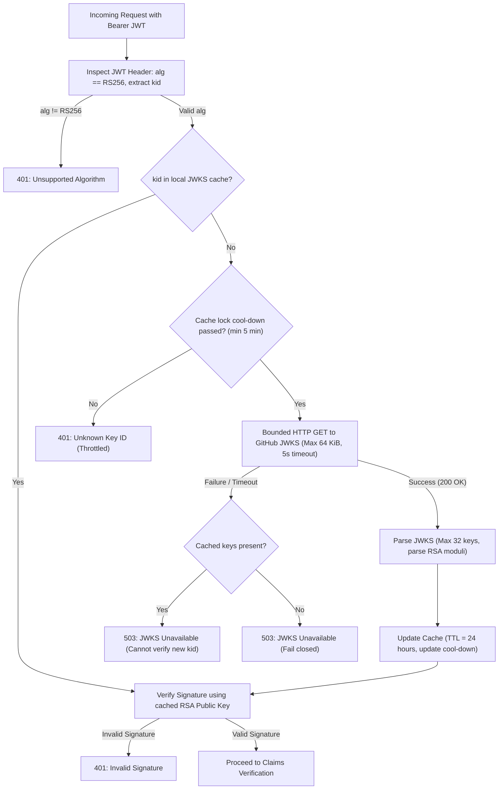
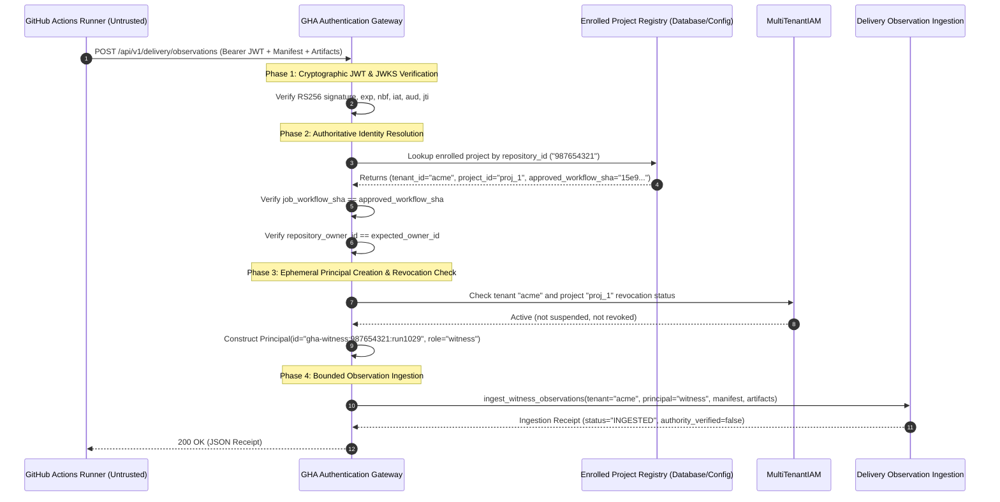

# GHA-03 Authentication Gateway & Observation Ingestion Specification (V1)

**Task**: GHA-03 — Authentication Gateway & Observation Ingestion Mechanism  
**Branch**: `feat/scrum-board-automation`  
**Implementation Owner**: Antigravity Development Team  
**Architecture Reviewer**: Codex  
**Date**: 14 October 2026  
**Status**: Design & Acceptance Matrix Checkpoint (Pre-Implementation Submission)  
**Governing Documents**:
- [`projects/scrum-board-automation/planning/ANTIGRAVITY_GHA_03_DESIGN_HANDOFF.md`](file:///home/acinonyx/Desktop/MAS/projects/scrum-board-automation/planning/ANTIGRAVITY_GHA_03_DESIGN_HANDOFF.md)
- [`projects/scrum-board-automation/planning/GHA_01_REVISED_ACCEPTANCE_REVIEW.md`](file:///home/acinonyx/Desktop/MAS/projects/scrum-board-automation/planning/GHA_01_REVISED_ACCEPTANCE_REVIEW.md)
- [`projects/scrum-board-automation/planning/GHA_02_FINAL_ACCEPTANCE_REVIEW.md`](file:///home/acinonyx/Desktop/MAS/projects/scrum-board-automation/planning/GHA_02_FINAL_ACCEPTANCE_REVIEW.md)
- [`company/DELIVERY_OWNERSHIP.md`](file:///home/acinonyx/Desktop/MAS/company/DELIVERY_OWNERSHIP.md)

---

## 1. Executive Summary & Core Security Principles

GHA-03 specifies the server-side **Authentication Gateway** and **Observation Ingestion** mechanism bridging untrusted GitHub Actions execution environments to the private, tenant-isolated coordinator.

### Core Security Principles

1. **Zero Credential Sharing**: Untrusted guest code, candidate pull requests, and CI runners never receive long-lived coordinator API keys, database credentials, Git write tokens, or evidence-signing private keys.
2. **Server-Owned Identity Mapping**: Request payloads and HTTP headers are untrusted data. They **never** choose or influence the tenant ID, project ID, principal identity, or authorization roles. Identity is derived strictly by server-side resolution from cryptographically verified GitHub OIDC claims.
3. **Strict Role Separation & No Impersonation**: An automated GitHub Actions CI worker acts strictly as an **observation witness / collector**. It is mapped exclusively to an ephemeral `witness` role (`delivery:witness_observe`). It **cannot** impersonate the `builder` principal to call `DeliveryService.submit()`, cannot act as `reviewer` to accept work, and cannot invoke coordinator dispatch authority (`delivery:coordinate`).
4. **Immutable Workflow Provenance**: Workflows are pinned strictly by immutable 40-character Git commit SHA (`job_workflow_sha`). Mutable branch names (e.g. `@refs/heads/main`) or tags (e.g. `@v1`) are explicitly rejected as unpinned.
5. **Pure Read-Only Admission & Zero Mutation on Failure**: Token validation, JWKS signature verification, claim boundary evaluation, and payload parsing occur prior to initiating any transaction. Any authentication or admission error fails closed with 4xx/5xx status, redacted errors, and **zero state mutation** in the coordinator database.

---

## 2. GitHub Actions OIDC Profile Specification

### 2.1 Reusable vs. Direct Workflow Claims

GitHub Actions OIDC tokens contain standard OpenID Connect claims plus custom GitHub context claims. The gateway validates both top-level and workflow-specific claims:

```json
{
  "iss": "https://token.actions.githubusercontent.com",
  "aud": "mas-coordinator-delivery",
  "sub": "repo:octocat/Acinonyx:pull_request",
  "repository": "octocat/Acinonyx",
  "repository_id": "987654321",
  "repository_owner": "octocat",
  "repository_owner_id": "12345678",
  "run_id": "1029384756",
  "run_attempt": "1",
  "job_workflow_ref": "octocat/Acinonyx/.github/workflows/reusable-delivery-gate.yml@15e9f7634f191b29a28bfdf911925b42d71329a1",
  "job_workflow_sha": "15e9f7634f191b29a28bfdf911925b42d71329a1",
  "workflow_ref": "octocat/Acinonyx/.github/workflows/ci.yml@refs/pull/42/merge",
  "workflow_sha": "a1b2c3d4e5f60718293a4b5c6d7e8f9012345678",
  "event_name": "pull_request",
  "ref": "refs/pull/42/merge",
  "sha": "a1b2c3d4e5f60718293a4b5c6d7e8f9012345678",
  "runner_environment": "github-hosted",
  "exp": 1792065000,
  "nbf": 1792064100,
  "iat": 1792064100,
  "jti": "550e8400-e29b-41d4-a716-446655440000"
}
```

### 2.2 Reusable Workflow Context vs. Direct Workflow
- **Reusable Workflow Profile (Mandatory for Candidate CI)**:
  - Untrusted PR branches cannot modify their own verification checks.
  - The caller workflow invokes a reusable workflow maintained in a trusted, protected branch.
  - In a reusable workflow invocation, GitHub provides `job_workflow_sha`, representing the exact commit SHA of the reusable workflow template itself.
  - The gateway matches `job_workflow_sha` against the project's enrolled `approved_workflow_sha`.
- **Direct Workflow Context (Allowed only for Admin Maintenance)**:
  - For top-level workflows, `job_workflow_sha` matches `workflow_sha`.
  - Allowed only if `ref` is a protected branch and `sha` matches an approved release tag or admin commit.
- **Mutable Ref Rejection**:
  - Any claim containing `@refs/heads/`, `@refs/tags/`, or non-40-hex commit references in `job_workflow_ref` is rejected immediately.

### 2.3 Required Claims Verification Rules

| Claim | Required Value / Check | Failure Classification | Error Code |
|---|---|---|---|
| `iss` | Strictly equals `https://token.actions.githubusercontent.com` | Authentication Failure | `INVALID_ISSUER` (401) |
| `aud` | Strictly equals `mas-coordinator-delivery` | Authentication Failure | `INVALID_AUDIENCE` (401) |
| `repository_id` | Must match enrolled project's numeric `github_repo_id` (string of digits) | Authorization Failure | `REPOSITORY_NOT_ENROLLED` (403) |
| `repository_owner_id` | Must match enrolled project's numeric `github_owner_id` | Authorization Failure | `OWNER_NOT_AUTHORIZED` (403) |
| `job_workflow_sha` | Must exactly match enrolled project's `approved_workflow_sha` (40 hex chars) | Security Policy Violation | `WORKFLOW_SHA_UNAPPROVED` (403) |
| `event_name` | Must be member of enrolled `permitted_events` (default: `["pull_request", "workflow_dispatch"]`) | Security Policy Violation | `EVENT_DISALLOWED` (403) |
| `exp` | Must be strictly greater than current server time ($now - \text{tolerance}$) | Authentication Failure | `TOKEN_EXPIRED` (401) |
| `nbf` | Must be less than or equal to current server time ($now + \text{tolerance}$) | Authentication Failure | `TOKEN_FUTURE` (401) |
| `iat` | Must be less than or equal to current server time ($now + \text{tolerance}$) | Authentication Failure | `TOKEN_ISSUED_IN_FUTURE` (401) |
| `exp - iat` | Must be $\le 900$ seconds (15 minutes maximum token lifetime) | Security Policy Violation | `TOKEN_LIFETIME_EXCEEDED` (401) |
| `jti` | Must not have been previously recorded in the active replay cache | Replay Attack | `TOKEN_REPLAYED` (401) |

---

## 3. Cryptographic JWT Verification & Bounded JWKS Protocol

### 3.1 Algorithm & Key Handling
- **Allowed Algorithms**: Strictly asymmetric `RS256` (`RSA-SHA256`).
- **Disallowed Algorithms**: Any token specifying `none`, symmetric algorithms (`HS256`, `HS384`, `HS512`), elliptic curves not published by GitHub (`ES256`), or `RS512` is rejected during header inspection without JWKS lookup.
- **Key ID (`kid`) Requirement**: The JWT header must include a non-empty `kid` string matching a key in the fetched JWKS.

### 3.2 Bounded JWKS Retrieval & Cache Lifecycle
The gateway manages a resilient, bounded JWKS cache to prevent Denial-of-Service and cache-stampede attacks:



1. **GitHub JWKS Endpoint**: `https://token.actions.githubusercontent.com/.well-known/jwks`
2. **Payload Size Limit**: Maximum response buffer capped at `64 KiB`. Any JWKS payload exceeding 64 KiB is aborted and rejected.
3. **Cache Duration (TTL)**: 24 hours under normal operation.
4. **Key Rotation & Unknown `kid` Throttling**:
   - If a token arrives with an unknown `kid`, the gateway may refresh the JWKS cache only if at least **5 minutes** have elapsed since the last external fetch.
   - Malicious bursts of tokens with random `kid` values cannot trigger an outbound HTTP flood to GitHub (anti-DoS stampede).
5. **Network / Provider Failure**:
   - If GitHub's JWKS endpoint is unreachable or times out (5-second timeout), key resolution fails closed with `AuthenticationUnavailableError` (HTTP 503).
   - Zero state mutation occurs; no unverifiable tokens are admitted.

### 3.3 Temporal Validity & Clock Skew
- **Clock Skew Tolerance**: Maximum **30 seconds** clock skew permitted for `exp`, `nbf`, and `iat`.
- **Maximum Token Age**: Tokens with `exp - iat > 900` (15 minutes) are refused. GitHub Actions OIDC tokens default to 5–15 minutes. Long-lived tokens are non-compliant.

---

## 4. Server-Owned Tenant & Identity Mapping

### 4.1 Architecture: Client Untrusted, Server Authoritative

Under no circumstances does the gateway trust tenant, project, actor, or role claims supplied in request bodies or query parameters.



### 4.2 Role Separation Matrix

| Role | Permitted Actions | Forbidden Actions | Principal Type |
|---|---|---|---|
| **`witness`** (GHA Runner) | `delivery:witness_observe`<br>`delivery:witness_upload_artifact` | `delivery:submit`<br>`delivery:accept`<br>`delivery:reject`<br>`delivery:coordinate` | Ephemeral Server-Mapped (`gha-witness:<repo>:<run>`) |
| **`builder`** (Developer / Supervised Agent) | `delivery:submit`<br>`delivery:request_scope` | `delivery:accept`<br>`delivery:coordinate`<br>`delivery:witness_observe` | Authenticated Tenant Principal |
| **`reviewer`** (Architect / Independent Verifier) | `delivery:accept`<br>`delivery:reject`<br>`delivery:challenge` | `delivery:submit`<br>`delivery:coordinate` | Authenticated Independent Reviewer |
| **`coordinator_admin`** | `delivery:coordinate`<br>`delivery:establish`<br>`delivery:agree` | `delivery:witness_observe` | Trusted Coordinator Authority |

### 4.3 Tenant Isolation & Revocation Checks
- **Single Enrolled Tenant**: Each `repository_id` maps to exactly one `(tenant_id, project_id)` in the server's enrolled registry. Tokens from unmapped repositories return 403 `REPOSITORY_NOT_ENROLLED`.
- **Durable Revocation**: Before granting an ephemeral witness session, the gateway verifies the tenant and project status in `MultiTenantIAM`. If the tenant is suspended, the project archived, or the witness connector revoked, authentication fails immediately with 403 `TENANT_REVOKED`.

---

## 5. Strict Bounded Request/Response Schemas & Zero-Mutation Invariant

### 5.1 Request Schema: Observation Ingestion Endpoint

**Endpoint**: `POST /api/v1/delivery/observations`  
**Headers**:
- `Authorization`: `Bearer <GitHub_OIDC_JWT>` (strictly required)
- `Content-Type`: `application/json` or `multipart/form-data`
- `X-Delivery-Fencing-Token`: Optional client echo; strictly validated against completed coordinator run if present.

```python
class WitnessObservationIngestionRequest(StrictModel):
    """Schema for GHA observation submission."""
    run_id: str = Field(min_length=1, max_length=128, pattern=r"^[A-Za-z0-9_\-]+$")
    intent_id: str = Field(min_length=1, max_length=128, pattern=r"^[A-Za-z0-9_\-]+$")
    attempt_id: str = Field(min_length=1, max_length=128, pattern=r"^[A-Za-z0-9_\-]+$")
    candidate_commit_sha: str = Field(pattern=r"^[0-9a-f]{40}$")
    observations: list[ManifestObservation] = Field(min_length=1, max_length=128)
```

### 5.2 Resource Limits
- `MAX_REQUEST_BODY_SIZE`: `12 * 1024 * 1024` bytes (12 MiB maximum multipart body).
- `MAX_MANIFEST_JSON_SIZE`: `1 * 1024 * 1024` bytes (1 MiB maximum JSON payload).
- `MAX_OBSERVATIONS_COUNT`: 128 observations per submission.
- `MAX_ARTIFACT_ZIP_SIZE`: `12 * 1024 * 1024` bytes compressed; `2 * 1024 * 1024` bytes per uncompressed member; `10 * 1024 * 1024` bytes total uncompressed.

### 5.3 Error Redaction & Standard Envelopes
To prevent leaking sensitive server paths, credentials, or internal coordinator topologies to public/untrusted CI logs, all gateway errors return standardized structured responses:

```json
{
  "status": "ERROR",
  "code": "WORKFLOW_SHA_UNAPPROVED",
  "message": "Workflow commit SHA does not match project configuration.",
  "timestamp": "2026-10-14T12:00:00Z",
  "request_id": "req-9a8b7c6d"
}
```

*Sanitization Rule*: Stack traces, file system paths, database exceptions, and JWT signature verification internals are written to private server audit logs (`events.jsonl`) but are **strictly excluded** from HTTP response bodies.

### 5.4 Zero-Mutation Invariant
1. All OIDC validation, claim matching, schema verification, and archive pre-checks execute in a non-transactional, pure read phase.
2. If any validation fails (4xx/5xx):
   - No database transaction is committed.
   - `pm_delivery_tasks` phase, revision, and metadata remain untouched.
   - `pm_delivery_submissions` records zero rows.
   - Task events log only the external rejection event.

---

## 6. Transactional State Boundaries & Deferred Protocols

### 6.1 What GHA-03 Owns (Implemented in this Package)
1. **GitHub OIDC JWT Validation Engine**: Asymmetric RS256 verification against GitHub's official JWKS with cache TTL, unknown `kid` throttling, and clock skew bounds.
2. **Authoritative Project Mapping**: Server-side resolution of `(repository_id, repository_owner_id)` to `(tenant_id, project_id, approved_workflow_sha)`.
3. **Ephemeral Witness Session Management**: Enforcing role separation (`witness` principal restricted from builder submission or reviewer acceptance).
4. **Observation & Artifact Ingestion Handler**: Ingests observations and bounded ZIP artifacts associated with an existing completed run without elevating caller authority or mutating task phase.

### 6.2 What GHA-04 Owns (Deferred to Next Increment)
1. **Durable Source Registry & Freshness Ledger**:
   - Persistent `pm_source_events` table tracking `(action_id, payload_digest, pr_head_sha, base_sha, status)`.
   - Monotonic generation sequencing ensuring stale PR head candidates cannot be submitted or reviewed.
   - CAS transition protocol: `RECORDED -> IN_PROGRESS -> COMPLETED | UNCERTAIN`.
2. **Replay vs. Rerun Semantics**:
   - Distinguishing exact duplicate replays (`workflow_run_attempt == 1`, same digest -> return stored outcome).
   - Distinct rerun handling (`workflow_run_attempt > 1` -> records as new attempt observation without paying for new execution).

### 6.3 What GHA-05 Owns (Deferred)
1. **GitHub Checks API Publisher**:
   - Pinned GitHub App credentials.
   - Strictly emitting check conclusion `success` only on verified `ACCEPTED` states.
   - Never emitting `neutral` or `skipped` on required checks.

---

## 7. Executable Acceptance Test Matrix (GHA-03 Gateway)

The following 22 test scenarios specify exact conditions, inputs, failure classifications, and assertions required for GHA-03 acceptance.

| Test ID | Scenario Description | Injected Condition / Payload | Expected HTTP Status | Expected Error Code / Assertion | State Mutation Check |
|---|---|---|---|---|---|
| **TC-01** | Wrong Token Issuer | `iss: "https://evil-issuer.com"` | 401 Unauthorized | `INVALID_ISSUER` | Zero DB mutation; task phase unchanged |
| **TC-02** | Wrong Token Audience | `aud: "wrong-audience"` | 401 Unauthorized | `INVALID_AUDIENCE` | Zero DB mutation; task phase unchanged |
| **TC-03** | Unsupported Algorithm (`none`) | JWT header `{"alg": "none"}` | 401 Unauthorized | `UNSUPPORTED_ALGORITHM` | Zero DB mutation; no JWKS lookup |
| **TC-04** | Unsupported Algorithm (`HS256`) | JWT header `{"alg": "HS256"}` | 401 Unauthorized | `UNSUPPORTED_ALGORITHM` | Zero DB mutation; no JWKS lookup |
| **TC-05** | Corrupted JWT Signature | Modified payload with original signature | 401 Unauthorized | `INVALID_SIGNATURE` | Zero DB mutation; task phase unchanged |
| **TC-06** | Expired Token | `exp: now - 60s` | 401 Unauthorized | `TOKEN_EXPIRED` | Zero DB mutation; task phase unchanged |
| **TC-07** | Future Token (`nbf` in future) | `nbf: now + 120s` | 401 Unauthorized | `TOKEN_FUTURE` | Zero DB mutation; task phase unchanged |
| **TC-08** | Token Issued in Future (`iat`) | `iat: now + 120s` | 401 Unauthorized | `TOKEN_ISSUED_IN_FUTURE` | Zero DB mutation; task phase unchanged |
| **TC-09** | Excessive Token Lifetime | `exp - iat = 3600s` (> 900s) | 401 Unauthorized | `TOKEN_LIFETIME_EXCEEDED` | Zero DB mutation; task phase unchanged |
| **TC-10** | Replayed Token (`jti` reuse) | Submitting identical token twice | 401 Unauthorized | `TOKEN_REPLAYED` | First token admitted; second rejected |
| **TC-11** | JWKS Unknown `kid` Throttling | Rapid burst of tokens with random `kid` | 401 Unauthorized | `UNKNOWN_KEY_THROTTLED` | Outbound HTTP calls throttled to $\ge 5$ min |
| **TC-12** | JWKS Endpoint Failure | Network timeout / 500 from GitHub JWKS | 503 Service Unavailable | `JWKS_UNAVAILABLE` | Fails closed; zero DB mutation |
| **TC-13** | Unenrolled Repository ID | `repository_id: "99999999"` | 403 Forbidden | `REPOSITORY_NOT_ENROLLED` | Zero DB mutation; task phase unchanged |
| **TC-14** | Mismatched Repository Owner ID | Valid repo ID, wrong `repository_owner_id` | 403 Forbidden | `OWNER_NOT_AUTHORIZED` | Zero DB mutation; task phase unchanged |
| **TC-15** | Mutable Workflow Ref Used | `job_workflow_ref: "...@refs/heads/main"` | 403 Forbidden | `WORKFLOW_NOT_PINNED` | Zero DB mutation; task phase unchanged |
| **TC-16** | Unapproved Workflow Commit SHA | Valid 40-hex SHA, but not approved in config | 403 Forbidden | `WORKFLOW_SHA_UNAPPROVED` | Zero DB mutation; task phase unchanged |
| **TC-17** | Disallowed GitHub Event | `event_name: "issue_comment"` | 403 Forbidden | `EVENT_DISALLOWED` | Zero DB mutation; task phase unchanged |
| **TC-18** | Client Role Spoofing Prevented | Payload contains `{"role": "builder"}` | 200 OK / Filtered | Role field ignored; principal is `witness` | Request fields cannot elevate privileges |
| **TC-19** | Witness Cannot Submit Delivery | Witness principal calls `submit()` | 403 Forbidden | `PERMISSION_DENIED` (`witness != builder`) | Task phase remains `AWAITING_SUBMISSION` |
| **TC-20** | Tenant Revocation Enforced | Tenant marked `SUSPENDED` in `MultiTenantIAM` | 403 Forbidden | `TENANT_REVOKED` | Zero DB mutation; task phase unchanged |
| **TC-21** | Oversized Payload Rejected | Request body $> 12$ MiB | 413 Payload Too Large | `PAYLOAD_TOO_LARGE` | Bounded read terminates immediately |
| **TC-22** | Valid Ingestion Succeeded | Valid OIDC + approved workflow + valid ZIP | 200 OK | `OBSERVATIONS_INGESTED` | Ingestion record created; no task phase change |

---

## 8. Explicit Exclusions & Implementation Roadmap

### 8.1 Explicit Exclusions in GHA-03
1. **No Public Gateway Activation**: The gateway engine is implemented and verified offline via local unit and integration tests using synthetic RSA keys and real token validation routines. No live public HTTPS port or router is opened.
2. **No Production GitHub Credentials**: No live GitHub App private keys, OIDC client secrets, or OAuth tokens are committed or placed in chat.
3. **No Live Workflow Enablement**: Files in `.github/workflows/` remain disabled.
4. **No Core Storage or Schema Changes**: `mas/pm/delivery.py` and the existing SQLite delivery schema remain strictly unmodified.
5. **No Production Project Enrollment**: No live production projects are enrolled in automated gates.

### 8.2 Incremental Implementation Roadmap
- **Step 1 (Current Checkpoint)**: Submit `GHA_03_GATEWAY_DESIGN_V1.md` and acceptance matrix for Codex independent review.
- **Step 2 (Local Engine Implementation)**: Implement `mas/pm/gateway/` (OIDC validator, JWKS cache, claim resolver, schema definitions) with pure synthetic test fixtures in `tests/test_gha_gateway_integration.py`.
- **Step 3 (Offline Ingestion Integration)**: Integrate observation ingestion with existing `delivery_validator.py` and completed coordinator runs.
- **Step 4 (Codex Verification & Handoff)**: Run full quality gates and CC contract suites; submit candidate commit for independent review.
