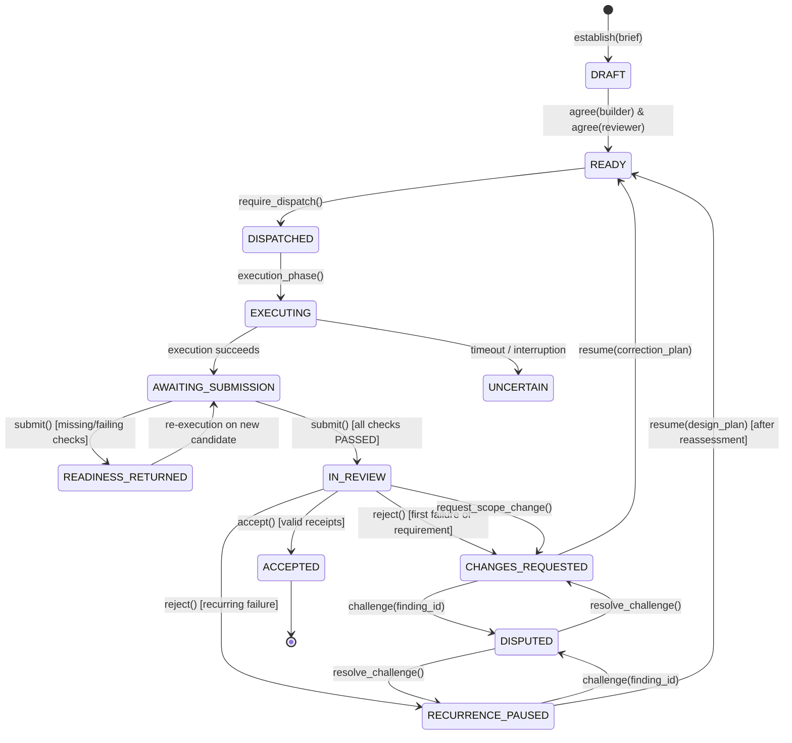

# GitHub Actions integration contract v1: delivery process gate enforcement

Contract ID: `mas-gha-integration-v1`
Status: Proposed specification (GHA-01). Not activated in live workflows.
Implementation Owner: Antigravity Development Team
Architecture Reviewer: Codex
Authority: Project Owner mandate (13 October 2026), `company/DELIVERY_OWNERSHIP.md`, and `DELIVERY_GATE_CONTRACT_V1.md`.

---

## 1. Scope and boundaries

This contract defines how GitHub Actions (GHA) CI/CD workflows interface with the MAS Coordinator delivery gates (`mas.pm.delivery.DeliveryService`, `DELIVERY_GATE_CONTRACT_V1.md`, and rules G01–G10) to enforce the remedies identified in `projects/scrum-board-automation/research/Acinonyx_Rework_Case_Study.md`.

### 1.1 In-scope
- Binding GitHub Actions workflow executions to durable coordinator tasks, tenants, brief versions, base commits, candidate commits, and dispatch identities.
- Trusted workflow and oracle ownership preventing candidate modifications from altering acceptance criteria or verification code.
- Strict isolation of untrusted candidate code from coordinator databases, signing secrets, provider credentials, and host resources.
- Authenticated, role-scoped communication between GitHub Actions runners and the MAS Coordinator.
- Event deduplication, rerun handling, stale candidate invalidation, and runner crash/timeout recovery.
- Enforcement of delivery gate phases: `READINESS_RETURNED`, `CHANGES_REQUESTED`, `RECURRENCE_PAUSED`, `DISPUTED`, `IN_REVIEW`, and `ACCEPTED`.
- Content-addressed artifact schema for test observations (`CheckObservation`), execution logs, and failure evidence.
- GitHub status checks and Check Run reporting strategy with automatic invalidation upon head commit advancement.
- Objective measurement of repeat work via `DeliveryService.metrics` without relying on GitHub labels, PR comments, or manual recollection.
- Exhaustive failure handling and denial specifications for all boundary violation scenarios.

### 1.2 Out-of-scope / strict limits
- This contract does **not** activate live workflows under `.github/workflows/` or grant live repository webhook dispatch.
- This contract does **not** enroll operational projects in `pm_delivery_projects` (enrollment remains explicit, idle-only, and irreversible).
- This contract does **not** replace or duplicate coordinator state, create a secondary scrum board, or bypass existing FSM guards.
- This contract does **not** grant push, merge, or release authority to GitHub Actions or autonomous agents.
- The coordinator synthetic-only worker registry remains strictly unchanged.

---

## 2. Provenance and identity binding

Every GitHub Actions execution evaluating an enrolled delivery task must bind the following immutable tuple before executing any check:

```json
{
  "tenant_id": "string (min_length=1, max_length=128)",
  "project_id": "string (min_length=1, max_length=128)",
  "issue_id": "string (min_length=1, max_length=128)",
  "brief_version": "integer (ge=1)",
  "base_commit_sha": "string (pattern=^[0-9a-f]{40}$)",
  "candidate_commit_sha": "string (pattern=^[0-9a-f]{40}$)",
  "dispatch_id": "string (UUIDv4 or coordinator intent_id)",
  "workflow_run_id": "string (GitHub github.run_id)",
  "workflow_run_attempt": "integer (ge=1)",
  "suite_digest": "string (pattern=^[0-9a-f]{64}$)",
  "policy_version": "integer (ge=1)"
}
```

### 2.1 Identity rules
1. **Tenant and project binding**: `tenant_id` and `project_id` must match the enrolled `pm_delivery_projects` record. Cross-tenant or un-enrolled project dispatches are rejected immediately.
2. **Task and brief version**: `issue_id` must reference an existing `pm_delivery_tasks` record in `READY`, `DISPATCHED`, or `EXECUTING` phase. `brief_version` must match the task's current `version`.
3. **Commit integrity**:
   - `base_commit_sha` must match `DeliveryBrief.base_sha`.
   - `candidate_commit_sha` must match the exact Git commit SHA of the candidate tree being evaluated.
   - If the candidate commit has child commits or the PR branch has advanced, the older execution is marked **STALE** and rejected from submission.
4. **Suite digest**: The acceptance test suite code and harness must be hashed (`SHA-256`) into `suite_digest` matching `DeliveryBrief.suite_digest`. If the test suite files in the runner differ from `suite_digest`, execution fails immediately.
5. **Durable dispatch linkage**: The dispatch must correspond to an admitted `pm_delivery_dispatches` entry linking `intent_id` and `issue_id`. GHA runs cannot be self-spawned.

---

## 3. Trusted workflow ownership and tamper prevention

To prevent the failure mode identified in the Case Study (where candidates weaken tests, forge outputs, or edit acceptance criteria to manufacture a passing result):

### 3.1 Immutable workflow and test oracle
1. **Protected branch baseline**: The workflow definition (`.github/workflows/*.yml`), verification scripts (`scripts/verify_*.py`, `scripts/run_quality_gate.sh`), test definitions (`tests/**`), and coordinator bridge tools MUST be checked out from the protected target branch (`base_commit_sha` or trusted ref), **never** from the candidate commit.
2. **Two-checkout pattern**:
   - Checkout 1 (Trusted Oracle): `actions/checkout@v4` with `ref: ${{ github.base_ref }}` (or the exact `base_commit_sha` stamped in the brief) into directory `./trusted-oracle`.
   - Checkout 2 (Candidate Code): `actions/checkout@v4` with `ref: ${{ candidate_commit_sha }}` into isolated directory `./candidate-source`.
3. **Scope enforcement during test execution**:
   - The runner verifies that `git diff --name-only base_commit_sha..candidate_commit_sha` contains only files within `DeliveryBrief.scope`.
   - Any modification to `.github/workflows/`, `tests/`, `mas/pm/delivery.py`, `mas/pm/adapters/admission.py`, `mas/pm/adapters/verifier.py`, `pyproject.toml`, or other out-of-scope files results in immediate rejection (`READINESS_RETURNED` with finding: unauthorized scope expansion).
4. **Test execution from trusted tree**:
   - Tests execute from `./trusted-oracle`, with candidate code installed in an isolated, unprivileged container mount.
   - The candidate cannot modify pytest fixtures, assertions, or test runners.

---

## 4. Credential boundaries and runner isolation

### 4.1 Secret distribution rules
1. **Zero coordinator database exposure**: Untrusted candidate code, PR runners, and external contributors MUST NOT have access to the MAS SQLite database file, database directory, or host filesystem.
2. **Zero signing secret exposure**: `EvidenceTrust` private issuer keys and coordinator tokens MUST NOT be placed in GitHub Actions repository secrets or passed into runner environment variables. Signing receipts is strictly a service-side operation performed by authorized coordinator components (`mas.pm.adapters.verifier`, `mas.pm.adapters.admission`).
3. **Zero Git push credentials**: Runners verifying candidates must execute with `GITHUB_TOKEN` having `contents: read` only. No token with `contents: write` or repo administration is provisioned.
4. **Zero provider API keys in guest**: Untrusted candidate execution must not receive OpenAI, Anthropic, or other foundation model API keys.

### 4.2 Execution isolation
1. **Container boundary**: Candidate test commands must execute inside an ephemeral rootless container (`docker run --rm --read-only --network=none --cap-drop=ALL`).
2. **Socket denial**: The host Docker socket (`/var/run/docker.sock`) must **never** be mounted into the candidate execution environment.
3. **Network denial**: Network access is disabled (`--network=none`) during candidate test execution, except for pre-cached dependencies verified by immutable hash.
4. **Temporary storage**: Container writes are restricted to an isolated `tmpfs` mounted at `/tmp` with `noexec,nosuid,nodev`.

---

## 5. Actions-to-coordinator authentication and transport

The coordinator is a Python service (`mas.pm.delivery.DeliveryService`), not a public unauthenticated web server. Integration with GitHub Actions follows a secure, authenticated boundary:

```
+-------------------------------------------------------------------------+
|                         GitHub Actions Runner                           |
|                                                                         |
|  [Trusted Oracle] ---> [Isolated Container] ---> [Artifact Collector]  |
|                                                          |              |
|                                             Structured JSON Evidence    |
|                                                          v              |
|                                                 [mas-delivery-agent]    |
+----------------------------------------------------------+--------------+
                                                           |
                                    Signed Session Token   | (HTTPS / gRPC)
                                    Role: delivery:submit  |
                                                           v
+-------------------------------------------------------------------------+
|                         MAS Coordinator Service                         |
|                                                                         |
|  [Tenant Scope / IAM] ---> [DeliveryService] ---> [CoordinatorStore]    |
|                                  |                        |             |
|                          pm_delivery_*           pm_coordinator_*       |
+-------------------------------------------------------------------------+
```

### 5.1 Authentication mechanisms
1. **OIDC / Service-Token Exchange**:
   - The GHA runner uses GitHub Actions OpenID Connect (OIDC) token (`actions/core.getIDToken()`) or a scoped ephemeral service token (`mas-session-token`).
   - The MAS Coordinator validates the token against the configured tenant IAM authority (`mas.iam.MultiTenantIAM`).
   - The token binds: `principal_id` = assigned `builder` (or `verifier`), `tenant_id` = enrolled tenant, and requires permissions `storage:write`, `delivery:read`, and `delivery:submit`.
2. **CLI Bridge on Secure Runner**:
   - In environments where GitHub Actions runs on self-hosted infrastructure with direct Coordinator access, the runner executes a trusted wrapper (`mas-delivery-cli`) within `tenant_scope(iam, session, tenant_id, root)`.
   - The wrapper uses the current process session binding. It rejects any attempt to pass custom actor overrides or bypass IAM.

---

## 6. Event handling, deduplication, and failure recovery

### 6.1 Event matrix and behavior

| GitHub Event | Context | Action / Coordinator Call | Concurrency & Deduplication |
|---|---|---|---|
| `workflow_dispatch` | Manual / scheduled trigger | Verifies brief `version`, checks out trusted base and candidate; executes suite. | Deduplicated by `(issue_id, version, candidate_sha)`. |
| `pull_request.synchronize` | New commit pushed to PR | Marks any pending execution for previous `candidate_sha` as `STALE`. Dispatches check for new commit. | Only latest `candidate_commit_sha` can submit. |
| `workflow_run.rerun` | User requests rerun in GHA UI | Idempotent replay: if an identical submission already exists, returns existing receipt; if prior run was `READINESS_RETURNED`, requires new run ID. | Does not overwrite existing `pm_delivery_submissions`. |
| Runner crash / timeout | Runner terminates before reporting | Execution remains `UNCERTAIN` or `EXECUTING` until timeout. Coordinator reconciles via `reconcile_execution`. | Funding hold preserved; no automatic retry without coordinator decision. |

### 6.2 Stale candidate detection
- If a pull request receives a new push while a workflow is executing:
  1. The runner checks the current GitHub branch ref `HEAD` SHA before submitting.
  2. If `HEAD != candidate_commit_sha`, the runner aborts submission with reason `CANDIDATE_SUPERSEDED`.
  3. `DeliveryService.submit` independently enforces that `run.candidate_commit_sha == submission.candidate_sha`. An attempt to submit an older commit is rejected.

### 6.3 Compare-and-Swap (CAS) revision control
- Every state-modifying call to `DeliveryService` (`establish`, `agree`, `submit`, `reject`, `resume`, `challenge`, `resolve_challenge`, `accept`) requires the exact current integer `revision` of the task.
- If concurrent runners or operations incremented `revision`, the operation fails with `DeliveryGateError: Stale delivery revision`.
- Runners must catch CAS mismatches, reload task state, and abort or re-evaluate.

---

## 7. Delivery gate phases and GHA lifecycle



### 7.1 Readiness Screening (`READINESS_RETURNED`)
- When GHA runs the acceptance checks, it generates a `Submission` payload containing a `CheckObservation` for every check defined in `DeliveryBrief.checks`.
- If **any** observation has `outcome != "PASSED"`, or if any check from the brief is omitted, `DeliveryService.submit` transitions the task to `READINESS_RETURNED`.
- **GHA response**: Posts a failing GitHub Check Run with detailed diagnostic reasons (e.g. `check_04 failed: exit code 1`). Does **not** alert the independent reviewer. The candidate is returned to the builder for local correction.
- **Repeat measurement**: The return increments `metrics.readiness_returns`. It is permanently preserved in `pm_delivery_submissions` and `pm_delivery_events`.

### 7.2 Independent Verification and Formal Review (`IN_REVIEW`)
- When **all** check observations pass and all previous finding closure paths are satisfied, `DeliveryService.submit` transitions the task to `IN_REVIEW`.
- GHA posts a neutral/pending Check Run: `mas/delivery-gate: IN_REVIEW - Awaiting independent reviewer acceptance`.
- The independent verifier executes the qualified verifier suite and produces a signed `VERIFICATION_EVIDENCE` receipt.
- The independent reviewer inspects the candidate diff and evidence and produces a signed `REVIEW_EVIDENCE` receipt.
- The reviewer calls `DeliveryService.accept(issue_id, revision, verification_id=..., review_id=...)`.

### 7.3 Rejection and Recurrence Pauses (`RECURRENCE_PAUSED`)
- If the reviewer rejects the candidate:
  - If the rejection concerns a requirement that was previously claimed closed (via `Submission.closures`), `DeliveryService.reject` automatically sets phase to `RECURRENCE_PAUSED`.
  - **GHA response**: GHA sets Check Run status to `action_required`. Automatic re-dispatch is **blocked**. The runner will refuse to execute new candidates for this task until the coordinator logs `DESIGN_REASSESSED` via `DeliveryService.resume(issue_id, revision, design_plan=...)`.
  - This directly solves the Case Study defect where agents endlessly retry patches without fixing the underlying mechanism.

### 7.4 Scope Changes (`SCOPE_CHANGED`)
- If review uncovers work outside the brief's requirements, it must call `request_scope_change`, **not** `reject`.
- GHA will refuse to submit against a task in `CHANGES_REQUESTED` until the coordinator either:
  1. Issues an updated brief via `establish(issue_id, new_brief, reason=...)` (which increments `version` and requires fresh agreements); OR
  2. Declines the scope change via `decline_scope_change(issue_id, revision, reason=...)`, returning the candidate to review.

### 7.5 Challenges (`DISPUTED`)
- If the builder challenges a finding (`challenge(issue_id, revision, finding_id, reason)`), the task enters `DISPUTED`.
- GHA dispatches are paused. The coordinator reviews the dispute and records `resolve_challenge` (upheld or withdrawn).
- If withdrawn, `resume_review` allows re-reviewing the existing candidate without re-running execution.

---

## 8. Structured result and artifact schema

### 8.1 CheckObservation schema
Every check in `DeliveryBrief.checks` must have an exact 1:1 corresponding `CheckObservation`:

```json
{
  "check_id": "string (min_length=1, max_length=80)",
  "outcome": "PASSED | FAILED | SKIPPED | UNAVAILABLE",
  "evidence_ref": "string (URL or artifact relative path, e.g. artifacts/check_01.json)",
  "digest": "string (pattern=^[0-9a-f]{64}$)"
}
```

- `digest` is the SHA-256 of the uncompressed evidence artifact referenced in `evidence_ref`.
- An outcome of `SKIPPED` or `UNAVAILABLE` is treated as non-passing and triggers `READINESS_RETURNED`.

### 8.2 Submission payload schema
The builder submits the completed execution:

```json
{
  "run_id": "string (min_length=1, max_length=128)",
  "candidate_sha": "string (pattern=^[0-9a-f]{40}$)",
  "observations": [
    {
      "check_id": "check_g01_pos",
      "outcome": "PASSED",
      "evidence_ref": "artifacts/check_g01_pos.log",
      "digest": "e3b0c44298fc1c149afbf4c8996fb92427ae41e4649b934ca495991b7852b855"
    }
  ],
  "closures": {
    "finding-2026-001": ["mas/pm/adapters/boundary.py", "mas/pm/adapters/antigravity.py"]
  },
  "limitations": "Synthetic execution fixture only; no live cloud resources provisioned."
}
```

### 8.3 Artifact packaging
1. All check logs, standard outputs, execution manifests, and test outputs are collected under `artifacts/`.
2. The runner creates an immutable zip archive: `delivery-evidence-${run_id}.zip`.
3. The runner computes `evidence_digest = sha256(delivery-evidence-${run_id}.zip)`.
4. Artifacts are uploaded via `actions/upload-artifact@v4` with retention period of 90 days.

---

## 9. GitHub status checks and check-run strategy

### 9.1 Status contexts
To avoid confusion with existing CI workflows, the delivery gate publishes dedicated Check Runs via the GitHub Checks API:

1. `mas/delivery/readiness`: Published by the GHA candidate check harness.
   - `queued`: Runner picked up job.
   - `in_progress`: Running bounded checks.
   - `success`: All checks passed, submitted to coordinator as `IN_REVIEW`.
   - `failure`: One or more checks failed; task in `READINESS_RETURNED`.
2. `mas/delivery/acceptance`: Published only when coordinator records `ACCEPTED`.
   - `pending`: Task in `IN_REVIEW`.
   - `success`: Independent verifier and reviewer receipts admitted; phase is `ACCEPTED`.
   - `failure`: Reviewer rejected or paused recurrence.

### 9.2 Automatic invalidation on new commit
- In GitHub repository branch protection rules, `mas/delivery/acceptance` is configured as a **strict required check**.
- Because Check Runs are bound to exact commit SHAs (`head_sha`), pushing a new commit automatically creates a new, pending check suite for the new commit.
- Any prior `success` status on the older commit does **not** transfer to the new commit.
- Force-pushes do not grant bypass; branch protection requires linear history and signed commits.

---

## 10. Repeat work measurability (Case Study Remedy)

A primary finding of `Acinonyx_Rework_Case_Study.md` is that repeat work was obscured across chat relays, PR revisions, and manual comments. Under this contract, all repeat work is durably recorded in the coordinator database:

### 10.1 Durably counted metrics
Calling `DeliveryService.metrics(issue_id)` computes:
- `readiness_returns`: Number of times the candidate failed pre-review checks and was returned to the builder.
- `formal_submissions`: Number of times a candidate reached `IN_REVIEW`.
- `rejections`: Number of times an independent reviewer rejected an admitted candidate.
- `recurrence_pauses`: Number of times a claimed-closed requirement was rejected again.
- `scope_requests`: Number of times a reviewer proposed work beyond the brief.
- `design_reassessments`: Number of coordinator reassessments required after recurrence pauses.
- `challenges`: Number of times a builder challenged a reviewer finding.
- `overturned_findings`: Number of challenges upheld in builder's favor.
- `acceptances`: Number of successful acceptances (0 or 1).

### 10.2 Anti-masking guarantees
- `pm_delivery_submissions` and `pm_delivery_events` are protected by SQLite database triggers (`BEFORE UPDATE RAISE(ABORT)` and `BEFORE DELETE RAISE(ABORT)`).
- Submissions cannot be overwritten, amended, or deleted.
- Every retry requires a new submission record, ensuring that repeat rounds are permanently queryable by SQL.

---

## 11. Complete failure cases and denial specifications

The following failure conditions MUST result in immediate, non-zero exit in the GHA runner and atomic rejection by the Coordinator:

| Defect / Threat | Detection Point | Enforced Behavior | Resulting Phase / Exit |
|---|---|---|---|
| **Missing brief** | Runner pre-flight / `DeliveryService.submit` | Issue has no record in `pm_delivery_tasks`. | Rejects with `DeliveryGateError: Missing delivery brief`. GHA exits code 1. |
| **Wrong tenant** | IAM token validation | Token `tenant_id` does not match `pm_delivery_projects.tenant_id`. | `PermissionError: Cross-tenant delivery operation`. GHA exits code 2. |
| **Stale CAS revision** | `DeliveryService` atomic transaction | Submitted `revision` does not equal current `pm_delivery_tasks.revision`. | `DeliveryGateError: Stale delivery revision`. GHA reloads and aborts. |
| **Changed candidate SHA** | `DeliveryService.submit` | `candidate_sha` in submission differs from completed run candidate. | `DeliveryGateError: Submission is not bound to successful current execution`. |
| **Candidate out-of-scope edit** | Runner scope validation | `git diff --name-only base..candidate` includes files not in `brief.scope`. | Runner fails pre-flight; submits `READINESS_RETURNED`. |
| **Forged test success** | Runner test harness / Verifier | Candidate outputs exit 0 without running tests, or fake pytest summary. | Verifier checks exact test execution counts and assertion trees. Rejection / return. |
| **Skipped check** | `DeliveryService.submit` | `observations` array lacks one or more check IDs from `brief.checks`. | `READINESS_RETURNED`. Incomplete check observations. |
| **Missing adverse test case** | `DeliveryService.establish` | A requirement in `brief.requirements` lacks an adverse (`negative: true`) check. | `ValueError: Each requirement needs positive and adverse-case checks`. Brief creation refused. |
| **Tampered test files** | Runner checkout integrity | Runner detects test files modified by candidate tree. | Runner aborts; candidate scope violation recorded. |
| **Self-approval** | `DeliveryService.accept` | Reviewer identity matches builder identity. | `PermissionError: Caller is not assigned reviewer` (or distinct principals check fails). |
| **Unresolved execution** | `DeliveryService.establish` | Previous run in `PENDING`, `CLAIMED`, or `PROCESSING`. | `DeliveryGateError: Unresolved execution prohibits new brief`. |
| **Recurrence of claimed closed finding** | `DeliveryService.reject` | Reviewer rejects requirement previously listed in `closures`. | Task transitions to `RECURRENCE_PAUSED`. Dispatch blocked until `resume`. |

---

## 12. Verification and testing plan

Before this contract is integrated into production workflows:
1. **Targeted unit tests**: Exercise the GHA runner bridge script against private SQLite fixtures covering all 12 failure cases.
2. **Offline container verification**: Run candidate checks in an isolated container without internet or Docker socket access.
3. **Simulated recurrence test**: Verify that resubmitting a candidate that fails a previously closed requirement causes `RECURRENCE_PAUSED` and prevents automatic GHA reruns.
4. **Independent review**: Codex architectural review must inspect and sign off on this contract specification.
