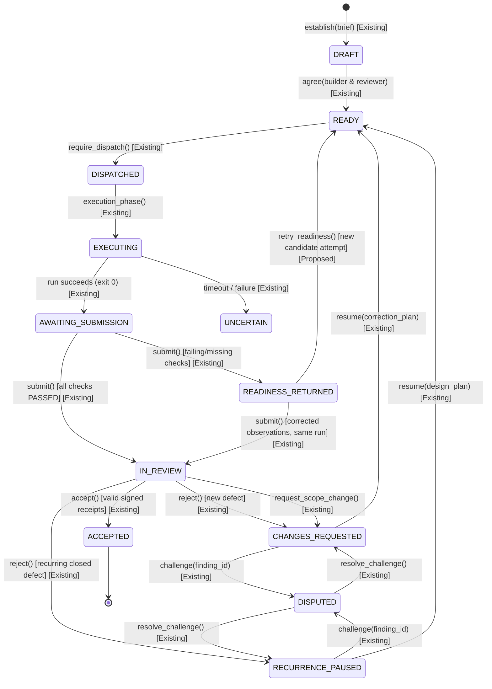

# GitHub Actions integration contract v1: delivery process gate enforcement

Contract ID: `mas-gha-integration-v1`
Status: Proposed specification (revised following GHA-01 architectural review). Not activated in live workflows.
Implementation Owner: Antigravity Development Team
Architecture Reviewer: Codex
Authority: Project Owner mandate (13 October 2026), `company/DELIVERY_OWNERSHIP.md`, and `DELIVERY_GATE_CONTRACT_V1.md`.

---

## 1. Scope, interface classification and boundaries

This contract defines how GitHub Actions (GHA) CI/CD workflows interface with the MAS Coordinator delivery gates (`mas.pm.delivery.DeliveryService`, `DELIVERY_GATE_CONTRACT_V1.md`, and rules G01–G10) to enforce the remedies identified in `projects/scrum-board-automation/research/Acinonyx_Rework_Case_Study.md`.

### 1.1 Interface classification
To avoid conflating existing capabilities with planned work, all interfaces and controls are explicitly classified into three tiers:

- **[Existing]**: Implemented and tested in the current repository code (e.g. `mas.pm.delivery.DeliveryService`, `pm_delivery_*` tables, additive migration `2026101301`, `EvidenceTrust`, and `ContainerBoundary`).
- **[Proposed]**: Designed in this contract and scheduled for phased implementation in the GHA backlog (e.g. Authentication Gateway, Source Registry / Event Ledger, Trusted Check Publisher, and Offline Runner Bridge).
- **[Unsupported]**: Explicitly out of scope and rejected by the security model (e.g. public OIDC endpoints on the coordinator, candidate self-approval, direct database access from runners, live provider execution in CI, or general unconstrained repository/browser verification).

### 1.2 Strict boundaries
1. **No workflow activation**: This contract does not deploy active workflows to `.github/workflows/` or register live webhook dispatchers.
2. **No operational enrollment**: Projects in `pm_delivery_projects` remain unenrolled until deliberately enrolled while idle.
3. **No state duplication**: The MAS Coordinator database remains the single source of truth. GitHub PR labels, comments, and commit statuses are downstream reflections, never primary state.
4. **No authority grant**: GitHub Actions execution does not grant push, merge, release, or financial settlement authority.
5. **Synthetic worker registry unchanged**: The coordinator worker registry remains strictly synthetic-only.

---

## 2. Provenance and identity binding

Every verification job evaluating an enrolled delivery task must bind an immutable identity tuple:

```json
{
  "tenant_id": "string (min_length=1, max_length=128) [Existing]",
  "project_id": "string (min_length=1, max_length=128) [Existing]",
  "issue_id": "string (min_length=1, max_length=128) [Existing]",
  "brief_version": "integer (ge=1) [Existing]",
  "base_commit_sha": "string (pattern=^[0-9a-f]{40}$) [Existing]",
  "candidate_commit_sha": "string (pattern=^[0-9a-f]{40}$) [Existing]",
  "dispatch_id": "string (UUIDv4 intent_id) [Existing]",
  "run_id": "string (UUIDv4 coordinator run_id) [Existing]",
  "action_id": "string (UUIDv4 logical action ID) [Proposed]",
  "workflow_run_id": "integer (ge=1) [Proposed]",
  "workflow_run_attempt": "integer (ge=1) [Proposed]",
  "suite_digest": "string (pattern=^[0-9a-f]{64}$) [Existing]",
  "oracle_digest": "string (pattern=^[0-9a-f]{64}$) [Proposed]",
  "runner_image_digest": "string (pattern=^sha256:[0-9a-f]{64}$) [Existing]",
  "policy_version": "integer (ge=1) [Existing]"
}
```

### 2.1 Provenance rules
1. **Tenant and project validation [Existing]**: `tenant_id` and `project_id` must match `pm_delivery_projects`. Cross-tenant dispatch is blocked by database constraints.
2. **Task and brief version [Existing]**: `issue_id` must reference an existing `pm_delivery_tasks` record. `brief_version` must equal the task's current `version`.
3. **Commit integrity [Existing]**:
   - `base_commit_sha` must match `DeliveryBrief.base_sha`.
   - `candidate_commit_sha` must match the exact Git commit SHA of the candidate tree under evaluation.
4. **Digest domain separation [Existing & Proposed]**:
   - `suite_digest` [Existing]: Canonical hash of `{source_path, cases}` conforming to the existing bounded `VerificationContract`. It is **not** a git tree hash and does not cover general repository pytest suites.
   - `oracle_digest` [Proposed]: SHA-256 digest of the trusted test harness files, test fixtures, and scripts checked out from `base_commit_sha`.
   - `runner_image_digest` [Existing]: Pinned immutable digest (e.g. `python@sha256:...`) matching the coordinator's qualified execution image.

---

## 3. Trusted workflow ownership and oracle integrity

To prevent candidates from tampering with acceptance tests, forging test output, or weakening assertions:

### 3.1 Two-checkout architecture [Proposed]
Workflows must execute a strict two-checkout pattern:
1. **Trusted Oracle Checkout**:
   - Checks out the protected base ref (`ref: base_commit_sha`) into `./trusted-oracle`.
   - Contains the authoritative test harness, test files, and verification scripts.
   - Pinned actions are used with exact commit SHAs (e.g. `actions/checkout@b4ffde65f46336ab88eb53be808477a3936bae11`).
2. **Candidate Source Checkout**:
   - Checks out the untrusted candidate commit (`ref: candidate_commit_sha`) into an isolated `./candidate-tree`.
   - Evaluated strictly as data/source input.

### 3.2 Scope enforcement and test modifications [Proposed]
1. **NUL-safe diff inspection**:
   - The runner executes `git diff -z --name-status base_commit_sha..candidate_commit_sha`.
   - Rejects symlinks, hardlinks, submodule changes, mode modifications (executable bits), and file creations/modifications outside `DeliveryBrief.scope`.
2. **Candidate changes to tests**:
   - If a task legitimately includes test changes, the affected test files must be listed in `DeliveryBrief.scope`.
   - Even when authorized, candidate test files **never** modify the running test oracle. Candidate test additions or modifications are evaluated by the trusted oracle as candidate source code under test, preventing the candidate from altering assertions evaluating itself.

---

## 4. Credential boundaries and guest isolation

### 4.1 Strict secret boundaries [Existing & Proposed]
1. **Zero coordinator database access [Existing]**: The coordinator SQLite database file (`mas_pm.db`) is strictly local to the coordinator service host. Runners never receive direct filesystem or network access to the database.
2. **Zero signing keys in runners [Existing]**: Private keys for `EvidenceTrust` (`IssuerGrant.secret`) reside exclusively within the coordinator service. No runner or CI secret contains evidence signing credentials.
3. **Zero Git push credentials [Existing]**: Runners execute with `contents: read` permissions only.
4. **Zero provider API keys [Existing]**: Untrusted candidate execution receives no LLM provider credentials (OpenAI, Anthropic, Gemini, etc.).

### 4.2 Qualified container boundary reuse [Existing]
Candidate check execution does not invoke raw, uncontrolled Docker commands. It reuses the qualified `ContainerBoundary` (`mas/pm/adapters/boundary.py`):
1. **Rootless & unprivileged**: Container executes as a non-root user (`uid > 0`), with `--cap-drop=ALL` and `--security-opt=no-new-privileges:true`.
2. **Network denial**: Container executes with `--network=none`.
3. **Filesystem isolation**: Root filesystem is mounted read-only (`--read-only`). Writable areas are limited to an isolated `tmpfs` at `/tmp` (flags: `noexec,nosuid,nodev`, size limit: 64 MiB).
4. **Socket denial**: The host Docker socket (`/var/run/docker.sock`) is **never** mounted.
5. **Resource and deadline limits**: Bounded CPU (`--cpus=1.0`), bounded memory (`--memory=512m`), and bounded execution deadline (default 30s per check, hard process timeout at 45s).
6. **Output bounds**: Standard output and standard error are captured with a hard limit of 1 MiB. Output exceeding 1 MiB is truncated and marked with an `OUTPUT_TRUNCATED` flag.
7. **Recovery journal**: All container creations register in the container recovery journal before start, ensuring delayed-creation cleanup on client timeout or crash.

---

## 5. Proposed authentication gateway and ingestion architecture

The MAS Coordinator is a private Python service, not a public web server. GitHub Actions runners cannot authenticate directly using `MultiTenantIAM`, because `MultiTenantIAM` verifies internal session tokens, not external GitHub OIDC JWTs.

```
+--------------------------------------------------------------------------+
|                         GitHub Actions Runner                            |
|                                                                          |
|  [Trusted Oracle] ---> [ContainerBoundary] ---> [Artifact Collector]     |
|         |                     |                          |               |
|         v                     v                          v               |
|  (base_commit_sha)     (isolated test)           (signed zip)            |
|                                                          |               |
|                                                          v               |
|                                             [GHA Ingestion Agent]        |
+----------------------------------------------------------+---------------+
                                                           |
                                      GitHub OIDC JWT      | (mTLS / Internal VPC)
                                      + Action Manifest    |
                                                           v
+--------------------------------------------------------------------------+
|              MAS Coordinator Authentication Gateway [Proposed]           |
|                                                                          |
|  1. Validate OIDC Token (JWKS, issuer, aud, repo_id, workflow_ref, exp)  |
|  2. Server-owned mapping: repo + workflow -> tenant_id + permitted role  |
|  3. Verify Action ID & Payload Digest in Source Event Ledger            |
|  4. Issue Ephemeral Coordinator Session (role: delivery:submit)          |
|                                                          |               |
|                                                          v               |
|                  [DeliveryService.submit] [Existing]                     |
|                                                          |               |
|                       pm_delivery_* SQLite Tables                        |
+--------------------------------------------------------------------------+
```

### 5.1 Gateway validation requirements [Proposed]
The Authentication Gateway performs strict server-side validation:
1. **Issuer verification**: `iss == "https://token.actions.githubusercontent.com"`.
2. **Audience verification**: `aud == "mas-coordinator-delivery"`.
3. **Repository binding**: `repository_id` and `repository_owner_id` must match the server-side configuration for the tenant's enrolled project.
4. **Workflow provenance**: `job_workflow_ref` must match the pinned trusted workflow ref on the protected default branch (e.g. `octocat/repo/.github/workflows/delivery-gate.yml@refs/heads/main`).
5. **Role mapping**: The gateway maps the authenticated workflow to the assigned `builder` principal and issues an ephemeral `delivery:submit` session token. Verifier observation collection uses a dedicated verifier ingestion channel, preventing builder impersonation.

---

## 6. Proposed source registry, event idempotency and freshness ledger

To prevent duplicate runs, race conditions, and evaluating stale candidates, the coordinator implements a server-owned **Source Registry and Event Idempotency Ledger** [Proposed].

### 6.1 Ledger schema and record fields [Proposed]
Before executing any side-effects, the gateway persists a record in `pm_source_events`:
- `action_id`: UUIDv4 uniquely identifying the logical dispatch action.
- `payload_digest`: SHA-256 of the canonical request payload.
- `repository_id`: Immutable GitHub repository ID.
- `pr_number`: Pull request number (or null for direct dispatch).
- `pr_head_sha`: Current commit SHA of the PR branch head.
- `base_commit_sha`: Base commit SHA against which the PR is opened.
- `workflow_run_id`: GitHub `github.run_id`.
- `workflow_run_attempt`: GitHub `github.run_attempt`.
- `status`: `RECORDED` | `IN_PROGRESS` | `COMPLETED` | `REJECTED` | `UNCERTAIN`.
- `outcome_body`: Serialized JSON outcome returned upon completion.

### 6.2 Idempotency and replay semantics [Proposed]
1. **Exact replay**: If a request arrives with an existing `(action_id, payload_digest)` in `COMPLETED` status, the gateway immediately returns the stored `outcome_body` without re-executing.
2. **Conflicting replay**: If an existing `action_id` arrives with a differing `payload_digest`, the request is rejected with `IdempotencyConflictError`.
3. **Rerun semantics (`workflow_run_attempt > 1`)**:
   - A manual or automated rerun in GitHub Actions reuses the original `workflow_run_id` but increments `workflow_run_attempt`.
   - The gateway records the new attempt as an observation of the existing logical dispatch, not a new coordinator job or new paid execution.
   - If the task has already entered `IN_REVIEW` or `ACCEPTED`, reruns are rejected as redundant.
4. **Atomic freshness check (PR-head race prevention)**:
   - When a candidate submission arrives, the gateway queries the current PR head generation.
   - If `pr_head_sha != candidate_commit_sha`, the candidate is marked `CANDIDATE_SUPERSEDED`. Submission is rejected, and no review is scheduled.
5. **Uncertainty handling [Existing]**:
   - If a runner crashes, disconnects, or times out, the event status is marked `UNCERTAIN`.
   - Existing funding holds remain held. No automatic retry is spawned without explicit coordinator reconciliation (`reconcile_execution`).

---

## 7. Durable delivery gate lifecycle and resubmission semantics

### 7.1 Existing lifecycle constraints [Existing]
The coordinator delivery gate (`DeliveryService`) enforces exact phase transitions:
1. `DeliveryService.submit()` **strictly requires** an existing completed run:
   - Task phase must be `AWAITING_SUBMISSION` or `READINESS_RETURNED`.
   - Run record in `pm_coordinator_runs` must have `status == 'EXITED'`, `exit_code == 0`.
   - Run attempt in `pm_coordinator_attempts` must have `status == 'SUCCEEDED'`.
   - Run intent in `pm_coordinator_intents` must have `status == 'COMPLETED'`.
   - `fencing_token` must match between run and intent.
   - `candidate_commit_sha` in the run must exactly match `submission.candidate_sha`.
2. `submit()` **cannot be called directly from `READY`**. A task in `READY` must first undergo dispatch admission (`require_dispatch`, `record_dispatch`) and physical execution.

### 7.2 Distinguishing resubmission from new candidate execution
A critical distinction required by the architectural audit:

1. **Resubmission of observations for the same candidate [Existing]**:
   - Applies when execution succeeded for candidate `C`, but initial observations were incomplete or malformed (resulting in `READINESS_RETURNED`).
   - The builder may re-invoke `DeliveryService.submit()` with the corrected observation manifest bound to the **same completed run ID and same candidate SHA**.
   - If all observations now pass, the task transitions from `READINESS_RETURNED` to `IN_REVIEW`.
2. **Execution of a new candidate commit [Proposed transition]**:
   - When a candidate has code defects requiring edits, the builder produces a new candidate commit `C'`.
   - In the current service implementation, dispatching a new run requires the task to be in `READY`. However, `DeliveryService` currently lacks an authorized transition from `READINESS_RETURNED` back to `READY` without coordinator re-establishment.
   - **Proposed Lifecycle Transition**: Add `DeliveryService.retry_readiness(issue_id, revision, new_attempt_intent)`:
     - Allows an assigned builder to transition a task from `READINESS_RETURNED` back to `READY` for a new attempt sequence under the same brief version.
     - Increments attempt sequence and generation.
     - Preserves all historical readiness return records in `pm_delivery_submissions`.
     - **Constraint**: This transition must be implemented in code before live multi-candidate loops can execute. For GHA-02, execution is strictly offline validation against an already completed fixture run.



### 7.3 Recurrence pause semantics [Existing]
- When a reviewer rejects a candidate citing a requirement previously claimed closed in `closures`, `DeliveryService.reject()` sets phase to `RECURRENCE_PAUSED`.
- The gateway blocks any further automated dispatches for this task.
- Only the assigned coordinator calling `DeliveryService.resume(issue_id, revision, design_plan=...)` can reassess the design and return the task to `READY`.

---

## 8. Bounded artifact schema and ingestion protocol

### 8.1 Safe artifact limits [Proposed]
To prevent resource exhaustion, zip-bombs, and path traversal:
1. **File count**: At most 64 regular files per artifact bundle.
2. **Total uncompressed size**: At most 10 MiB total uncompressed content.
3. **Individual file size**: At most 2 MiB per file.
4. **Path safety**:
   - All paths must be relative POSIX paths (e.g. `artifacts/logs/check_01.log`).
   - Leading slashes (`/`), backslashes (`\`), directory traversal (`..`), empty path segments, and NUL bytes (`\x00`) are rejected.
   - Symlinks, hardlinks, FIFOs, and socket files are rejected.
5. **Completeness check**: Ingestion validates that actual uploaded bytes equal the declared file size and match the declared SHA-256 digest. Incomplete or corrupted uploads are rejected atomically.

### 8.2 Observation format [Existing]
Every acceptance check defined in `DeliveryBrief.checks` must have a corresponding observation:

```json
{
  "check_id": "string (min_length=1, max_length=80) [Existing]",
  "outcome": "PASSED | FAILED | SKIPPED | UNAVAILABLE [Existing]",
  "evidence_ref": "string (safe relative path) [Existing]",
  "digest": "string (pattern=^[0-9a-f]{64}$) [Existing]"
}
```

- `outcome`: Any outcome other than `PASSED` causes `READINESS_RETURNED`.
- `digest`: SHA-256 of the uncompressed evidence artifact.

---

## 9. Valid GitHub Actions semantics and trusted check publisher

### 9.1 Valid GitHub triggers [Proposed]
Workflows must use valid GitHub Actions event triggers:
- `pull_request`: `types: [opened, synchronize, reopened]`. Evaluates PR candidate commits.
- `merge_group`: Evaluates candidates in the GitHub Merge Queue before merge.
- `workflow_dispatch`: Controlled manual dispatch for operator-authorized reruns.
- *(Note: `workflow_run.rerun` is invalid in workflow syntax; reruns re-trigger the original workflow event with incremented `run_attempt`)*.

### 9.2 Pinned action revisions [Proposed]
All external GitHub Actions must be pinned by immutable 40-character commit SHA:
- `actions/checkout@b4ffde65f46336ab88eb53be808477a3936bae11` # v4.1.1
- `actions/upload-artifact@5d5d22a31266ced268874388b861e4b58bb5c2f3` # v4.3.1

### 9.3 Trusted Check Publisher separation [Proposed]
To preserve the security boundary:
1. **Candidate runner authority**: The runner executing candidate checks has **no** GitHub Checks write permissions. It outputs only structured evidence artifacts.
2. **Authorized Check Publisher**: A separate, privileged service or workflow job running in an isolated environment receives the coordinator's verified state and publishes Check Runs using GitHub App credentials.
3. **Checks API state mapping**:
   The GitHub Checks API uses `status` and `conclusion`. The publisher maps coordinator states strictly:

| Coordinator Delivery Phase | Checks API `status` | Checks API `conclusion` | Human-Readable Check Description |
|---|---|---|---|
| `READY` / `DISPATCHED` | `queued` | *none* | Delivery check queued |
| `EXECUTING` | `in_progress` | *none* | Executing candidate test checks |
| `READINESS_RETURNED` | `completed` | `failure` | Readiness returned: nonpassing or missing check observations |
| `IN_REVIEW` | `in_progress` | *none* | In review: awaiting independent verifier & reviewer receipts |
| `CHANGES_REQUESTED` | `completed` | `action_required` | Changes requested: review finding recorded against requirement |
| `RECURRENCE_PAUSED` | `completed` | `action_required` | Recurrence paused: repeated failure of previously closed requirement |
| `DISPUTED` | `in_progress` | *none* | Disputed: builder challenge pending coordinator resolution |
| `ACCEPTED` | `completed` | `success` | Accepted: independent verification and review receipts admitted |
| `UNCERTAIN` / Timeout | `completed` | `timed_out` | Uncertain: execution timed out or interrupted; holds retained |
| `CANDIDATE_SUPERSEDED` | `completed` | `neutral` | Superseded: newer commit pushed to pull request branch |

### 9.4 Branch protection and merge requirements [Proposed]
1. The repository branch protection rule requires the Check Run `mas/delivery/acceptance` to have conclusion `success`.
2. Because Check Runs are bound to exact commit SHAs (`head_sha`), pushing a new commit automatically leaves the new commit without a successful check run.
3. Merge is strictly blocked until the new candidate commit completes execution, passes readiness, and receives independent acceptance.

---

## 10. Repeat work measurability (Case Study Remedy)

A primary finding of `Acinonyx_Rework_Case_Study.md` is that repeat work was obscured across chat relays, PR revisions, and manual comments. Under this contract, all repeat work is durably recorded in the coordinator database:

### 10.1 Durably counted metrics [Existing]
Calling `DeliveryService.metrics(issue_id)` aggregates:
- `readiness_returns`: Number of times the candidate failed pre-review checks and was returned to the builder.
- `formal_submissions`: Number of times a candidate reached `IN_REVIEW`.
- `rejections`: Number of times an independent reviewer rejected an admitted candidate.
- `recurrence_pauses`: Number of times a claimed-closed requirement was rejected again.
- `scope_requests`: Number of times a reviewer proposed work beyond the brief.
- `design_reassessments`: Number of coordinator reassessments required after recurrence pauses.
- `challenges`: Number of times a builder challenged a reviewer finding.
- `overturned_findings`: Number of challenges upheld in builder's favor.
- `acceptances`: Number of successful acceptances (0 or 1).

### 10.2 Immutability triggers [Existing]
- `pm_delivery_submissions` and `pm_delivery_events` are protected by SQLite triggers:
  - `pm_delivery_submissions_no_update`
  - `pm_delivery_submissions_no_delete`
  - `pm_delivery_events_no_update`
  - `pm_delivery_events_no_delete`
- Updates and deletions trigger `RAISE(ABORT)`. Historical rounds cannot be modified, reordered, or deleted.

---

## 11. Failure modes, security threats and denial specifications

The following table specifies the exact enforced behavior and denial outcomes across 14 failure scenarios:

| Scenario / Threat | Detection Point | Accountable Component | Enforced Behavior | Resulting Phase & Exit Outcome |
|---|---|---|---|---|
| **1. Missing brief** | Gateway validation | `mas.pm.delivery` [Existing] | Issue lacks record in `pm_delivery_tasks`. | Rejects with `DeliveryGateError("Missing delivery brief")`. HTTP 400. |
| **2. Wrong tenant** | Gateway token validation | Authentication Gateway [Proposed] | Token `tenant_id` does not match `pm_delivery_projects.tenant_id`. | `PermissionError("Cross-tenant delivery operation")`. HTTP 403. |
| **3. Stale CAS revision** | `DeliveryService` atomic transaction | `mas.pm.delivery` [Existing] | Submitted `revision` does not equal `pm_delivery_tasks.revision`. | `DeliveryGateError("Stale delivery revision")`. Runner reloads task state. |
| **4. Changed candidate SHA** | `submit()` execution check | `mas.pm.delivery` [Existing] | `candidate_sha` differs from completed run candidate. | `DeliveryGateError("Submission is not bound to successful current execution")`. |
| **5. Submitting from READY** | `submit()` phase check | `mas.pm.delivery` [Existing] | Caller attempts `submit()` while phase is `READY`. | `DeliveryGateError("Successful execution required before submission")`. |
| **6. Stale PR head (Head race)** | Freshness check before submit | Source Registry [Proposed] | Branch `HEAD` has advanced beyond candidate commit SHA. | Gateway rejects submission as `CANDIDATE_SUPERSEDED`. Check Run conclusion `neutral`. |
| **7. Replay with changed payload** | Idempotency lookup | Source Registry [Proposed] | Same `action_id` submitted with different payload digest. | Rejection with `IdempotencyConflictError`. HTTP 409. |
| **8. Candidate scope expansion** | NUL-safe diff check | Runner harness [Proposed] | Candidate modifies files outside `DeliveryBrief.scope`. | Runner aborts check; records scope violation in observation. `READINESS_RETURNED`. |
| **9. Forged test outputs** | Bounded verifier | `EvidenceTrust` / Verifier [Existing] | Candidate outputs fake pytest summary without execution. | Verifier evaluates solve(payload) against host expectations; fake summary rejected. |
| **10. Missing adverse test check** | `DeliveryService.establish()` | `mas.pm.delivery` [Existing] | Brief requirement lacks negative/adverse check. | `ValueError("Each requirement needs positive and adverse-case checks")`. Brief creation refused. |
| **11. Incomplete artifact upload** | Artifact collector | Ingestion Gateway [Proposed] | Uploaded zip size or digest does not match manifest. | Gateway aborts upload; marks observation `UNAVAILABLE`. `READINESS_RETURNED`. |
| **12. Path traversal in artifact** | Artifact extraction / unpack | Artifact Collector [Proposed] | Zip contains `../`, leading `/`, or symlink. | Extraction refused with `PathTraversalError`. Artifact rejected. |
| **13. Recurrence of closed defect** | `DeliveryService.reject()` | `mas.pm.delivery` [Existing] | Reviewer rejects requirement previously listed in `closures`. | Phase becomes `RECURRENCE_PAUSED`. Automated dispatches locked until `resume()`. |
| **14. Premature PM DONE write** | `require_accepted()` hook | `mas.pm.delivery` / `mas.pm.db` [Existing] | Supported PM method attempts close before acceptance. | `DeliveryGateError("Independent delivery acceptance required before DONE")`. |
